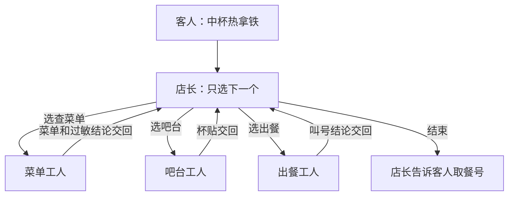
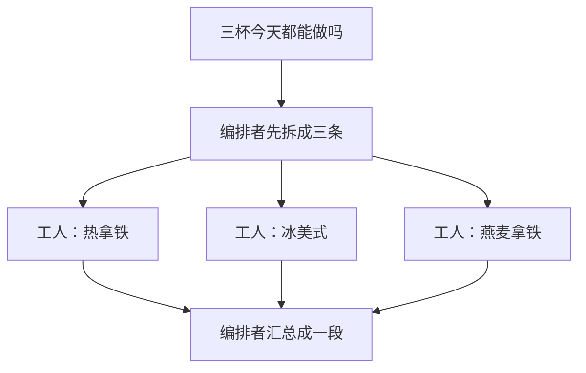

# **Supervisor 模式**：谁分派、谁执行、怎么交还

> 对应模块：[模块 14 · Multi-Agent ⭐⭐⭐⭐](./README.md) · 小节进度第 1 条
> 这一小节由 Coach 按 2026-10-10 本对话 `coach start` 详解首次写入。贯穿场景按学习者要求，与模块 11 的咖啡店主图、模块 12 的 `make_latte` / `cafe://today-menu` / `cafe://allergy-info`、模块 13 的点咖啡小程序对齐，用**点咖啡**。学习者只减不加。进度表仍是 ⬜，在进度表打钩只走 `coach complete`。多一次交接花多少 Token 是进度表第 2 条，代理对代理协议（Agent2Agent，A2A）是第 3 条，本文件不把它们当新课写完。

- **来源**：本对话 `coach start` 详解（对照模块 11 的节点、边、条件路由，以及模块 13 的当工具调用（Agents as Tools）和任务移交（Handoff））。主管（Supervisor）、编排者-工人（Orchestrator-Workers）、分层主管（Hierarchical Supervisor）按公开资料里的常见分工写。LangGraph.js 当天的函数名、结束标记的字段名，这一轮没有打开文档核对，写在「还没搞懂的」。2026-10-10 增量：例子改成和前面小节一样的点咖啡
- **状态**：已沉淀
- **Demo**：无。从模块 14 起本仓库不再新写模拟演示，见学习总览。已有的 `apps/14-Multi-Agent/01-Supervisor-模式-step-1/` 和 `01-Supervisor-模式-step-2/` 留下，不作为本条通过条件。判断见 [## Demo 判断](#demo-判断)。

> 各节写什么、达标要求：见仓库根 [AGENTS.md §7.2](../../../AGENTS.md#72-写入小节文档--小节进度对齐)。

## 是什么

主管模式（Supervisor）是一张星形分工图。中间的主管只负责分派。四周的工人（Worker）负责干活。工人干完把结果交回主管。主管再决定叫下一个工人，或者结束（FINISH），由主管这条线对客人说出最终答案。

三句话对上这一小节的题目：

1. **谁分派**：主管，在这家店里就是店长。它读当前这杯单的进度，选出下一个工人，或者选出结束。它不读菜单原文、不按咖啡机、不对杯贴。
2. **谁执行**：工人。每个工人是一个会自己循环的 Agent，有自己的提示词，通常还有自己的工具。查菜单的人只读今日菜单和过敏表，吧台只做杯，出餐只核对杯贴和订单。
3. **怎么交还**：工人把产出交回店长。客人的下一句话仍然进店长这条线。工人不接过「现在由我对客人说话」。

模块 11 的状态机（State Machine）已经有咖啡店主图：点单 → 识别饮品 → 热饮或冰饮制作 → 出餐。那张图的站点还在。主管模式多的是角色：条件路由那一站是店长，干活的节点是工人，工人节点的出边都指回店长。`make_latte` 仍是吧台里的一次工具调用，不是这张分工图上的店长。

下面六种都要能画。前三种是图的形状。后三种是同一张星形图上的分支：结果放在哪、什么时候停、工人失败时谁对客人说话。

### 一次只派一个，交回后再决定

客人说：「来一杯中杯热拿铁。」这杯必须先知道今天做不做、客人碰不碰牛奶，才能制作，做好了再核对杯贴、再叫号。



顺序不是预先写死的三步。出餐若写「杯贴做成了冰美式」，店长下一轮可以再选吧台，把这条意见一起交回去重做。

公开资料里，LangGraph 的主管教程是这一种：主管节点输出下一个节点的名字，每个工人有一条边回到主管。Anthropic《Building effective agents》里的编排者-工人是下面另一种形状。两张图都要会画。

### 先拆开，能同时做的一起做，再汇总一次

客人改口：「热拿铁、冰美式、燕麦拿铁，今天都能做吗？」三杯互不依赖，都是在问今日菜单。编排者（Orchestrator）先拆成三条子任务，三个工人同时查，三份结果都回来之后，再拼成一段告诉客人。



这张图是散开再收拢。中间没有「热拿铁查完，再决定要不要查冰美式」。中杯热拿铁那杯「必须先有菜单结论才能制作」走上面那种一次一个。三杯只问今日有没有，走这一种。

### 主管只派给小组主管

人再多，店长不直接点名每一个读菜单的人、每一个按咖啡机的人。店长只派给点单组主管和吧台组主管。点单组主管再派「读 `cafe://today-menu`」和「读 `cafe://allergy-info`」。吧台组主管再派「热饮制作」和「出餐叫号」。交还是逐层的：工人交回小组主管，小组主管交回店长，店长决定叫另一组还是结束。

LangGraph 的分层代理团队（Hierarchical Agent Teams）是这张图。小组内部仍然可以是一次派一个的主管。顶层那张图上，点单组和吧台组各是一个节点。

### 交还进同一份状态：下一站读字段

同一份共享状态（Shared State）只放能写成文字和结构的字段。不放数据库连接、流、函数。模块 11 已经讲过：检查点（Checkpoint）写不进这些。字段名沿用咖啡店这杯单：`orderSlip`、`menuNotes`、`drinkType`、`cupLabel`、`pickupCall`。

```text
orderSlip:     来一杯中杯热拿铁
menuNotes:     null
drinkType:     null
cupLabel:      null
pickupCall:    null
next:          还没选
guestReply:    null
```

第一轮，店长看见菜单结论、杯贴、叫号都是空的，输出 `next = menu`。菜单工人读今日菜单和过敏表，把结论放进 `menuNotes`：「今日有热拿铁。拿铁含牛奶。这单没提过敏。」并把 `drinkType` 放成 `hot`。边回到店长。

第二轮，店长看见有菜单结论、没有杯贴，输出 `next = brew`。吧台工人只根据 `menuNotes` 和 `drinkType` 做杯，调用 `make_latte`，把「中杯热拿铁」放进 `cupLabel`。它的输入里没有菜单接口的原始来回。边回到店长。

第三轮，店长看见有杯贴、没有叫号，输出 `next = serve`。出餐工人对照 `orderSlip` 和 `cupLabel`，把结论放进 `pickupCall`：「A12，中杯热拿铁，杯贴与订单一致。」边回到店长。

第四轮，店长看见核对通过，输出 `next = finish`，并放上 `guestReply`：「中杯热拿铁好了，请取 A12。」客人看见的是店长交出的这句话。

工人节点交出的是状态补丁，例如 `{ menuNotes: "今日有热拿铁…", drinkType: "hot" }`。店长节点交出的是 `{ next: "brew" }`，或 `{ next: "finish", guestReply: "…" }`。条件边按 `next` 跳。

### 交还进工具返回值：工人另开一份消息列表

这是模块 13 的当工具调用（Agents as Tools），放进店长之后的样子。店长的工具只有「问菜单」「问吧台」「问出餐」。店长自己的消息列表（messages）长这样：

```text
客人：来一杯中杯热拿铁
店长：工具调用 ask_menu
工具返回值：今日有热拿铁。拿铁含牛奶。这单没提过敏
店长：工具调用 ask_brew（把上一段菜单结论放进参数）
工具返回值：中杯热拿铁已做好
店长：工具调用 ask_serve
工具返回值：A12，杯贴与订单一致
店长：对客人说「请取 A12」
```

菜单工人自己的消息列表通常只有这一次任务：系统提示词、这一次的问题、它读 `cafe://today-menu` 和 `cafe://allergy-info` 的来回、最后一段结论。客人的下一句「改成大杯」追加到店长的消息列表，不追加到菜单工人那份。

和共享状态的差别在于下一站看见什么。共享状态里，吧台工人直接读 `menuNotes` 字段。工具返回值里，这段结论先回到店长的消息列表，店长再决定把它放进下一次工具参数。两种都算交还。工人都不接客人的下一句。

### 结束，以及工人失败时仍由店长对客人说话

结束（FINISH）是店长的一个合法选择，和「选某个工人」并列。出餐通过，或者已经没有可派的人，店长停止再派，把 `guestReply` 交给客人。

工人失败走同一条交还边。咖啡机超时，吧台工人交回的是「咖啡机超时，`cupLabel` 仍是空的」，不是对客人说的道歉。店长再选：再派一次吧台，或结束，并告诉客人「这杯没做成，可以改排队或换美式」。

还要有最大轮次。店长每次都能再找出一个工人时，这张图会一直转。模块 07 的最大步数用在这里：例如店长最多再选 6 次，到了就结束，并写明停在哪一站、缺哪一份产出。

## 为什么（Agent 开发要懂）

一个 Agent 把「读菜单和过敏表、做杯、核对杯贴」放进同一份提示词、同一份消息列表时，三件事会搅在一起。菜单和过敏表的原文占满上下文窗口（Context Window）。做杯时模型容易在客人说过牛奶过敏时仍去调 `make_latte`。核对时它核对的是自己刚刚写下的杯贴，容易放水。拆开之后，每个工人只看见自己该看见的那一截。店长这边留下的是进度：谁做过、交出了什么、下一步叫谁。

一次只派一个，是因为做杯依赖菜单结论，出餐依赖杯贴。若三个人同时开工，吧台没有过敏结论也会把奶咖做出来，出餐没有杯子可对。图上有核对，轨迹里没有「先菜单、后做杯、再叫号」。

三杯「今天都能做吗」互不依赖。若仍排成一次一个，热拿铁查完才查冰美式，客人多等两段互不相干的时间。先拆再同时做，是为了这三份结果可以一起回来再汇总。中杯热拿铁这杯若误用这张图，汇总时杯子可能已经做好，过敏表却还没读到。

店长若直接点名每一个读菜单的人、每一个按咖啡机的人，店长的上下文里会堆满组内的资源原文和 `make_latte` 来回。分层是为了店长只看见「点单组：可以做热拿铁；吧台组：杯还没好」。组内换人，店长的分派不用改。店长若仍把「去调 `make_latte`」画成自己的直接下属，吧台组主管就没有分派权，分层图是空的。

共享状态把菜单结论、杯贴、叫号分成字段，是为了吧台读不到 `cafe://today-menu` 的原始来回。若把菜单工人的全部工具来回放进吧台的输入，吧台会把无关行抄进杯贴，或者在原文里挑一个看起来像饮品名的字符串去制作。

工具返回值让工人在自己的消息列表里跑完，只交回一段文字，是为了客人的下一句仍然进店长。若下一句追加到工人那份列表，店长不知道这杯进行到哪，星形图断成任务移交（Handoff）。

结束标记是为了店长能停。没有它，杯贴已经核对通过，店长仍会再派一个人。失败也交回店长，是为了对客人说话的人始终是店长：咖啡机超时、到了最大轮次、停在哪一站，都由店长说明。若吧台工人自己对客人道歉，客人会以为按机器的人就是这杯单的负责人，出餐和叫号都不会发生。

多派一次就多一轮模型调用。Token 差多少、耗时差多少，留到下一小节。这一小节先把分工图画对。

## 易混点

**一次分诊之后专员直接答完，和店长再决定下一个人。** 路由（Routing）看客人这句话，把它交给一个专员，专员对客人说完。客人说「牛奶过敏，以后别推荐拿铁」，过敏专员直接把替代喝法告诉客人。主管这里，工人交回的是中间产出，客人的下一句仍回到店长。混在一起会怎样：吧台做好奶咖就递给客人，出餐工人从没被叫到，过敏结论也没人再看。

**下一句换人接，和结果交回店长。** 任务移交（Handoff）里，当前接客人的人换成另一个 Agent，原来那个不再等一段返回值。交还里，工人交出菜单结论、杯贴或一段文字，店长还在，下一句仍进店长。模块 13 的判据在这里仍然适用。混在一起会怎样：吧台工人变成当前接客人的人，客人说「改成大杯」进了吧台，店长的 `next` 不再更新。模块验收里要单独实现任务移交，那是整个模块的动手范围。这一小节的分工图先把交还画对。

**一次工具调用，和会自己循环的工人。** `make_latte` 如果只是一次调用，那是模块 05 的工具调用，调用方可以是吧台工人。吧台工人还会自己看温度、失败再做、有自己的提示词，才算这张图上的一个工人。混在一起会怎样：`cafe://today-menu`、`cafe://allergy-info`、`make_latte` 被画成三个 Agent，图上看起来有分工，轨迹里没有人在读 `menuNotes` 再决定下一步。

**店长在同一次回复里把活干完。** 店长的输出应该是下一个名字，或结束。混在一起会怎样：同一次回复里菜单结论、杯贴、叫号都有了，工人节点没有输入也没有输出。分工图和轨迹对不上，核对没有发生。

**一次一个的店长，和先拆再并行的编排者。** 前者每次选一个工人，等交回再选。后者先列出互不依赖的子任务，一起做，再汇总一次。混在一起会怎样：三杯菜单被排成队，或者做杯和读过敏表同时开始，奶咖已经做给说过过敏的客人。

**顶层直接派工人，和顶层只派小组主管。** 分层图上，店长的下一跳只有点单组主管和吧台组主管。混在一起会怎样：顶层轨迹里出现「去调 `make_latte`」，吧台组主管没有做过一次分派，两层图退成一层。

**字段放在同一份状态里，和一段文字放进工具返回值。** 两种都是交还，下一句都进店长。差别是下一站的输入从哪来：吧台读 `menuNotes` 字段，或读店长放进 `ask_brew` 参数的那一段文字。混在一起会怎样：以为共享状态会自动出现在店长的工具返回值里，或以为工具返回值会自动变成 `cupLabel`。看轨迹时对不上「这一步改的是哪一份数据」。

**把不能序列化的东西放进共享状态。** 交回的字段要能写成文字和结构。混在一起会怎样：状态里有数据库连接、模型流、函数，后面做检查点时写不进去，进程杀掉就无法从上一杯的进度继续。

## 例子

每个例子把同一家店的数据走一遍。中杯热拿铁的字段跳转已经在「是什么」里。这里用吧台白板和点咖啡小程序再演一次。

### 吧台白板：一次派一个

白板一开始只有客人的原话：「来一杯中杯热拿铁。」`菜单结论`、`杯贴`、`叫号` 都是空的。

店长不碰咖啡机。他在白板角上写下「下一步：菜单」。菜单的人把「今日有热拿铁，这单没提过敏」放进 `菜单结论`，人回到店长身边。店长改成「下一步：吧台」。吧台只看 `菜单结论`，做好杯，写上 `杯贴：中杯热拿铁`。店长改成「下一步：出餐」。出餐写「A12，杯贴与订单一致」。店长改成「结束」，对客人说「请取 A12」。客人补一句「改成大杯」，仍交给店长，不直接交给已经离开的菜单工人。

若出餐写「杯贴做成了冰美式」，店长把「下一步」改回吧台，这条意见留在同一块白板上。吧台改的是这一杯，不是另做一杯谁也看不见的。

### 三杯同时问菜单

客人改口要热拿铁、冰美式、燕麦拿铁今天能不能做，三杯互不依赖。店长同时撕三张纸条。三张纸条都回到白板之后，店长才说「三杯今天都有。燕麦拿铁不含牛奶。」白板上不会出现「热拿铁查完，再决定要不要查冰美式」。若燕麦那张还没到就对客人说，那段里会缺燕麦，店长却已经答完。

### 店长只看两个组的板

店长的板子上只有两行：「点单组：可以做热拿铁」「吧台组：杯还没好」。店长让吧台组开工。他不会在自己的板子上写「去调 `make_latte`」。读 `cafe://today-menu` 和 `cafe://allergy-info` 写在点单组主管自己的板子上。组长把「可以做热拿铁」交回店长。店长看见吧台组也交了「A12 可取」，才对客人说取餐号。

### 点咖啡小程序：字段回到同一份订单

```text
order = {
  orderSlip: "来一杯中杯热拿铁",
  menuNotes: null,
  cupLabel: null,
  pickupCall: null,
  panel: "choose"
}
```

页面的壳是店长。壳不读菜单原文、不调用 `make_latte`。它看见 `menuNotes` 是空的，这一步只打开菜单结果区。菜单区把 `menuNotes` 写成「今日有热拿铁，这单没提过敏」，控制权回到壳，`panel` 仍由壳决定。壳看见有菜单结论、没有杯贴，打开吧台区。吧台区把 `cupLabel` 写成「中杯热拿铁」。壳再打开出餐区。`pickupCall` 写成「A12」之后，壳显示取餐号，不再打开子区域。页面标题一直是点咖啡。

若吧台区自己把会话切成「现在由吧台接客人」，后续输入不再回到壳，壳的 `panel` 就不再表示这杯进行到哪。这就是交还被做成了换人。

### 壳等待子函数的返回值

```text
menuNotes = await askMenu()
cupLabel = await askBrew(menuNotes)
壳自己把「请取 A12」放进回复区
```

`askMenu` 内部可以再读 `cafe://today-menu` 和 `cafe://allergy-info`，那些来回留在菜单那一次调用里。壳的调用记录上只有返回的那一段字符串。客人在输入框里打的下一句「改成大杯」，进的是壳这一层，不是 `askMenu` 那次已经结束的调用。

### 咖啡机超时仍由壳对客人说话

吧台子步骤返回 `{ ok: false, reason: "咖啡机超时" }`。壳的尝试次数从 1 变成 2，可以再派吧台。次数到 3，壳显示「这杯没做成，可以改排队或换美式」，不再打开吧台区。吧台区不自己弹一条「对不起，我是客服」。客人看见的说明来自壳。到了上限时，页面上写明停在吧台、缺的是 `cupLabel`。

## 需求清单

每条对应一种做法。这是以后验收的准绳。演示按由浅入深做，不一次搭完整家店。第一步只做需求 1 和需求 4 里「一次派一个、结果放进同一份状态、能结束」。其余几条等第一步看懂了再一起决定加什么。

**需求 1 · 中杯热拿铁，一次派一个**

- 业务场景：客人要一杯中杯热拿铁，必须先有今日菜单和过敏结论，再制作，再核对杯贴、叫号。
- 目标：画出一次只派一个的店长，并逐步看见每一次分派和交还，直到结束。
- 涉及：谁分派、谁执行、交还、结束（FINISH）。
- 验收：页面上能分步点完。每一步能看见当前是店长还是哪个工人、这一步写入了哪个字段、下一步选了谁。出餐通过后出现结束。最终那句取餐话由店长侧交给客人。客人的下一句仍然进店长。

**需求 2 · 三杯今天都能做吗**

- 业务场景：客人同时问热拿铁、冰美式、燕麦拿铁今天能不能做，三条互不依赖。
- 目标：先拆开，同时执行，再汇总一次。
- 涉及：编排者-工人（Orchestrator-Workers）。
- 验收：能看见三条子任务一起发出、三份结果都回来之后才有汇总段。能指出它和需求 1 的差别：这里没有「做完一个再决定下一个」。

**需求 3 · 店长只派两个组**

- 业务场景：店长只对接点单组和吧台组，组内再派人。
- 目标：画出两层主管。
- 涉及：分层主管（Hierarchical Supervisor）。
- 验收：顶层轨迹里只出现两个小组主管的交还。读 `cafe://today-menu`、调用 `make_latte` 出现在对应小组内部，不出现在店长的直接分派里。

**需求 4 · 吧台只看见整理后的菜单结论**

- 业务场景：吧台工人不能看见 `cafe://today-menu` 的原始来回。
- 目标：交还进共享状态（Shared State）的字段。
- 涉及：共享状态。`menuNotes`、`cupLabel`、`pickupCall` 分字段存放。`orderSlip` 是客人原话，`drinkType` 是热饮或冰饮。
- 验收：能看见 `menuNotes`、`cupLabel`、`pickupCall` 先后被写入。吧台那一步的输入里有 `menuNotes`，没有菜单工人的工具来回。

**需求 5 · 店长把工人当成自己的工具**

- 业务场景：菜单、吧台、出餐各用自己的消息列表跑，店长只收下一段文字。
- 目标：交还进工具返回值（tool result）。
- 涉及：当工具调用（Agents as Tools）放进店长的连续分派。
- 验收：店长的消息列表里能看见工具调用和工具返回值。某个工人自己的消息列表在交回后不再追加客人的下一句。

**需求 6 · 咖啡机超时**

- 业务场景：吧台做杯时咖啡机超时。
- 目标：失败也交回店长。店长重派，或结束并说明缺什么。轮次有上限。
- 涉及：失败后再分派、最大轮次、结束（FINISH）。
- 验收：页面上能看见失败内容进了交还。客人看到的说明来自店长侧，例如「这杯没做成，可以改排队或换美式」。轮次到上限时停止，并写明停在哪一站、缺哪一份产出。

## 这几种做法对照

| 做法 | 图上长什么样 | 客人的下一句进谁 | 需求 |
| --- | --- | --- | --- |
| 一次只派一个的主管（Supervisor） | 工人的边回到店长，店长再选下一个或结束 | 店长 | 需求 1 |
| 编排者-工人（Orchestrator-Workers） | 先拆成多条，一起做，再收成一段 | 编排者汇总之后对客人说 | 需求 2 |
| 分层主管（Hierarchical Supervisor） | 店长只连小组主管，组内再派工人 | 店长 | 需求 3 |
| 共享状态（Shared State） | 菜单结论、杯贴、叫号是同一份状态上的字段 | 店长 | 需求 4 |
| 工具返回值（tool result） | 工人另开消息列表，店长的列表里多一段工具返回值 | 店长 | 需求 5 |
| 结束（FINISH）与失败后再分派 | 店长选出结束，或看见失败后再选工人 / 结束 | 店长。工人不直接道歉 | 需求 1 的结束，需求 6 |

路由（Routing）、任务移交（Handoff）、一次普通的工具调用，是上面的易混对照，不是这一小节要新画的第四种分工图。

## 取舍

| 你在意的事 | 更合适的做法 |
| --- | --- |
| 后一步依赖前一步的产出，例如没有菜单结论就不能做杯 | 一次只派一个，交回后再选 |
| 几件事互不依赖，例如三杯今天都能做吗 | 先拆开，同时做，再汇总 |
| 工人很多，店长不该看见组内的菜单原文和 `make_latte` 来回 | 分层。店长只派点单组主管和吧台组主管 |
| 下一站要读清楚的字段，例如吧台只读 `menuNotes` | 放进共享状态的字段 |
| 工人的内部来回不想留在店长的消息列表里，只要最后一段 | 工人当工具，交回工具返回值 |
| 对外只有一个对客人说话的人 | 结束和失败说明都由店长侧说出 |
| `make_latte` 只是一次调用，没有自己的提示词和循环 | 用普通工具。不要为了这张图多画一个 Agent |

两种交还可以同时存在：店长和工人之间用工具返回值，工人内部仍把菜单结论放进自己的状态。这一小节先分开看清「下一站读到的是字段，还是店长转交的一段文字」。

## 踩坑

- 图上有查菜单、吧台、出餐，轨迹里店长一次回复生成了菜单结论、杯贴和叫号。工人没有输入、没有输出。核对没有发生。
- 吧台工人做完直接对客人说话，下一句「改成大杯」进了吧台。这是任务移交，店长的分派停了。
- 三杯互不依赖的菜单问题排成一次一个，客人白等。或者做杯和读过敏表同时开始，奶咖已经做出去。
- 顶层轨迹里直接出现「去调 `make_latte`」。吧台组主管没有分派过，分层只是多画了一个框。
- 吧台的输入里是 `cafe://today-menu` 的原始来回，不是 `menuNotes`。杯贴会抄进无关行，或从原文里挑一个饮品名。
- 共享状态里放了数据库连接、模型流、函数。检查点写不进去。
- 没有结束，也没有最大轮次。杯贴已经核对通过，店长仍继续派人。到了上限却不写明停在哪一站、缺哪一份产出，客人只看见中断。
- 把 `cafe://today-menu`、`cafe://allergy-info`、`make_latte` 画成三个工人。没有人在读状态再决定下一步。

## 还没搞懂的

- LangGraph.js 当前版本里，主管节点的函数名、结束标记写在哪个字段，这一轮没有打开文档核对。公开教程里常见的是：主管输出下一个工人的名字，或一个表示结束的标记（常见写法有 FINISH）。写代码时以当天文档为准。
- 需求 2 若三个工人同时改同一份状态，两个写入撞在同一个字段上怎么合并，这一轮没有讲。以后要演示并行时再定合并规则。

## 我追问过的

本对话没有知识追问。不编造。

## 契约记录

- 学习者说「先沉淀文档」。这是写入动作，不记入「我追问过的」。
- 学习者说「帮我把沉淀文档里的一些例子，改成跟之前小杰一样的做咖啡的例子。」仓库里没有叫「小杰」的角色。按之前小节的点咖啡例子改：模块 11 的点单、热饮或冰饮、出餐，模块 12 的 `make_latte`、`cafe://today-menu`、`cafe://allergy-info`，模块 13 的点咖啡小程序。这是例子选型，不记入「我追问过的」。
- 进度表这一行仍是 ⬜。在进度表打钩只走 `coach complete`。
- 这一轮只改这一份小节文档里的例子。可运行演示等学习者说写，再写进 `apps/14-Multi-Agent/01-Supervisor-模式-step-1/`。
- 这一轮没有打开外部网页。进度表「我的链接」这一列不在这一轮改。

## Demo 判断

```text
Demo 判断
- 小节：Supervisor 模式：谁分派、谁执行、怎么交还
- 结论：无。从模块 14 起本仓库不再新写模拟演示，见学习总览。已有的 `apps/14-Multi-Agent/01-Supervisor-模式-step-1/` 和 `01-Supervisor-模式-step-2/` 留下，不作为本条通过条件。
- Step 1 第一件事：只演示需求 1 和需求 4。一个店长，菜单和吧台两个工人，出餐可以是同一步里的第三次分派，仍然一次只派一个。客人原话是「来一杯中杯热拿铁」。同一份共享状态，字段用 orderSlip、menuNotes、drinkType、cupLabel、pickupCall。页面上分步点：先看店长选出谁，再看那个工人把哪个字段放进状态，再看店长的下一次选择，直到结束。真调大模型。一个主流程文件，一步一个请求。
- 锁定时机：学习者主动决定
- 理由：本条要能讲清的是一张自己任务的分工图。图要对上一次跑出来的轨迹：店长选了谁、工人放进了哪个字段、结束之后对客人说话的仍是店长这条线。只在笔记里画图，对不上交还。
- 代码写到：apps/14-Multi-Agent/01-Supervisor-模式-step-1/ · yarn app:14-01-supervisor-step-1
- N 动态：第一步是工作区。禁止预判后面还有几步。需求 2、3、5、6 加不加、加在同一步的新页面还是下一步，等学习者看完第一步再一起定。
- 与讲完后告诉你接下来会写出什么的那一段一致。例子从耳机周报改成点咖啡，第一步仍是一次派一个、结果放进同一份状态、能结束
```

## Demo 子节进度

| 状态 | 子节 | 入口 | 端口 | 本子节教学点 |
| --- | --- | --- | --- | --- |
| ✅ | step-1 | `yarn app:14-01-supervisor-step-1` | `50162` | 一次派一个 + 共享状态 · 客户端持 SharedState（orderSlip / menuNotes / drinkType / cupLabel / pickupCall / guestReply / round），每点「下一步」发一次 POST /api/step = 一轮 supervisor round（店长 LLM 选 nextWorker + 工人 LLM 写 patch），直到店长选 finish 写 guestReply |
| ✅ | step-2 | `yarn app:14-01-orchestrator-workers-step-2` | `50163` | 需求 2 · 编排者-工人（Orchestrator-Workers）· 一次发请求跑三段：① 编排者 LLM 拆 N 个互不依赖子任务 ② N 个菜单员 LLM 走 Promise.all 并行 ③ 汇总者 LLM 把 N 份拼成一段 guestReply · 总耗时 ≈ orchestrator + max(N × worker_latency) + aggregator，对照 step-1 的 sum(rounds) |

## §5.4 目标 ↔ 代码整合打钩前检查

跑打钩前检查日期：2026-10-10

step-1 已锁定（一次派一个 + 共享状态）；step-2 第一次把编排者-工人的代码写进文件夹（这几个工人同时做），覆盖需求 2；其余 3 条需求（3 分层 / 5 Agents as Tools / 6 失败）等学习者看完 step-2 再一起决定加什么。

### §5.4.A 目标 → 代码覆盖

「本条要能讲清」：能画一张分工图。

| 目标点 | 状态 | 证据 |
| --- | --- | --- |
| 能指出谁分派：店长只选出下一个工人或结束 | 已实现 | step-1 routes/supervisor.ts:20 → lib/flow/supervisor.ts `runOneStep` ① 店长 LLM（response_format json_schema + nextWorker enum）= menu/brew/serve/finish 之一；按钮「下一步（POST /api/step）」逐轮触发 |
| 能指出谁执行：工人写出自己的产出 | 已实现 | step-1 lib/flow/supervisor.ts ② 若不是 finish：调对应工人 LLM（menu/brew/serve 各自独立系统提示词），返回 patch；按钮「下一步」跑完一轮 = 工人把字段写进 SharedState |
| 能指出怎么交还：结果回到店长，下一句仍由店长对客人说 | 已实现 | step-1 lib/flow/supervisor.ts ② 工人 patch 合并进 newState（round+1）；下一轮客户端把 newState 再发回来 = 店长重新选人。客人下一句 = 改 input 框重新「开始这一杯」= 仍是店长这条线 |
| 能把图对上一次运行：每步的选择、交回的内容、结束 | 已实现 | step-1 浏览器跑完 4 轮：menu → brew → serve → finish，guestReply = "您的一杯中杯热拿铁已为您准备好啦，请凭取餐号 A12 到取餐区取餐哦，欢迎下次光临～"；轨迹卡按 round 倒序显示「店长选 → 工人 / finish + reasoning + workerPatch」 |

**A 段小结**：过。已实现 4 / 4。需求 1（一次派一个）+ 需求 4（共享状态）全部已实现。

### §5.4.B 文档 → 代码对齐

| 小节文档里的讲点 | 代码里有没有 | 状态 |
| --- | --- | --- |
| 中杯热拿铁四轮：查菜单、吧台、出餐、结束，边都回到店长 | 已实现 | step-1 一次 round = 一次 LLM 选 + 一次 LLM 写；round 1 菜单 / round 2 吧台 / round 3 出餐 / round 4 finish 全部跑通 |
| 同一份共享状态字段 orderSlip / menuNotes / drinkType / cupLabel / pickupCall | 已实现 | step-1 lib/flow/types.ts `SharedState` + lib/flow/schemas.ts `workerSchemas`（menu 写 menuNotes+drinkType、brew 写 cupLabel、serve 写 pickupCall） |
| 工人只看自己该看的字段 | 已实现 | step-1 lib/flow/prompts.ts `WORKER_SYSTEM`：菜单员只看 orderSlip；吧台员只看 orderSlip + menuNotes + drinkType；出餐员只看 orderSlip + cupLabel |
| 店长选 finish 后写 guestReply，结束 | 已实现 | step-1 lib/flow/supervisor.ts `finish` 分支：finishSchema + 店长 LLM 写 guestReply，isFinished=true |
| 演示空 state 4xx + 演示后端 5xx（§5.3.2 错误处理 ≥2 类） | 已实现 | step-1 routes/supervisor.ts `bodySchema.safeParse` → 400；routes/force-error.ts → 500；页面上两个按钮触发 alert 红字 |
| 客户端持 SharedState，每点一次「下一步」发一次请求 | 已实现 | step-1 public/index.html App 组件：`state` 持有在 React state，`runNextStep` 每次 postJson + setState；轨迹数组累加 |
| 三杯今天都能做吗 = 先拆、同时做、再汇总（需求 2） | 已实现 | step-2 lib/flow/orchestrator.ts `runOrchestrator`：① 编排者 LLM 拆 3 个子任务 ② Promise.all 3 个菜单员 LLM 并行查 ③ 汇总者 LLM 写 guestReply |
| 总耗时 ≈ max(N × worker_latency) 而不是 sum | 已实现 | step-2 实测：3 杯，编排者 6120 ms + max(工人) 3412 ms + 汇总者 5618 ms = 总 15157 ms；sum(工人) = 8698 ms，节省 5286 ms（≈ 61%） |
| 三段流水线可视化（编排者 / N 个工人并行 / 汇总者）+ max vs sum 对照数字 | 已实现 | step-2 public/components/orchestrator-panel.js：三段卡片 + 每段 elapsedMs；② 段每杯进度条按耗时比例；右上角「max vs sum」数字 |

**B 段小结**：过。已实现 9 / 9。

### 留待后续 step

需求 3（分层主管）、需求 5（Agents as Tools）、需求 6（失败 + 最大轮次）—— 按 Demo 判断表的「N 动态」约定，等学习者看完 step-2 再决定加在下一步还是同 step 加 sub-page。

## 过关自检

能画出中杯热拿铁：中间是店长，四周是查菜单、吧台、出餐。每个工人的箭头回到店长。结束的箭头由店长告诉客人取餐号。

再能指出另外几种做法画在哪里：热拿铁、冰美式、燕麦拿铁是先拆开、一起查、再汇总；店长的板子上只有点单组和吧台组；菜单结论、杯贴、叫号是同一份状态上的字段；工人也可以只交回一段工具返回值，下一句仍进店长；咖啡机超时的说明由店长说，并且有最大轮次。
