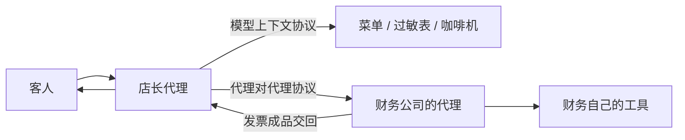

# **A2A**：MCP 连工具，A2A 连 Agent；本仓库只要求认知

> 对应模块：[模块 14 · Multi-Agent ⭐⭐⭐⭐](./README.md) · 小节进度第 3 条
> 这一小节由 Coach 按 2026-10-10 本对话 `coach start` 详解首次写入。贯穿场景沿用点咖啡：中杯热燕麦拿铁，店里的工具仍是 `make_latte`、`cafe://today-menu`、`cafe://allergy-info`，店外另加一家财务公司的开票代理。学习者只减不加。进度表这一行已于 2026-10-10 打钩。模块复盘是进度表第 4 条，本文件不把它当新课写完。

- **来源**：本对话 `coach start` 详解。协议对象、状态、发现方式和授权要求对照 [A2A 规范 1.0.0](https://a2a-protocol.org/latest/specification/) 正文（2026-10-10 读到的版本）。对照上一小节的主管（Supervisor）、当工具调用（Agents as Tools）、任务移交（Handoff），以及模块 12 的模型上下文协议（Model Context Protocol，MCP）。
- **状态**：已沉淀
- **Demo**：无。这一段只检查笔记，不检查代码。从模块 14 起本仓库不再新写模拟演示，见学习总览。判断见 [## Demo 判断](#demo-判断)。

> 各节写什么、达标要求：见仓库根 [AGENTS.md §7.2](../../../AGENTS.md#72-写入小节文档--小节进度对齐)。

## 是什么

模型上下文协议连的是工具。代理对代理协议（Agent2Agent，A2A）连的是另一个代理：先发现它，再把活委派给它，再盯着这份活的任务生命周期（Task Lifecycle）。

客人说：「中杯热燕麦拿铁，开发票，抬头等我补。」店长这条线仍然对客人说话。查菜单、查过敏、做出杯，走模型上下文协议，调用 `cafe://today-menu`、`cafe://allergy-info`、`make_latte`。这三样是工具：给参数，拿结果。它们没有名片，也不会中途反问税号。

开票是财务公司的代理，跑在另一家的服务上。店长先读它的代理卡片（Agent Card），再作为客户端把「给这单开票」发过去。财务代理交回发票。客人的下一句仍然进店长。财务代理内部有没有去调税务接口，店长看不见。规范把这种协作叫做不透明执行（Opaque Execution）：双方按声明过的能力和交换的消息协作，不共享内部计划、记忆和工具实现。



财务自己的工具那一根，是财务代理内部的事。店长不拿到那把钥匙。

### 客户端和远程代理

客户端（A2A Client）替用户或另一个系统开口。这杯咖啡里，客户端是店长代理，不是坐在柜台前的客人。

服务端，也叫远程代理（Remote Agent），暴露一个符合协议的端点，接收任务并给出回应。这杯咖啡里就是财务公司的代理。

消息上的角色名和聊天记录不是同一套。`ROLE_USER` 表示客户端发出的。`ROLE_AGENT` 表示远程代理发出的。这里的「用户」常常是店长代理。客人的原话由店长收好，再整理成一条发给财务的消息。

### 代理卡片：对方是谁、会什么、怎么连

代理卡片是服务端公开的一份 JSON 说明。别人靠它决定要不要把活交过来，以及用哪种网络说法来交。规范 1.0.0 里，一份卡片至少要能回答这些事：

- 名字、说明、版本。例如「员工餐开票」，版本 `1.0.0`。
- 技能（Skill）：它擅长什么。技能带编号、名字、描述、标签，可以附示例说法。技能是给人和其他代理挑选用的说明。它不是一次工具调用，也没有参数表。
- 支持的接口（supportedInterfaces）：按优先顺序写出地址、协议绑定（Protocol Binding）、协议版本。绑定用开放字符串。规范正式写了三种：`JSONRPC`、`GRPC`、`HTTP+JSON`。客户端选列表里靠前、而且自己能说的那一种。
- 能力（capabilities）：会不会流式（Streaming），会不会推送通知（Push Notification），登录之后有没有一份更详细的扩展卡片（Extended Agent Card）。
- 默认能收、能交的媒体类型，以及联系它要哪种认证。

卡片还可以带签名，用来核对这是这家公司发的、内容没有被改。公开卡片谁都能读。扩展卡片要先按公开卡片里声明的方式登录，才看得到更多技能。公开卡片只写「员工餐发票」时，登录后的扩展卡片才可能写「对公专票」。没登录就按公开卡片挑人，会漏掉能力。把专票写在公开卡片上，又会把不该公开的技能放在首页。

找到卡片有三条路，规范 8.2 节都写了。

| 怎么找到 | 这杯咖啡里长什么样 | 用错了会怎样 |
| --- | --- | --- |
| 约定网址 | 打开 `https://invoice.partner.com/.well-known/agent-card.json` | 跟旧文章里的 `/.well-known/agent.json` 对不上。1.0.0 注册的后缀是 `agent-card.json` |
| 目录 | 公司的可协作代理目录里搜「开票」 | 目录过期时，活会派到已经下线的地址 |
| 事先写好的地址 | 合同里直接给了这张卡片的网址或正文 | 对方换了端点，这边不更新，发送会打到旧服务 |

两条协议都可以走 HTTP 上的 JSON-RPC。管道相同，只说明字节能传过去。模型上下文协议上的动作是发现工具、读资源、调用工具。代理对代理协议上的动作是发送消息、查询任务、列出任务、取消任务、订阅任务进展、读取代理卡片。方法对不上，就不是同一层。

### 委派之后，对方可以怎么回

店长发送消息（Send Message）之后，对方有两种合法回法。

一条消息就结束。问「今天还能开当天发票吗？」财务代理直接回一条消息（Message）：「16 点前可以。」没有任务号，也没有后续状态要盯。这种适合当场能答完、不需要再管理的一问一答。

建一个有状态的任务（Task）。「给这单 32 元燕麦拿铁开票」会跨好几分钟，中间还可能缺税号。对方建一份任务。任务标识（taskId）由服务端生成。客户端不能自己编一个新任务的标识交过去。以后进展都挂在对方给的这个标识上。多轮来回放在历史（history）里。成品放在制品（Artifact）里。

也可以先用几条消息把范围谈清楚，再转入任务。谈的时候还没有承诺要执行。

上下文标识（contextId）把相关的任务和消息归成一次办事。第一问可以不带它。对方若生成了一个，必须放进回应里。店长以后原样带回。服务端生成的这个标识应当当成不透明的一串字符，不要拆开猜含义。客户端不要自己编一个交过去，除非已经知道对方会怎么处理。自己编的对方若不接受，对方必须拒绝，并且不能在这次回应里另造一个新的。

要接着办已经结束的那张票，带原来的上下文标识、不带那个已经结束的任务标识。规范写明：只带上下文标识、不带任务标识，是在已有上下文里新开一份任务。同一上下文里的新任务可以继承之前的办事上下文。已经结束的那份任务不能再收消息。任务标识和上下文标识对不上时，对方必须拒绝。

### 消息、内容块、制品

消息是一轮沟通。制品是这份任务交出来的成品。规范写明：消息不应当用来交付任务结果，结果应当放在任务的制品里。问税号是消息。发票 PDF 是制品。把问税号的那条消息显示成下载链接，客人会点到一份还不存在的文件。

一条消息或一份制品拆成内容块（Part）。每一块正好是下面四种里的一种：

| 内容块 | 字段 | 这杯咖啡里放什么 |
| --- | --- | --- |
| 文字 | `text` | 「抬头：星河科技」 |
| 结构化数据 | `data` | `{ "amount": 32, "sku": "oat-latte" }` |
| 文件网址 | `url` | 发票 PDF 的下载地址 |
| 文件字节 | `raw` | 小票照片。JSON 里写成 base64 |

一块里同时塞文字和网址，不符合「正好一种」。媒体类型也要是卡片上该技能声明能收的，否则对方可以回答内容类型不支持。

任务历史里不保证留下每一条消息。流式连接断开再接上，也可能漏掉中间的状态消息。关键成品要放在制品里，再靠查询任务拿回整份任务，不要只靠某一条中途消息。

### 任务状态

规范 1.0.0 列出这些任务状态（TaskState）。进行中的可以继续。被打断（Interrupted State）的要等一件事。终态（Terminal State）不能再收新消息。我读到的正文没有另附一张「必须先经过哪一态」的转移表，所以下面只写每个状态表示什么，不写死一条唯一路径。

| 状态 | 类 | 这杯咖啡里发生了什么 |
| --- | --- | --- |
| 未指定（`TASK_STATE_UNSPECIFIED`） | 还不知道 | 还没读到真正的状态。不能把它显示成「正在开票」 |
| 已提交（`TASK_STATE_SUBMITTED`） | 进行中 | 财务代理确认这份活已经收下 |
| 处理中（`TASK_STATE_WORKING`） | 进行中 | 它正在做 |
| 需要输入（`TASK_STATE_INPUT_REQUIRED`） | 被打断 | 「抬头和税号是什么？」店长问客人，再带同一个任务标识和上下文标识把答案发回去 |
| 需要授权（`TASK_STATE_AUTH_REQUIRED`） | 被打断 | 要客人公司在财务系统里授权。凭据走另一条安全通道 |
| 已完成（`TASK_STATE_COMPLETED`） | 终态 | 制品里有发票 |
| 失败（`TASK_STATE_FAILED`） | 终态 | 做的过程中出错，例如税务接口挂了 |
| 已取消（`TASK_STATE_CANCELED`） | 终态 | 客人说不要发票了，店长调用取消任务 |
| 已拒绝（`TASK_STATE_REJECTED`） | 终态 | 对方决定不做。可以发生在刚收下时，也可以发生在做了一阵之后。例如这张卡只开员工餐，客人是散客 |

四种终态的页面文案不能合成一句「开票失败」。完成是有发票。失败是对方答应做、但没做成。取消是店长这边叫停。拒绝是对方判定这单不归它。已经到终态的任务，取消也会被拒绝，因为没有可以取消的进行中状态了。

需要输入和需要授权都是停下来等，等的东西不同。

需要输入等的是业务内容。客户端用同一个任务标识和上下文标识再发一条消息，任务才接着走。

需要授权等的是身份。对方必须用一份任务来跟踪，把状态改成需要授权，并在状态消息里说明要哪种授权（事先在带外或扩展里谈好的可以例外）。凭据应当从带外的安全通道到达，例如另一条 HTTPS，而不是写进内容块。凭据到达之后，对方可以不再等你补一条消息就继续做。因此店长这边要订着这份任务的进展：订阅、登记推送，或自己来查。只等下一条「请你回复」的消息，可能错过它已经继续做完的状态。密码若写进内容块，再被下一个代理转发，每一跳都能看见。

### 怎么知道做到哪了

收到进展有三种。后两种要卡片先声明。

一直等到它停。配置里的 `returnImmediately` 默认是假：发送消息会等到终态，或等到需要输入、需要授权，回应里带上当时的任务、制品和状态。短的开票适合这种。把这个开关设为真，对方在仍可能处理中时就返回，之后要自己查询任务（Get Task）、订阅，或等推送。

流式（Streaming）。卡片里 `streaming` 为真时，可以边做边收状态变化和制品片段。适合客人还停在点单页。卡片没声明这个能力，你去订阅，对方应拒绝。事件按产生的顺序送达，中间不能调换次序。连接在进入终态时关掉。

推送通知（Push Notification）。卡片里 `pushNotifications` 为真时，店长留下一个自己的网址。财务代理在状态变化时用普通 HTTP POST 把进展打过来。客人可以先去拿咖啡。店长这边要能从外网被叫到，回应 2xx 表示收下，并认出任务标识是自己发出去的那份。同一份通知可能到多次，处理时要认得出「这张票我已经收下了」。

三种可以并存。页面开着走流式。客人关掉页面后，同一份任务再靠推送或定时查询收尾。

## 为什么（Agent 开发要懂）

分错层，架构会在三个地方坏掉。

第一，把财务代理当成 `make_latte` 那种一次调用。对方做到一半要税号，工具返回值里没有「这份活停下来等补充」这种正式状态。多轮问话会被藏进自己的函数里，或者整单失败重来。对方要等税务局十分钟时，也没有正式的取消，没有「成品到了再通知我」。

第二，把咖啡机说成另一个代理。咖啡机没有名片、没有技能说明、没有任务号。为一次出杯去建发现、委派、生命周期，多一轮别人家的模型调用。上一小节的成本就是在这种多余交接上涨的。客人只是要一杯咖啡。

第三，把店里的工具密钥放进发给财务代理的消息里，让它自己去按咖啡机。不透明执行要求店长看不见对方的内部工具，也不把 `make_latte` 的密钥交出去。密钥一旦写进消息，链上每一跳都能读到。

所以：问一句就能做完的能力，留在模型上下文协议。会自己循环、会反问、会交文件、而且不在你进程里的，才用代理对代理协议。本仓库这一小节只要求能把这条边界讲清。

## 易混点

| 容易混成 | 实际差在哪 | 判错会怎样 |
| --- | --- | --- |
| 模型上下文协议和代理对代理协议是同一层，因为都可以走 JSON-RPC | 一边的方法是发现工具、调用工具。另一边的方法是发送消息、查询任务、取消任务、读取代理卡片 | 去工具列表里找任务状态，或者去代理卡片里找 `make_latte` 的参数表，两边都对不上 |
| 主管模式就是代理对代理协议 | 主管模式是同一个程序里的星形分工。工人把字段交回同一份共享状态。它们不靠 `/.well-known/agent-card.json` 被发现 | 给菜单工人、吧台工人各做一张对外卡片，一次出杯变成跨服务调用 |
| 用了代理对代理协议，就等于任务移交 | 从客人的座位看，下一句仍进店长，财务代理只交回成品。这仍是当工具调用。任务移交是客人的下一句改由另一个接 | 没告诉客人换人，客人对着店长补充的税号进不去财务那条线；或者反过来，把仍由店长接待的开票说成已经移交 |
| 把远程代理包成一个工具 `issue_invoice` 就够了 | 一次工具调用把任务状态收进函数内部。需要输入、需要授权、取消、制品分块，协议里都有正式对象 | 缺税号时只能失败重来，或者在工具函数里自己发明一套停顿 |
| 消息和制品是一回事 | 消息是一轮沟通。制品是成品。规范写明结果应当放在制品里 | 把「请补充税号」渲染成发票下载链接 |
| 需要输入和需要授权是同一种停顿 | 需要输入靠同一任务上的下一条消息续上。需要授权的凭据走带外通道，对方可以不再等消息就继续做 | 把密码写进内容块；或者授权已经完成，页面还停在「请回复」 |
| 四种终态都能叫失败 | 完成是有成品。失败是没做成。取消是自己叫停。拒绝是对方不做 | 客人看见「失败」，不知道该补税号、该重试，还是该换一家 |
| `ROLE_USER` 就是柜台前的客人 | 这个角色是客户端。这杯咖啡里是店长代理 | 把客人的整段闲聊原样交给财务代理，或者让财务代理直接接客人的下一句 |
| 旧文章里的 `/.well-known/agent.json` 仍是 1.0.0 的约定网址 | 1.0.0 注册的是 `/.well-known/agent-card.json` | 请求打到不存在的路径，就说这家没有开票代理 |

## 例子

### 生活：咖啡机和隔壁的财务所

咖啡机在店里。咖啡师按下「燕麦拿铁」，机器出杯，或者报一个错误。机器不发名片，不问税号，也不把你的店长叫到隔壁。这是工具。模型上下文协议规定的是店长怎么发现并调用这类能力。

隔壁财务所是另一家。你先看他们的名片：擅长开员工餐发票，门口地址写在名片上。你把金额和饮品送过去。他们打电话来要税号。你问完客人再回过去。票开好，他们把 PDF 交给你，你再告诉客人。你不站在他们办公室里看他们盖哪个章。这是另一个代理。代理对代理协议规定的是名片、委托、中途追问和成品怎么交。

客人始终对着你说话。你没有把电话交给财务所。所以这一跳从客人的座位看，仍是当工具调用。若你说「请直接打给财务所」然后挂断，那是任务移交，要另外告诉客人换人了。协议本身不替你做这个换人。

### 前端：点单页上客人看见什么

点单页只跟店长这条线说话。开票过程中，页面按任务状态换文案，不把财务代理的内部工具调用摊开。

| 客人看见的 | 对应状态 | 数据在哪 |
| --- | --- | --- |
| 正在问今天还能不能开发票 | 一条消息就结束，没有任务号 | 回应的文字块 |
| 正在开票 | 已提交或处理中 | 任务标识已有，制品还没有 |
| 请补充抬头和税号 | 需要输入 | 状态上的消息；客人提交后，同一任务标识再发一条 |
| 请到公司账号完成授权 | 需要授权 | 状态消息说明要哪种授权；密码不进这一条 |
| 发票已开好，这是链接 | 已完成 | 制品里的网址块或字节块 |
| 税务接口暂时失败 | 失败 | 终态，旧任务不能再收消息 |
| 已按你的要求取消 | 已取消 | 终态 |
| 对方只开员工餐，这单不接 | 已拒绝 | 终态 |

客人中途说「做成热的」。这一句仍进店长。改杯走 `make_latte`。改抬头才带原来的上下文标识去新开一份开票任务。

### 这一单的数据怎么走

1. 店长读取 `https://invoice.partner.com/.well-known/agent-card.json`。卡片上的技能是开员工餐发票，接口列表第一项是自己能说的那种绑定。
2. 店长发送消息。内容块是结构化数据：`{ "amount": 32, "sku": "oat-latte" }`。这一问不带任务标识。
3. 对方生成任务标识和上下文标识，状态先到已提交。店长把这两个标识原样留下。
4. 对方把状态改为需要输入，消息文字是「请给抬头和税号」。
5. 店长问客人。客人回答后，店长用同一个任务标识、同一个上下文标识再发一条文字块。
6. 若这单要对公授权，状态改为需要授权。凭据从另一条 HTTPS 到达。店长订阅或查询，避免对方不再等消息就继续做。
7. 对方把发票放进制品，内容块是 PDF 的网址。状态改为已完成。流若开着，到这一态就关掉。
8. 客人说抬头写错了。店长只带上下文标识、不带那份已完成的任务标识，新开一份任务。旧任务不再收消息。
9. 菜单、过敏、出杯始终不进上面这些消息。它们仍是店长自己的工具调用。

## 需求清单

下面每条都用这杯咖啡验收。验收是讲得清。本仓库不把协议做出来。

1. 业务场景：燕麦拿铁要查菜单、查过敏、做出杯，同时要开发票。目标：菜单、过敏表、咖啡机走模型上下文协议；财务公司走代理对代理协议。涉及：两层边界、不透明执行。验收：能指出 `make_latte` 没有代理卡片，财务代理没有被写进工具列表；能说出把咖啡机密钥发给财务会怎样。
2. 业务场景：店里要接一家新的开票服务。目标：能按约定网址、目录、合同里的地址三种方式拿到卡片，并选出自己能说的那种接口。涉及：代理卡片、三种发现、支持的接口。验收：能写出 `/.well-known/agent-card.json`，并说明旧文章里的 `agent.json` 为什么会找错；能说明公开卡片和扩展卡片各该看什么。
3. 业务场景：先问「今天还能开当天发票吗」，再要求给这单开票。目标：前一句用一条消息结束；后一句建立任务。涉及：消息、任务、上下文标识、任务标识由服务端生成。验收：能说出哪一次没有任务号；抬头写错时，为什么是只带上下文标识去新开一份，而不是往已完成的任务再发消息。
4. 业务场景：金额和饮品已经送出，抬头还没有。目标：停在需要输入，客人补充后仍用原来的任务标识和上下文标识。涉及：被打断的状态、续消息。验收：能说出续上时要带哪两个标识；能说出如果新开一单、又没带上下文标识，财务代理为什么可能不知道你在补刚才那张。
5. 业务场景：对公专票要客人公司授权。目标：停在需要授权，凭据走另一条安全通道。涉及：需要授权、带外凭据、进展不能只等下一条回复。验收：能说出密码若写进内容块，再被下一个代理转发时谁能看见；能说出凭据到达后对方可以不再等消息就继续做，所以要订阅、推送或查询。
6. 业务场景：发票开好、税务接口失败、客人取消、对方以「只做员工餐」拒绝。目标：四种终态不混用。涉及：已完成、失败、已取消、已拒绝。验收：每种都能说客人下一眼该看见什么；四种之后若要重开，都是同一上下文里的新任务，旧任务不再收消息。
7. 业务场景：财务代理先问税号，后交出 PDF。目标：问话在消息的文字块里，订单结构在数据块里，PDF 在制品的网址块或字节块里。涉及：内容块四种、消息和制品。验收：能指出「把问税号的那条消息显示成下载链接」错在哪；能说出为什么不能只靠历史里的某一条消息当成品。
8. 业务场景：客人盯着点单页等了十秒；另一单客人先去拿咖啡，二十分钟后票才好。目标：短等待用等到停或流式；长等待用推送或查询任务。涉及：三种进展、卡片上的能力开关、`returnImmediately`。验收：能说出卡片没写流式时硬订阅会怎样；能说出推送重复到达时为什么要认任务标识。
9. 业务场景：开票过程中客人改口「做成热的」。目标：下一句仍进店长；改杯走店内工具，改抬头才是给财务代理的新任务。涉及：和当工具调用、任务移交、主管模式的差别。验收：能说出这一跳为什么还不是任务移交；能说出吧台工人为什么不需要一张代理卡片。

## 这几种情况都要分开讲

| 情况 | 数据怎么走 | 需求 |
| --- | --- | --- |
| 连的是工具，还是另一个代理 | 菜单和咖啡机走工具调用；开票走代理卡片和任务 | 需求 1 |
| 卡片从约定网址、目录，还是合同地址来 | 公开卡片和登录后的扩展卡片分开看 | 需求 2 |
| 一条消息结束，还是建任务 | 问「今天还能开吗」没有任务号；开票有服务端生成的任务标识 | 需求 3 |
| 缺的是业务内容 | 需要输入，同一任务标识和上下文标识再发一条 | 需求 4 |
| 缺的是授权 | 需要授权，凭据走带外；进展靠订阅、推送或查询 | 需求 5 |
| 四种终态 | 完成、失败、取消、拒绝各有一句对人说的话；结束的任务不再收消息 | 需求 6 |
| 问话和成品 | 文字块、数据块、网址块、字节块；成品在制品里 | 需求 7 |
| 客人在不在页面上 | 等到停、流式、推送；后两种要卡片先声明 | 需求 8 |
| 客人下一句谁接 | 仍进店长。改杯走工具。这不是任务移交，也不是给吧台工人发卡片 | 需求 9 |

## 取舍

| 你在意的事 | 更合适的做法 |
| --- | --- |
| 能力是问一句、回一段结果，而且就在自己进程里，例如读菜单、做杯 | 模型上下文协议。不建代理卡片，不建任务 |
| 能力在别的厂商那里，会自己循环，会反问，会交文件，例如开票 | 代理对代理协议。店长当客户端，客人仍对着店长说 |
| 对方只是「问一句、回一段字」，你愿意把中途状态藏进一次调用 | 可以包成工具。缺税号、等十分钟、要取消时，这层包装会丢掉正式状态 |
| 客人的下一句要改由财务公司直接接 | 那是任务移交，要告诉客人换人了。代理对代理协议只负责两条代理之间的通道 |
| 工人和店长在同一个程序里，共享 `orderSlip` 这类字段 | 主管模式。不对外发布代理卡片 |
| 技能不该让匿名访客看见，例如对公专票 | 放进登录后的扩展卡片。公开卡片只留能公开的技能 |
| 客人还看着页面 | 流式，或默认等到停。卡片要声明流式，才用流式 |
| 客人已经离开，活要跑很久 | 推送或查询。推送要卡片声明，并且重复通知要能认任务标识 |
| 要改已经完成的抬头 | 只带原来的上下文标识新开任务。不往终态任务再发消息 |

## 踩坑

- 用 2025 年文章里的 `/.well-known/agent.json` 去对 1.0.0。约定网址是 `/.well-known/agent-card.json`。
- 自己编一个任务标识去「创建」任务。新任务的标识由服务端生成。
- 自己编一个上下文标识交过去，又不知道对方会不会接受。对方可以拒绝，并且不会在这次回应里另造一个。
- 任务标识和上下文标识对不上仍照发。对方必须拒绝。
- 把发票 PDF 放在消息里当结果。结果应当在制品里。历史也不保证留下每一条消息。
- 需要授权时把密码放进内容块。凭据走带外。写进消息后，转发链上的每一跳都能看见。
- 需要授权之后只等客人再发一条聊天。对方可以在凭据到达后直接继续做。没有订阅、推送或查询，页面会停在旧状态。
- 把已完成、失败、已取消、已拒绝都显示成「开票失败」。
- 往终态任务再发「改抬头」。应当只带上下文标识新开一份。
- 卡片没写流式或推送，仍去订阅或登记网址。
- 推送重复到达就开出两张票。要认任务标识，重复的收下一次即可。
- 把吧台工人做成对外代理，或把财务代理写进 `make_latte` 那份工具列表。两层就叠在一起了。
- 没告诉客人换人，就把开票说成任务移交。客人下一句仍应该进店长。

## 还没搞懂的

- 规范 3.1.1 的行为段写，发送消息必须立刻返回任务或一条消息，任务可以在返回之后继续做。后面的 `returnImmediately` 又写：默认要等到终态或被打断才返回，设为真才马上返回。这两句哪句优先，这一轮没有再对协议作者核对。学习时按配置那一节记：默认等到停；开关打开才马上拿任务号离开。
- 规范 4.1.3 列出了状态，我读到的正文没有一张「必须先经过处理中」的转移表。有的实现说明写「已提交可以直接到已完成」。这句话不在我读过的规范正文里，所以不把它当成必须遵守的转移。
- 卡片能力里还有 `stateTransitionHistory`。这一轮没有读它表示什么，不放进要会讲的清单。

## 过关自检

能用一杯燕麦拿铁说清边界：模型上下文协议是店长到菜单、过敏表和咖啡机；代理对代理协议是店长到财务公司的代理。发现靠代理卡片，委派靠消息和任务，任务有需要输入、需要授权和四种终态。

能说出客人的下一句仍进店长，所以这一跳还不是任务移交。能说出发票在制品里，税号追问在消息里，密码不在内容块里。能说出已完成的任务不能再改，改抬头是同一个上下文标识里的新任务。

## 我追问过的

本对话没有知识追问。不编造。

## 契约记录

- 学习者说「沉淀文档」。这是写入动作，不记入「我追问过的」。
- 进度表这一行已于 2026-10-10 打钩。打钩前只核对了用词和笔记，没有核对代码。
- 这一轮实际读过的外部页面是 A2A 规范 1.0.0。进度表「我的链接」只填这个地址。
- 从模块 14 起，这一小节不在本仓库新建模拟演示。笔记写在这一份小节文档里。

## Demo 判断

```text
Demo 判断
- 小节：A2A：MCP 连工具，A2A 连 Agent；本仓库只要求认知
- 结论：无
- 理由：这一段只检查笔记，不检查代码。从模块 14 起，可运行的代码放在学习者单独的真实项目里，见学习总览。本条要能讲清的是边界，不必实现协议。
- 你学完要：笔记写在这一份小节文档里。不新建 apps/ 文件夹。
```
