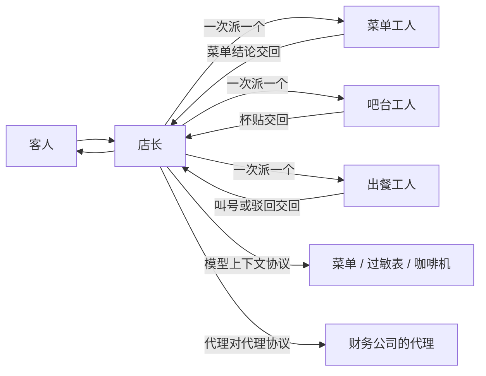

# **模块复盘**

> 对应模块：[模块 14 · Multi-Agent ⭐⭐⭐⭐](./README.md) · 最后一条（**不写代码**，只回顾收口）
> 这一小节由 Coach 按 2026-10-10 本对话 `coach start` 详解后，学习者说「沉淀文档」首次写入。学习者只减不加。进度表这一行已于 2026-10-10 打钩。

- **来源**：本对话 `coach start` 详解。对照本模块前三节：[主管模式](./01-Supervisor-模式.md)、[多 Agent 成本](./02-多-Agent-成本.md)、[代理对代理协议](./03-A2A.md)
- **状态**：已沉淀

> 本节写什么、达标要求：见仓库根 [AGENTS.md §7.3](../../../AGENTS.md#73-模块复盘进度表最后一行)。

## 一句话讲完这个模块

这个模块解决一件事：这杯单该不该拆给好几个人。拆，是为了上下文隔开、有人专门核对，或者对方根本不在你这个进程里。拆完一定更贵。贵在每一次交接都再叫醒一次模型。

## 这些条怎么连成一条线

三节是一条线。第一节画分工图：谁点名，谁干活，结果交回谁。第二节给这张图记账：调用次数、输入 Token（Input Tokens）、输出 Token（Output Tokens）、墙钟时间（Wall-Clock Time）。第三节画协议边界：店里的菜单、过敏表、咖啡机走模型上下文协议（Model Context Protocol）；隔壁财务公司走代理对代理协议（Agent2Agent，A2A）。没有第一节，账单不知道在给谁加算。没有第二节，分工图回答不了值不值得。没有第三节，人会把咖啡机说成另一个代理，或把财务公司塞进工具列表。

贯穿仍是点咖啡。客人要一杯中杯热燕麦拿铁，并说「开发票，抬头等我补」。验收里的调研、写作、审稿三个角色，就是这张星形图上的三个工人。点咖啡里对应菜单、吧台、出餐。店长分派，结果交回店长。

菜单工人、吧台工人、出餐工人和店长在同一个程序里。他们交回的是字段，或一段文字。客人的下一句「改成热的」仍进店长。这是交还。财务代理跑在别人的服务上：先读代理卡片（Agent Card），再委派，再盯任务生命周期（Task Lifecycle）。店长看不见财务内部盖了哪个章。这是不透明执行（Opaque Execution）。从客人的座位看，开票仍然交回店长，所以这一跳还是当工具调用（Agents as Tools）的形状。只有店长说「请直接打给财务所」并挂断，下一句才改由财务接。那才是任务移交（Handoff）。

### 三种图，账单不一样

一次派一个，用在「必须先有菜单结论才能做杯」。墙钟时间是各跳相加，含店长每一次点名。第二节的示意加法里，吧台决定做杯那一跳输入 580 Token，单代理看见菜单原文后决定做杯那一跳输入 950 Token。吧台更短，是因为那 400 Token 的菜单原文没进他的输入。四侧相加，多代理输入 5860、输出 290、9 次调用、墙钟 18 秒；单代理输入 2490、输出 70、3 次调用、墙钟 6 秒。差是两列相减：输入多 3370，墙钟多 12 秒。隔离省的是某一跳的原文。总账因为多了点名的人而变大。这组数字只为了把加法走通，换成真实调用时用接口用量字段和自己记的时刻重算。

先拆再同时做，用在三杯只问「今天都能做吗」，三杯互不依赖。三个菜单工人重叠，墙钟看最慢的那一份。示意里客人等 8 秒；排成队则大约 16 秒。输入仍是三份工人加上编排者的拆开和汇总，约 5720 Token。时间短了，钱没有少。必须先菜单再做杯的那一杯，不能用这张同时开工的图。否则杯子可能已经做好，过敏表还没读到。

分层主管（Hierarchical Supervisor）用在店长不该看见组内的菜单原文和 `make_latte` 来回。店长只派点单组主管和吧台组主管。小组主管自己也是模型调用。示意里点单组主管收任务再交回摘要，多出约 1160 输入 Token。店长那一张账可以不出现菜单原文。原文仍算在组内工人头上，总账要加上这一层。

杯贴打回是一整圈，不是把最后那句取餐号改一个词。示意里这一圈再加约 2030 输入 Token，总输入变成 7890。驳回理由写进下一次输入，后一跳更长。漏记这一圈，重做看起来几乎免费。

两种交还的总账范围也不同。共享状态（Shared State）里，菜单原文留在菜单工人自己的调用上，吧台只读 `menuNotes`，那 400 Token 仍算菜单工人的。当工具调用时，店长的消息列表只多出那条工具返回值。总账仍要加上工人内部每一次。只加店长看见的那句「今日有热拿铁」，菜单工人读原文的调用就从账单里消失了。

### 和隔壁财务所接上之后

咖啡机在店里。咖啡师按下「燕麦拿铁」，机器出杯，或者报一个错误。机器不发名片，不问税号。这是工具。模型上下文协议规定的是店长怎么发现并调用这类能力。

隔壁财务所是另一家。你先看名片：擅长开员工餐发票，地址写在名片上。约定网址是 `https://invoice.partner.com/.well-known/agent-card.json`。你把金额 32 元和货号送过去。他们打电话来要抬头和税号。你问完客人，用对方给的任务标识再答回去。票开好，他们把 PDF 交给你，你再告诉客人。你不站在他们办公室里看他们调哪个税务接口。

点单页只跟店长这条线说话。页面按任务状态换文案：正在开票、请补充税号、请到公司账号授权、发票链接、对方不接这单。税号追问在消息里。发票在制品（Artifact）里。密码走另一条安全通道，不写进发给财务的内容块。客人中途说「做成热的」，这一句仍进店长，改杯走 `make_latte`。抬头写错了，只带原来的上下文标识新开一份开票任务。已经完成的那份任务不再收消息。

这一跳的费用记在总账里：读卡片、发送消息、中途再问一次、收制品，每一次模型调用都加。财务内部还有他们自己的工具调用。店长看不见，也就不要假装加进店长的消息列表。你能看见的是交回来的发票和状态。

## 模块验收对答

按本模块 README「验收」逐条，用点咖啡讲一遍。调研、写作、审稿三角色协作做在单独的真实项目里；下面是关上文件后要能说出口的回答。

| 验收项 | 我的回答 |
| ------ | -------- |
| 实现了 Supervisor / Worker 模式 | 店长只选下一个名字，或结束。菜单读 `cafe://today-menu` 和 `cafe://allergy-info`，吧台根据菜单结论做杯，出餐对照订单和杯贴。工人干完都回到店长。顺序不是预先写死的三步：出餐若写「杯贴做成了冰美式」，店长可以再选吧台。调研、写作、审稿是同一张星形图，点咖啡里对应这三个工人。 |
| 实现了 Agent Handoff（任务移交） | 出杯默认是交还：店长还在，客人说「改成大杯」仍进店长。任务移交是另一次：店长告诉客人「请直接打给财务所」然后挂断，下一句改由财务代理接。当工具调用里，工人交出一段返回值，调用方仍是店长。两件都要能指出来。 |
| 有 Shared State，多个 Agent 能读写同一份上下文 | 同一份订单上有 `orderSlip`、`menuNotes`、`drinkType`、`cupLabel`、`pickupCall`。吧台读的是 `menuNotes`，读不到菜单接口的原始来回。字段要能写成文字和结构。数据库连接、模型流、函数写不进检查点。另一种交还是工具返回值：工人另开一份消息列表，只把最后一段交回店长。下一站看见的来源不同，客人的下一句都进店长。 |
| **做了成本和延迟对比**：同一任务单 Agent vs 多 Agent，Token 差多少、耗时差多少 | 同一句客人的话、同一个模型、同一份菜单原文、同一个温度（Temperature），各记四列。示意加法里，单代理是 3 次调用、输入 2490、输出 70、墙钟 6 秒。店长一次派一个是 9 次、输入 5860、输出 290、墙钟 18 秒。差是两列相减：输入多 3370，墙钟多 12 秒。这组数字只为了把加法走通。真实项目里改用接口用量字段和自己记的时刻。 |
| 能给出一个明确结论：什么场景多 Agent 值得，什么场景是过度设计 | 值得拆的理由有两类。一是隔离：做杯时不该再看见整份菜单原文，核对的人也不该核对自己刚写下的杯贴。二是对方不在你这个进程里，会中途反问、会交文件。过度设计是：客人只问「今天有拿铁吗」，或 `make_latte` 只是一次调用，却拆成五个代理。成本按人数翻，核对并没有多发生。 |
| **A2A 认知（不必实现）**：能一句话说清 MCP = Agent→工具，A2A = Agent→Agent（发现、委派、任务生命周期） | 模型上下文协议是店长到工具：给参数，拿结果。代理对代理协议是店长到另一个代理：发现、委派、盯着任务从需要输入走到已完成。咖啡机没有名片。财务公司有名片。两条都可以走 HTTP 上的 JSON-RPC。方法对不上，就不是同一层。 |

## 最容易记错的三条

**某一跳变短，就当成总账变少。** 吧台那一跳 580 Token，对单代理的 950 Token，少了 370。四侧相加是 5860 对 2490。判错之后，会用隔离宣布多代理更省 Token，方向是反的。隔离换来的是吧台读不到菜单原文，少把原文抄进杯贴，也少在客人说过牛奶过敏时仍去做奶咖。这笔差值得不值得，要另看有没有少做错杯。Token 差本身不是质量分。同一类还有两句：三杯同时查完，客人少等了，输入 Token 仍是三份；客人看见的取餐号可以只有几十个 Token，账单是整条轨迹，含打回那一圈。

**主管模式和代理对代理协议是同一件事。** 主管模式是同一个程序里的星形图。工人把字段交回同一份订单，不靠名片被发现。代理对代理协议是去读另一家的代理卡片，再发送消息、查询任务、取消任务。判错之后，会给菜单工人、吧台工人各做一张对外卡片，一次出杯变成跨服务调用，成本就在这种多余交接上涨。反过来，把财务代理写进 `make_latte` 那份工具列表，对方做到一半要税号时，没有正式的「停下来等补充」，也没有正式的取消和成品通知。`ROLE_USER` 在这条协议里常常是店长这个客户端。柜台前的客人原话由店长收好，再整理成一条发给财务。

**为了听起来有分工，把一次调用也升成一个代理。** `cafe://today-menu`、`cafe://allergy-info`、`make_latte` 若被画成三个代理，图上看起来有三个人，轨迹里没有人在读 `menuNotes` 再决定下一步。客人只是要一杯咖啡。一次工具调用能做完的能力留在模型上下文协议。会自己循环、会反问、会交文件、而且不在你进程里的，才用代理对代理协议。

## 落过的 Demo 各自证明了什么

本仓库里主管模式留下两份可运行代码，都在 `apps/14-Multi-Agent/` 里。它们不作为这三节的通过条件。用量那一节的 2490、5860、5720、2030 不是这两份代码量出来的。代理对代理协议这一节没有可运行代码，边界写在 [03-A2A.md](./03-A2A.md) 里。

| Demo / 入口 | 跑它当时看清了什么 |
| ----------- | ------------------ |
| `apps/14-Multi-Agent/01-Supervisor-模式-step-1/` | 一次派一个。客人原话「来一杯中杯热拿铁」，同一份共享状态。店长每次只选一个工人或结束。工人把补丁写进 `menuNotes`、`cupLabel`、`pickupCall`。结束之后对客人说话的仍是店长这条线。菜单和做杯是模型按提示词编出来的字段。 |
| `apps/14-Multi-Agent/01-Supervisor-模式-step-2/` | 先拆再同时做。三杯只问今天有没有。编排者拆开，三个菜单工人一起查，再汇总成一段。墙上的等待看最慢的那一份。三份结果都要回来才对客人说。 |

## 踩过的坑（跨小节）

- 图上有查菜单、吧台、出餐，轨迹里店长一次回复就生成了菜单结论、杯贴和叫号。工人没有输入，也没有输出，核对没有发生。
- 吧台做完直接对客人说话。下一句「改成大杯」进了吧台。这是任务移交，店长的分派停了。若没告诉客人换人，客人会以为还在跟店长说话。
- 三杯互不依赖的菜单问题排成一次一个，客人白等。或者做杯和读过敏表同时开始，奶咖已经做给说过过敏的客人。
- 顶层轨迹里直接出现「去调 `make_latte`」。吧台组主管没有分派过，分层只是多画了一个框。
- 只记客人最后看见的取餐号，或只加店长消息列表里的工具返回值。打回那一圈、菜单工人内部读原文的调用，都不在这句话里。
- 两边的模型、温度、菜单原文不一致。差出来的 Token 不能算在「多了几个代理」头上。用量里没有缓存那一列，却把重复的系统提示词从总账里删掉。店长那四遍系统提示词就要少记。
- 用旧文章里的 `/.well-known/agent.json` 去对规范 1.0.0。约定网址的后缀是 `agent-card.json`。自己编任务标识去创建任务，或把发票 PDF 放在消息里当结果，或把已完成、失败、已取消、已拒绝都显示成「开票失败」，或把咖啡机密钥写进发给财务的消息。

## 还没搞懂的 → 去哪解决

- LangGraph.js 当天主管节点的函数名、结束标记写在哪个字段：自己查当天文档。公开教程里常见的是主管输出下一个工人的名字，或一个表示结束的标记。
- 三个工人同时改同一份状态、两个写入撞在同一个字段上怎么合并：自己查。留下的那份并行代码是各自查菜单再汇总，没有做字段合并。
- 各厂商把缓存命中的 Token 写在用量的哪个字段、缓存怎么计价：模块 19，可靠性 / 成本 / 性能。没看到单独一列时，重复前缀按全价加。
- 规范里「发送消息必须立刻返回」和配置 `returnImmediately` 默认等到停，这两句哪句优先：自己查规范后续勘误。学习时按配置那一节记：默认等到停，开关打开才马上拿任务号离开。
- 任务状态没有一张「必须先经过处理中」的转移表；卡片能力里的 `stateTransitionHistory` 这一轮没有读：自己查规范 1.0.0 正文。不把别人实现说明里的转移当成必须遵守的路径。

## 需求清单

这些需求串成同一家咖啡店。每条对应一种拆法。验收是能讲清。数字若要换成自己的，用同一次真实调用的用量字段和时刻。

1. 业务场景：客人点一杯中杯热拿铁，必须先菜单、再做杯、再出餐。目标：画出一次派一个的星形图，并写出单代理和多代理的四列差。涉及：谁分派、谁执行、怎么交还、共享状态、四列相减。验收：吧台读到的是 `menuNotes`；结束之后对客人说话的是店长；差是两列相减，能同时说出吧台某一跳更短、总账更大。
2. 业务场景：三杯只问今天有没有。目标：先拆开，同时做，再汇总，秒和 Token 各一行。涉及：编排者-工人（Orchestrator-Workers）、并行的墙钟看最慢的一份、Token 相加。验收：写明时间短了，输入 Token 仍是三份工人加上拆开和汇总。
3. 业务场景：读菜单的人和按咖啡机的人很多，店长不该看见组内原文。目标：店长只派两个小组主管。涉及：分层主管、多一层多一组系统提示词。验收：顶层轨迹里没有「去调 `make_latte`」；小组主管那一层的输入进总账。
4. 业务场景：杯贴做成了冰美式，打回重做。目标：这一圈单独成行再加进总账。涉及：失败仍交回店长、后一跳因为驳回字段更长。验收：总账含这一圈的调用次数和输入 Token。最终那句取餐号的 Token 不能代替这一圈。
5. 业务场景：客人说「改成大杯」，以及另一次店长把开票电话交给财务所。目标：前一次仍是交还，后一次是任务移交并告诉客人换人。涉及：下一句进谁。验收：能指出哪一次店长的分派还在更新，哪一次客人已经对着另一个人说话。
6. 业务场景：燕麦拿铁要查菜单、查过敏、做出杯，同时要开发票。目标：前三样走模型上下文协议，财务公司走代理对代理协议。涉及：代理卡片、任务、制品、不透明执行。验收：能指出 `make_latte` 没有代理卡片；发票在制品里，税号追问在消息里；把咖啡机密钥发给财务之后，链上每一跳都能看见。
7. 业务场景：客人只说「今天有拿铁吗」，或只需要按一次咖啡机。目标：留在一个代理加一次工具调用。涉及：过度设计。验收：能说出若拆成五个代理，多出来的是点名的系统提示词和交接，核对并没有多发生。

## 过关自检

能用一杯燕麦拿铁加开发票，把三节连成一句：店长在同一个程序里分派菜单、吧台、出餐；账单把所有人的输入 Token、输出 Token、调用次数和墙钟时间加总；咖啡机走模型上下文协议，财务公司走代理对代理协议。

能说出什么时候值得拆（上下文要隔开，或对方会反问、会交文件），什么时候是过度设计（一次工具调用，或一句「今天有拿铁吗」拆成五个代理）。能指出交还和任务移交差在下一句进谁。

## 我追问过的

本对话没有知识追问。不编造。

## 契约记录

- 学习者说「沉淀文档」。这是写入动作，不记入「我追问过的」。
- 进度表这一行已于 2026-10-10 经 `coach complete` 打钩。打钩前只核对了用词和笔记，没有核对代码。
- 这一轮没有打开外部网页。进度表「我的链接」这一列不在这一轮改。
- 从模块 14 起，这一小节不在本仓库新建可运行代码。回顾写在这一份小节文档里。
