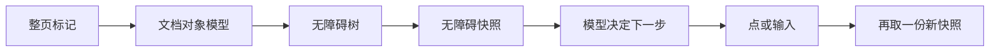

# **Accessibility Tree**：给 LLM 的页面摘要，通常比 DOM 短、噪音少

> 对应模块：[模块 15 · Browser / Computer Agent ⭐⭐⭐⭐⭐](./README.md) · 小节进度第 1 条
> 这一小节由 Coach 按 2026-10-10 本对话 `coach start` 详解首次写入。贯穿场景是客服工作台里的订单页。学习者只减不加。进度表这一行还没打钩。下一节是桌面操作，本文件只把它当作边界，不把它当新课写完。

- **来源**：本对话 `coach start` 详解。快照的文本写法对照 [Playwright 无障碍快照](https://playwright.dev/docs/aria-snapshots)（2026-10-10 打开的页面）。`page.accessibility` 已删除，来自检索到的 Playwright 1.57 发布说明摘要，这一轮没有逐行打开那一页。
- **状态**：已沉淀
- **Demo**：无。这一段只检查笔记，不检查代码。从模块 14 起本仓库不再新写模拟演示，见学习总览。

> 各节写什么、达标要求：见仓库根 [AGENTS.md §7.2](../../../AGENTS.md#72-写入小节文档--小节进度对齐)。

进度表里搜「无障碍树」时，全称被截短（省略中间字符）。正文用完整说法：无障碍树（Accessibility Tree）。

## 是什么

给大语言模型（LLM）的默认页面描述，是一份过滤之后的无障碍快照（ARIA Snapshot）。模型要决定的是：这一页现在能点什么、每项叫什么、处于什么状态。整页超文本标记语言（HTML）里的类名、样式和脚本，对这个决定几乎没有帮助。

浏览器里同时有三份东西。

**文档对象模型（DOM）**是元素面板里那棵树：标签、属性、类名、文本，一层套一层。订单后台很容易在这里堆出大量类名、内联样式、图标路径和埋点脚本。

**无障碍树（Accessibility Tree）**是浏览器为读屏软件（Screen Reader）另算的一棵树。原料是文档对象模型、层叠样式表（CSS）和页面上的无障碍属性。每个节点上主要是：

- 角色（Role）：链接、按钮、文本框、勾选框、标题、导航、对话框、警告。
- 可访问名称（Accessible Name）：读屏软件念出来的那一句，例如「提交订单」。
- 状态（State）和当前值：禁用、已勾选、已展开、校验失败、这一栏现在填了什么。
- 谁包着谁。

很多节点不会进这棵树。没有语义的包裹层、脚本、样式，以及 `display: none`、`hidden`、`aria-hidden="true"` 包住的内容，一般都不暴露。所以它通常已经比文档对象模型短。Chrome 开发者工具的无障碍面板看的是这棵计算树，里面仍可能有被标成忽略的通用节点。

**无障碍快照（ARIA Snapshot）**是再收过一次的文本，给模型读。Playwright 用 `page.ariaSnapshot()` 取整页，用 `locator.ariaSnapshot()` 取某一块。得到的是一份缩进文本：一行一个节点，缩进表示谁包着谁。官方文档写的格式是：

```text
- role "name" [attribute=value]
```

`role` 是角色。引号里是可访问名称。方括号里是状态，文档列出的常见项有 `checked`、`disabled`、`expanded`、`invalid`、`level`、`pressed`、`selected`。标题的级别写成 `[level=1]`。校验失败且带当前值时，可以长这样：

```text
- textbox "Email" [invalid]: not-an-email
```

登录卡收成快照，模型和读屏软件该看到的是同一层信息：

```text
- heading "登录" [level=1]
- textbox "邮箱"
- textbox "密码"
- button "登录"
```

模型按这四行填邮箱、填密码、点名为「登录」的按钮。执行完，旧快照作废，再取一次。若邮箱格式不对，新的一份里会出现警告，文本框带上 `[invalid]`。模型这才知道：登录按钮还在，失败原因是邮箱，下一步是改邮箱。

可访问名称不是把某一个属性原样抄出来。浏览器按顺序找第一份非空的文字。常见顺序是：`aria-labelledby` 指到的那段文字，然后是 `aria-label`，然后是关联的 `label`、按钮内部的文字、图片的替代文本（`alt`）。再不行，有些控件才退到 `title`。占位符（`placeholder`）有时会被拿去当最后的名字；字一填进去，占位符消失，这份名字也不可靠。不要把占位符当成已经写好的标签。

Playwright 文档同时写了一句边界：测试里的快照模板是一条约束，不一定是整棵树的完整抄录。模板可以只写「这里有个按钮」，不写名字、不写是否禁用，测试仍然能过。`page.ariaSnapshot()` 打出来的那一份，才是当前范围内各节点的表示。给模型的应是打出来的这份，不是一份故意写短的测试模板。

旧接口 `page.accessibility.snapshot()` 不要再记。检索到的 Playwright 1.57 发布说明写明：弃用三年之后，`page.accessibility` 已从接口里删除。现在取文本用 `page.ariaSnapshot()` 和 `locator.ariaSnapshot()`。



生活里，这是窗口办事。柜台该递给你的是一张「现在能办的事」：窗口名、要填的栏、这一栏现在能不能用。整本内部流程手册里有表格编号和去年的通知。无障碍快照是那张清单。整页标记是那本手册。办完一笔，清单要换新的，因为窗口状态变了。

## 为什么（Agent 开发要懂）

模型的上下文窗口（Context Window）有长度。一个后台页的标记里，大量字符是类名、内联样式、图标路径和埋点脚本。这些字符照样换成词元（Token），和真正的按钮抢位置。模块验收里说的「一个页面十万词元」，指的是这种浪费的量级：整页塞进去，又贵，又容易让模型去猜一个下次发布就变的类名。快照丢掉这些，常常能少一个数量级。这是机制上的判断。具体少多少，要拿你自己的页面量，这里不编一个固定数字。

浏览器代理要模仿的是使用者：点、输入、阅读。使用者不跟类名打交道。读屏软件走的就是无障碍树。用同一层来描述页面，模型和「人下一步会做什么」对齐。

定位也更稳。组件库的按钮常常包在影子树（Shadow DOM）里。影子树开或关，只决定页面脚本能不能拿到内部节点。读屏软件仍然能看到组件暴露出来的角色和名字。快照里只要有 `button "提交订单"`，就可以按角色加名字去点。靠一层层类名写的选择器，重构样式就会断。前提是组件真的暴露了角色。内部全是没有角色的 `div` 时，树摊平之后仍然没有可点的按钮。

只把整页标记塞进提示词，模型会在样式里找「标记已发货」，可能抓到一个看起来像按钮的 `div`，也可能抓到注释里的旧文案。词元花在样式上，真正的按钮被挤到上下文后部。

## 易混点

| 你手里的那一份 | 它实际是什么 | 用错时会发生什么 |
| --- | --- | --- |
| 整页标记 | 结构、类名、样式、脚本都在 | 词元大量花在样式上，模型去猜会变的类名 |
| 浏览器里的完整无障碍树 | 读屏用的计算树，仍可能含被忽略的通用节点 | 比快照吵，还没滤成「能点什么」 |
| `page.ariaSnapshot()` 打出来的快照 | 当前范围内的角色、名字、状态、层级 | 默认该给模型的那一份 |
| 测试用的快照模板 | 一条可以写得很短的断言约束 | 模板里省略了禁用和名字，模型就看不见这些 |
| 可见文字 | 屏幕上的字，没有角色 | 「已发货」既是状态徽章又是筛选芯片时，分不清该读还是该点 |
| 截图 | 像素 | 用来补树上没有的画面；它没有稳定的角色和名字 |
| 无障碍规则报告 | 对比度、缺标签这类质量问题 | 告诉你页面合不合格，不代替「此刻有哪些控件」 |

快照短，只说明噪音少。短本身不保证够用。没有状态、同名没有区分、取完又发生了加载，短快照仍然会让模型点错。

视觉上看得见，也不等于在树上。画布（Canvas）里的字在屏幕上，树上可能没有。反过来，用裁切藏起来、专给读屏看的文字，屏幕上不明显，树上仍然在。`opacity: 0` 或挪出屏幕，常常还在树上。`display: none` 和 `aria-hidden="true"` 则一般不在。

快照里的名字，也不等于开发者写的某一个属性。关联的 `label`、按钮里的文字、`aria-labelledby` 指到的句子，都可能成为最终念出来的那一句。

截图在这一节里只是补充通道：树上没有的画面，才用像素来补。桌面范围能操作什么、权限和风险有多高，是下一节的内容。

## 例子

下面都用同一张客服订单页，把数据怎么走演一遍。

### 整页标记和快照各给模型什么

订单列表的源代码里有表格，也有图标、工具类和统计脚本。快照收完之后，表格、标题、按钮、输入框还在，类名和脚本不在。模型按「按钮，标记已发货」行动。

只抽可见文字会把角色弄丢。`innerText` 可能得到两句一样的「已发货」：一句是状态徽章，一句是筛选芯片。文字相同，一个该读，一个该点。快照里两行的角色不同，模型才能只点筛选。

### 状态会改下一步

角色和名字只说明「这里有个按钮」。状态说明「现在能不能按、已经怎样」。

- 还没选中订单时，「标记已发货」是禁用的。快照里要有 `[disabled]`。模型看不见禁用，会反复点，然后把失败理解成工具坏了。
- 筛选区折着的时候，树上是「按钮，筛选」加上已折叠。勾选框「仅看待发货」要等展开之后才出现。
- 邮箱填错时，文本框是 `textbox "邮箱" [invalid]`，旁边有 `alert "邮箱格式不对"`。登录按钮还在，不代表这次提交成功。

### 三个都叫「删除」

三行订单，每行一个名字是「删除」的按钮。快照里就是三行 `button "删除"`。模型只说「点删除」时，执行器对不上唯一目标。动作里要带上这一行的订单号，或带上序号。

### 点完必须换一份快照

点「加载更多」之前，快照里只有前二十行。新的二十行是点击之后才进文档、才进无障碍树的。拿旧快照去点第二十一行，那一行当时不在树上。

虚拟列表也一样：没滚进视口的行，文档里没有节点，树上也不会有。

对话框弹开之后也要重取。背景若被标成对无障碍隐藏，新快照里主要只剩对话框。继续拿弹窗之前的整页快照，模型会去点已经被盖住的行。

循环是：等这一屏内容出现，取快照，模型选一个动作，执行，再取一份新快照。

### 取整页，还是只取对话框

整页快照适合「还不知道焦点在哪」。对话框已经打开时，对那一块调用 `locator.ariaSnapshot()`，模型不会去点对话框后面的「删除」。

范围取得太窄也会漏。只拍了表格，筛选条在表格外面，模型就看不见「仅看待发货」。范围要跟这一步人正在看的那一块对齐。

### 支付框在另一份文档里

主页面的快照不包含内嵌框架（iframe）里面的控件。收款若是另一个文档，主快照里往往只有「内嵌框架」这一项，没有卡号框。要进入那一份文档，再取一次快照。

跨来源的内嵌框架，父页面常常读不到。浏览器不允许父页面随意看另一个站点的文档。这种卡号框不会出现在主快照里，也不能靠把主页面标记塞得更长来补上。

### 树上没有柱子上的数字，也没有图标的名字

销售额若是用画布画的，快照里可能只有「画布，销售图」，没有每个柱子的数字。页面别处若有一张同等的表格，读那张表的快照。数字只存在于像素里时，再补一张截图。

工具栏三个图标按钮都没有 `aria-label`，里面也没有文字。快照里就是三个没有名字的按钮。在页面补上名字之前，不能把它们当成已经能安全区分的三个动作。

### 影子树里的提交按钮

元素面板里，提交按钮藏在影子树内部，类名选择器要穿过组件。快照摊平之后仍是 `button "提交订单"`，按角色和名字去点。组件若没有暴露角色，摊平之后仍然没有这个按钮。这时要改的是组件，不是把整页标记再塞一遍。

## 需求清单

下面每条都用这张客服订单页验收。验收是讲得清。真要做出来，做在单独的真实项目里。本仓库不写模拟页。

1. 业务场景：客服打开订单列表，一页里有表格、图标和埋点脚本。目标：模型仍能指出「标记已发货」是一个按钮。涉及：整页标记和过滤后的快照。验收：能说明标记把词元花在类名和脚本上；快照里这一项以按钮角色加上可访问名称出现。
2. 业务场景：列表里既有状态徽章「已发货」，又有筛选芯片「已发货」。目标：模型只把芯片当成可点的筛选项。涉及：快照相对「只抽可见文字」。验收：两处文字都在，角色不同；点的是筛选，不会把徽章当成芯片。
3. 业务场景：未选订单时「标记已发货」禁用；筛选条默认折叠；邮箱填错时旁边出现警告。目标：不点禁用按钮，先展开再勾选，并读出校验失败的原因。涉及：禁用、展开、校验失败、警告。验收：这三种状态都出现在当次快照里，并且下一步跟着状态走。
4. 业务场景：三行订单，每行一个名为「删除」的按钮。目标：只删客服指定的那一单。涉及：同名控件，用所在行的订单号或序号区分。验收：动作里能指出是哪一行；不会只说「点删除」。
5. 业务场景：点「加载更多」后才出现后二十行；或弹出对话框后背景不再可操作。目标：下一步用的是点击之后的树。涉及：快照过期、动态加载、对话框打开。验收：加载或弹窗之后有一次新的快照；新行或对话框里的控件来自这新的一份。
6. 业务场景：订单对话框已打开，后面还有整张列表。目标：这一步只在对话框里改备注。涉及：整页快照和只对当前区域取快照。验收：这一步的快照范围是对话框；列表上的「删除」不在这次可选动作里。筛选条件若在对话框外，另一次快照要能覆盖筛选条。
7. 业务场景：收款用内嵌框架，卡号框不在主页面的树上。目标：分得清「还没进那一份文档」和「页面上没有卡号框」。涉及：内嵌框架是单独的文档；跨来源时父页面读不到内部。验收：主快照里看不到卡号字段；能进入的框架会再取一份快照；跨来源时明确说读不到，而不是把主页面标记加长。
8. 业务场景：销售额是画布；工具栏三个图标按钮都没有可访问名称。目标：数字优先从旁边的表格快照读取；三个图标在补上名字之前不当成已经能安全点选。涉及：画布不把柱子放进树；没有名字的按钮无法区分；截图只补充像素里才有的信息。验收：能说出快照里缺的是「柱子上的数字」还是「按钮的名字」；有表格就读表格；只有像素里才有的信息才用截图。

## 这几种情况都要分开讲

| 情况 | 数据怎么走 | 需求 |
| --- | --- | --- |
| 整页标记 | 类名、样式、脚本占词元；模型去猜会变的类名 | 需求 1 |
| 过滤后的快照，对照只抽可见文字 | 角色和可访问名称还在；两句「已发货」靠角色分成徽章和芯片 | 需求 2 |
| 状态写在快照里 | 禁用、折叠、校验失败决定下一步 | 需求 3 |
| 同名控件 | 三个 `button "删除"`，用订单号或序号指到一行 | 需求 4 |
| 快照过期 | 加载更多或对话框打开之后，必须再取一份 | 需求 5 |
| 取整页，还是只取当前区域 | 对话框这一步只取对话框；筛选条在外面就要另取 | 需求 6 |
| 另一份文档 | 主快照没有卡号框；能进的框架再取一次；跨来源则读不到 | 需求 7 |
| 树上看不见 | 画布没有柱子上的数字；没名字的图标不能当成三个不同动作；像素里才有的信息才用截图 | 需求 8 |

## 取舍

| 你在意的事 | 更合适的做法 |
| --- | --- |
| 要决定下一步点哪里、往哪一栏输入 | 把 `page.ariaSnapshot()` 或当前区域的 `locator.ariaSnapshot()` 给模型 |
| 还不知道焦点在哪 | 先取整页快照 |
| 对话框或抽屉已经打开，后面的列表不该被点到 | 只取这一块 |
| 两个控件角色和名字都相同 | 带上所在行的订单号或序号 |
| 刚刚点过、加载过、或弹窗打开了 | 丢掉旧快照，再取一份 |
| 数字在旁边的表格里，图只是画布 | 读表格那一块的快照 |
| 信息只画在像素上，树上没有对应文字 | 再补一张截图。桌面级操作留到下一节 |
| 控件在影子树里，但已经暴露了角色和名字 | 按角色和名字点，不写穿过影子树的类名选择器 |
| 要证明页面结构没被改坏 | 那是测试断言，模板可以只约束一部分。给模型的仍是打出来的完整快照 |
| 要查对比度、缺标签 | 那是无障碍规则报告，不代替这一刻的控件清单 |

## 踩坑

- 把整页标记塞进提示词。一个后台页的类名和脚本会占满上下文窗口，模型去点一个会变的类名。
- 只抽可见文字。状态徽章和筛选芯片都叫「已发货」时，分不清该读还是该点。
- 把测试模板当页面摘要。模板可以省略名字和 `[disabled]`，模型就看不见按钮现在不能按。
- 快照里没有禁用、展开、校验失败。模型反复点一个已经禁用的「标记已发货」，或在筛选还折着的时候找勾选框。
- 三个「删除」只说「点删除」。执行器无法对应到唯一一行。
- 用点击之前的快照去点「加载更多」之后才出现的行。那一行当时不在树上。
- 对话框打开后仍用整页旧快照。模型会去点已经被盖住的列表。
- 只拍表格，漏掉表格外面的筛选条。范围要比着人正在看的那一块取。
- 主页面快照里找不到卡号框，就改把整页标记加长。卡号在另一份文档里；跨来源时父页面读不到。
- 画布上的柱子当成熟上的文字。树上可能只有「画布，销售图」。有表格就读表格。
- 三个没有名字的图标按钮照样让模型选。快照无法编出删除、编辑、查看。
- 用占位符当可访问名称。字填进去之后，这份名字会消失。
- 继续调用已经删除的 `page.accessibility.snapshot()`。文本快照用 `page.ariaSnapshot()` 或 `locator.ariaSnapshot()`。
- 影子树里的按钮改去拼类名选择器。角色和名字已经暴露时，按快照里的那一行点。组件没暴露角色时，把整页标记塞进去也变不出一个按钮。

## 还没搞懂的

- 检索摘要里出现过：给 `ariaSnapshot` 附上每个元素的方框坐标。2026-10-10 打开的快照文档正文没有写这个选项。同名控件这一节只按订单号或序号讲。方框坐标等打开对应发布说明再补。
- Playwright 1.57 删除 `page.accessibility` 这一句，来自发布说明的检索摘要，这一轮没有逐行打开那一页。
- 浏览器内部把「哪些节点算值得暴露」滤到什么粒度，各引擎不完全一样。这里只讲给模型的那一层：角色、可访问名称、状态、层级。不把某一版源码里的过滤清单当成规范。

## 过关自检

能说出：给模型的默认页面描述，是滤过的无障碍快照，里面有角色、可访问名称、状态和层级。整页标记把词元花在类名和脚本上，所以优先快照，不把整页超文本标记语言塞进去。

能说出：只抽可见文字会丢掉角色。禁用、同名、过期、取哪一块、内嵌框架、画布和没名字的图标，都会让一份更短的摘要仍然点错。点完、加载完、对话框打开之后要重新取快照。

能说出：截图用来补树上没有的画面。桌面级操作是下一节的内容。测试模板可以写得很短，那是断言约束，不是给模型的页面摘要。

## 我追问过的

本对话没有知识追问。不编造。

## 契约记录

- 学习者说「沉淀文档」。这是写入动作，不记入「我追问过的」。
- 进度表这一行仍是未打钩。这次只写这一份小节文档。
- 这一轮实际打开过的外部页面是 Playwright 无障碍快照文档。进度表「我的链接」只填这个地址。
- 从模块 14 起，这一小节不在本仓库新建模拟演示。笔记写在这一份小节文档里。

## Demo 判断

```text
Demo 判断
- 小节：Accessibility Tree：给 LLM 的页面摘要，通常比 DOM 短、噪音少
- 结论：无
- 理由：这一段只检查笔记，不检查代码。从模块 14 起，可运行的代码放在学习者单独的真实项目里，见学习总览。本条要能讲清的是为什么优先无障碍快照，而不是把整页标记塞给模型。
- 你学完要：笔记写在这一份小节文档里。不新建 apps/ 文件夹。
```
