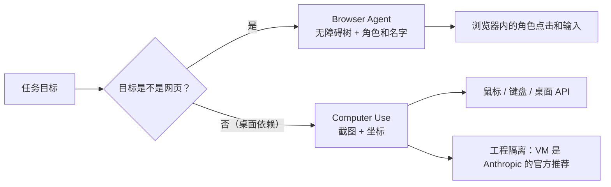

# **Computer Use**：比「只开浏览器」范围大（桌面），权限和风险更高

> 对应模块：[模块 15 · Browser / Computer Agent ⭐⭐⭐⭐⭐](./README.md) · 小节进度第 2 条
> 这一小节由 Coach 按 2026-10-10 本对话 `coach start` 详解首次写入。贯穿场景沿用客服工作台里的订单页和它周围的桌面依赖。学习者只减不加。进度表这一行还没打钩。上一节（Accessibility Tree）已经写完、README 已 ✅、`coach complete` 在本会话内由学习者补跑过——这里就不再重复。本节范围：Computer Use 作为一类 Agent 形态、和 Browser Agent 的区别、风险与变体。

- **来源**：本对话 `coach start` 详解。
- **状态**：已沉淀
- **Demo**：无。这一段只检查笔记，不检查代码。从模块 14 起本仓库不再新写模拟演示，见学习总览。

> 各节写什么、达标要求：见仓库根 [AGENTS.md §7.2](../../../AGENTS.md#72-写入小节文档--小节进度对齐)。

## 是什么

**Computer Use** 是一种让大语言模型（LLM）看到屏幕截图、并像人一样操作整台桌面的能力。它不是「在浏览器里加点儿智能」——它把模型当成一个坐在键盘前的使用者：看见什么屏幕、点哪里、敲什么键、看现在的状态变了没。

「Computer Use」这个词在公开材料里通常有两层意思，不要混。

**作为能力名**，指 Anthropic 在 2024 年 10 月给 Claude 接入的一组工具：`computer` 工具（截图、点击、键入）、`text_editor`、`bash`。模型用这些工具去看屏幕、移动鼠标、敲键盘，操作操作系统本身。

**作为一类产品形态**，指任何「让模型看到真实屏幕、操作真实桌面」的 Agent——不管底层走浏览器自动化、桌面自动化框架、还是裸坐标。OpenAI Operator、面向桌面 GUI 的多模态 Agent，也在这一类。

本节讲的「Computer Use」是后者这一类。模块 15 第 1 条「无障碍树（Accessibility Tree）」是 Browser Agent 的拿手菜：模型看到的是无障碍快照，操作目标是网页里的角色和名字。Computer Use 拿到的不是无障碍快照，是**截图**，操作目标是**像素坐标**和**键盘事件**。



生活里，这是「操作员在哪儿」的问题。需要办的业务在系统网页里时，由 Browser Agent 做；业务在邮件、Excel、老程序里时，由 Computer Use 做。前者看到的是页，后者看到的是整张桌面。

## 为什么（Agent 开发要懂）

**客服系统是网页，但很多依赖是桌面**。邮件客户端、PDF 阅读器、Excel、老的 Win32 程序、企业内网客户端——这些没有网页 API、没有 OpenAPI、也没有无障碍语义。模型要操作它们，只能看见屏幕点屏幕。

浏览器截图只覆盖当前 Tab（浏览器标签页）。Computer Use 截的是整个桌面（或指定窗口）。截图里可能同时有邮件、终端、办公软件、广告弹窗。模型要判定：哪一块是任务相关的、哪一块是噪音。

**精确度变了**。Browser Agent 走角色和名字点控件，「点名为『登录』的按钮」是稳定的。Computer Use 走坐标，「在 (340, 720) 点一下」是脆弱的——分辨率、缩放、窗口位置、动效，全都能让那个坐标失效。同一个按钮在不同显示器上要重新定位。

**风险面完全不同**。Browser Agent 限制在浏览器进程里，权限边界是浏览器厂商给的最坏情况下的同一道边界。Computer Use 伸手到的是整个操作系统：能读桌面上的所有文件、能开所有应用、能改系统设置、能装东西、能在已经登录的会话里代为签批。模型也好，人工的开发环境也好，没有「只能动这一屏」的天然边界——只能靠**工程上的隔离**。

**模型责任变了**。Browser Agent 那一节引入「让人对页面更可信」（无障碍树 = 读屏软件那一层）。Computer Use 引入「让人对操作员更可信」——合规、审计、敏感操作前的二次确认（敏感操作触发真人按下确认键）、敏感数据打码、失败时停止而不是靠模型猜。

## 易混点

| 你以为是一个东西的两个版本 | 它们实际差在哪 | 用错时会发生什么 |
| --- | --- | --- |
| Browser Agent vs Computer Use | 范围不同：Browser Agent 只在浏览器内，Computer Use 覆盖整个桌面 / 指定窗口 | 把只会在网页里做的事让 Computer Use 做，是浪费；让 Browser Agent 操作 Outlook，是没工具 |
| 截图 + 坐标 vs 无障碍树 + 角色 | 截图精度脆、坐标脆；无障碍树只能用在「桌面也暴露无障碍结构」的目标上 | 截图路线 OK Excel 类没暴露无障碍结构的程序；无障碍树路线 OK 网页和现代桌面控件 |
| 桌面无障碍 API（Windows UI Automation / macOS Accessibility API / Linux AT-SPI）vs 直接看像素 | API 路径拿到的「是控件」而不是「是颜色块」，跟 Browser Agent 的角色 + 名字一路 | 不暴露无障碍树的程序（老 Win32、画布、游戏）只能用截图路线 |
| Computer Use（产品形态）vs Anthropic 的 `computer` 工具（具体 SDK） | 前者是「一类 Agent」，后者是 Anthropic 提供的、模型能力加上沙箱建议的具体实现 | 把 Anthropic 的安全准则当成所有 Computer Use 类产品的标准 |
| Computer Use vs 机器人流程自动化（Robotic Process Automation，RPA，如 UiPath / Automation Anywhere） | RPA 是脚本化的「按这个步骤点」，几乎不靠模型推理；Computer Use 是模型每一步决定点哪里 | 流程稳定 + 步骤多 → RPA 更便宜更稳；流程里要判断、要读懂模糊画面 → Computer Use |
| Computer Use vs 视觉语言模型（Vision-Language Model，VLM）/ 多模态基础模型 | VLM 是「看得懂的脑子」，Computer Use 是「加上操作系统控制手脚」的整套系统 | 只有 VLM 不会点屏幕；只有工具、没有 VLM 是按键精灵 |
| `bash` / `text_editor` 工具 vs `computer` 工具 | 前两个拿到的是结构化的文本或 shell 输出，不是屏幕 | 该用 `bash` 的工作用了 `computer`，又慢又脆；该用 `computer` 的工作用 `bash`，模型看不到自己的错误画面 |
| 截图前后给同一份上下文 vs 截图前压缩历史 | 桌面 Agent 一轮里要好几张截图，词元（Token）数堆得快 | 上下文窗口（Context Window）满后旧截图被压掉，模型会忘掉刚才那张对照画面是什么 |

**短本身不保证够用**。截图小了不一定够用——按钮上字看不清、状态栏读不到、缩略图和实物大小对不上。模型把截图当「信息源」而不是「图越小越省钱」。

## 例子

下面都用同一张客服订单页，以及它周围的桌面依赖。

### 整桌 vs 只看 Tab

订单处理在浏览器里；可是确认邮件在 Outlook、附件要存到本机共享盘、报销要在 Excel 里登一笔、跨部门的支付要在企业内网客户端（一个 2014 年的 Win32 程序）走完。

- 浏览器 Active Tab 截图：模型只能看见订单页
- Computer Use 整屏截图：模型能同时看见浏览器、Outlook、Excel、内网客户端，还能看见老板弹来的 IM 通知

模型要做的判定：当前这一步目标在哪个窗口，先 `Alt+Tab` 切过去，截图确认焦点对了，再操作。模型要会**找窗口**、**切窗口**、**点之前先看一眼**，而不是默认接着刚才那台显示器走。

### 凭截图走老程序（生活类比）

老式自助售票机，触屏，没有无障碍标签，模型只能在屏幕坐标上点。每次点完都要再截一张图，看屏幕是不是真变了。这一类坐标路线：糊、慢、要看图识图，但**没有别的入口**。

模型要会：截前一张图、操作、截后一张图、用两图差异比对看是否生效。按钮位置变了（不同的电影场次排版不同），要按图重新定位，不能死磕上次记住的坐标。

### 跨应用 + 凭据

模型在浏览器里填好了一半的付款页，但验证码要从短信 app 读——短信 app 在桌面另一侧。

- 模型切到短信 app，截图，读出数字
- 模型**不能**把验证码写到任何日志
- 模型回到浏览器，把验证码填进去，截图确认

跨应用这件事本身就带来两类问题：**权限**——短信是敏感数据；**对焦**——填之前要先把焦点切回浏览器表单，不能在短信 app 的输入框里敲错。模型要会切窗口、看截图、保留私密值不入盘。

### 看图识状态而不是看坐标

模型看到桌面上的应用里有一个勾选框是「已勾选」状态——在截图里只是一个颜色块。模型要用 VLM 把颜色 + 位置变成「勾选」这一语义，再继续决策。

状态识别的精度，跟模型本身和控件暴露的语义成正比。完全藏在画布里、连弱语义都没有的控件，模型再强也猜不出。

### 上下文越跑越满时怎么办

桌面 Agent 一轮里要有好几张截图，跑 N 轮后词元（Token）数堆得很高。第一轮的截图已经跟当前任务无关，但还在上下文里。模型一边要参考近况，一边要往里塞新截图。

策略：最近 N 张图保留全图，更早的转成一段文字摘要（前后端控件名 + 关键状态 + 关键动作结果）。摘要不是「以前发生过什么」的复述，而是「以前那一步的关键状态是什么」，能让模型继续判定。

### 隔离：跑在 VM 里

Anthropic 的官方建议是把 Computer Use 类 Agent 跑在一台独立的虚拟机里。宿主（用户日常用的系统）不暴露给 Agent，Agent 只看见自己那台虚拟桌面。这样：

- 宿主桌面的邮件、文件、已登录会话不直接暴露给 Agent
- Agent 在自己桌面看到的权限是可控的：能看见的窗口、能访问的目录
- 失败兜底：VM 可以整体重置，相当于把 Agent「归零」，不留脏数据

裸跑在用户宿主桌面的 Agent 拿到一切权限——这一类几乎不可生产。

## 需求清单

下面每条都用这张客服订单页验收。验收是讲得清。真要做出来，做在单独的真实项目里。本仓库这一节不写模拟页。

1. **业务场景**：客服订单页 + Outlook 邮件 + Excel 报表同时在桌面打开。**目标**：模型只点中间那块订单页，不被右侧 Outlook 通知分散。**涉及**：截图范围（整桌 vs 指定窗口）、窗识别、焦点判断。**验收**：动作前都看到「焦点在订单页」；不在邮件窗口产生任何动作。

2. **业务场景**：内网客户端是 2014 年的 Win32 程序，没有无障碍标签，控件只有坐标。**目标**：模型按截图定位按钮再点，不靠模板坐标。**涉及**：截图 + 坐标、等待完成状态、双截图差异比对。**验收**：每次动作前后都有截图；按钮位置变了能找到新位置重试。

3. **业务场景**：客服桌面上同时挂着银行后台（沙箱）和非沙箱的企业 ERP。**目标**：Agent 只动沙箱那一套，不碰 ERP。**涉及**：VM / 沙箱边界、操作前判断。**验收**：银行后台动作全部在沙箱内；ERP 这一侧不出现任何动作；模型若要求操作 ERP，立刻停。

4. **业务场景**：Win32 程序按钮位置滑动（与需求 2 同主题、不同变体）。**目标**：点空后回退重试，不重复无效点击。**涉及**：截图前后对比、动作幂等（idempotent，同一动作可以安全重复）。**验收**：点空时截图显示「未变化」，模型重新定位再点；不发生「点了 5 次同一坐标」。

5. **业务场景**：同事 IM 弹窗覆盖在订单页上。**目标**：模型先关弹窗再继续业务。**涉及**：识别意外窗口、关窗口。**验收**：操作前看到的不是弹窗；若识别到弹窗被关掉才继续走业务步骤。

6. **业务场景**：点击「提交订单」是敏感操作。**目标**：模型在敏感动作前停下让真人确认。**涉及**：敏感操作二次确认、可观测。**验收**：动作停在「确认」那一步；真人按下后模型才继续；这中间能拉到动作轨迹 + 截图审计。

7. **业务场景**：桌面 Agent 一轮里要 4 张截图，跑了 8 轮后词元（Token）数堆了。**目标**：旧截图要按策略压成文字摘要。**涉及**：历史压缩、可观测、上下文窗口管理。**验收**：上下文始终有「最近 3 张图 + 之前文字摘要」；压掉的旧图不再出现在提示词里。

8. **业务场景**：订单页要登录 + 短信验证。**目标**：模型只整理表单，不代登录、不看短信。**涉及**：登录态、密码、短信验证码的隐私处理。**验收**：登录、短信这两步被人工接管；模型只在已登录会话里做事；密码不进入提示词、验证码不入日志。

9. **业务场景**：客服用双屏，副屏开着监控。**目标**：模型在主屏做事，动作前主动切到主屏。**涉及**：多显示器切换、焦点检查。**验收**：每次动作前显式「切屏 + 截图对焦」；不在副屏产生动作。

10. **业务场景**：所有动作、截图、值都要进审计轨迹（合规需要）；密码 / 验证码 / 卡号要打码。**目标**：审计员能看到客户坐席到底做了哪些动作，又不会泄露敏感字段。**涉及**：截图前后存证、打码、可观测。**验收**：审计轨迹里看不到明文密码 / 验证码 / 卡号；能看到动作 + 时间 + 截图 + 文字描述。

## 这几种情况都要分开讲

| 情况 | 数据怎么走 | 需求 |
| --- | --- | --- |
| 截图范围（整桌 / 单窗口 / Active Tab） | 模型决定的「视野」 | 需求 1 |
| 操作信号（坐标 vs 控件 ID vs 快捷键 vs 拖拽） | 模型决定的「下手点」 | 需求 2 |
| 隔离与权限（VM / 容器 / 沙箱 / 宿主裸跑） | 模型能拿到什么、动什么 | 需求 3 |
| 失败 1：点空 / 坐标失效 | 双截图比对 + 重定位 | 需求 4 |
| 失败 2：弹窗遮挡 | 先关弹窗再继续 | 需求 5 |
| 失败 3：敏感操作 | 真人二次确认 | 需求 6 |
| 失败 4：上下文堆满 | 历史截图压缩成摘要 | 需求 7 |
| 边界 1：登录 / 验证码 | 人工接管 | 需求 8 |
| 边界 2：多显示器 + 焦点丢失 | 切屏 + 截图对焦 | 需求 9 |
| 已知边界 + 可观测 + 合规审计 | 截图 + 时间 + 描述 + 打码 | 需求 10 |

## 取舍

| 你在意的事 | 更合适的做法 |
| --- | --- |
| 任务只发生在网页里 | 走 Browser Agent（模块 15 第 1 节），Computer Use 是浪费 |
| 任务依赖桌面应用 / 邮件 / 老程序 | 用 Computer Use，不要假装这些有 API |
| 程序暴露无障碍树 | 优先走无障碍 API（控件 + 名字），截图只是补充通道 |
| 程序不暴露无障碍树（老 Win32、画布） | 截图 + 坐标，配合**前后双截图比对确认** |
| 任务含敏感操作（提交 / 删除 / 付款 / 外发） | 在敏感动作前停下让真人确认；可观测 + 审计必备 |
| 模型不会画布 / 拖拽 / 手势 | 把动作拆成更小的步骤，或者放弃这条路线转人工 |
| 多显示器 | 每一步显式 `切屏 + 截图确认焦点` |
| 模型上下文要爆 | 历史截图压缩成「最近 N 张图 + 之前文字摘要」 |
| 跑在生产 / 合规场景 | **用 VM 隔离**（Anthropic 推荐）；不要在宿主桌面裸跑 |
| 要审计 | 每动作前存截图 + 写动作描述 + 敏感字段打码 |
| 想知道画面差别 | OCR + VLM 对前后双截图做差异比对，不靠「我看着差不多」 |
| 知识层面 Computer Use 是补丁栈 | 把 Computer Use 当最后备选；优先 RPA / 桌面 API / 无障碍树 |

## 踩坑

- **在宿主桌面裸跑模型**。模型看见一切、拿到一切权限，签错一份邮件就能上合规事故。
- **凭模板坐标点控件**。分辨率、缩放、布局一动就废。每次坐标都得当「昨天」看的，不能缓存。
- **点完不截图确认**。坐标点空了要等下一次才发现，浪费一轮。
- **凭「我看着差不多」说点完了**。VLM 自己不一致，必须双截图差异比对。
- **动作前后不切窗口**。多显示器或多个应用时敲键进错窗口。
- **上下文窗口堆满旧截图**。桌面 Agent 的词元（Token）数飞涨，旧图被顶掉后模型忘记刚才的操作。
- **敏感数据进提示词 / 进日志**。密码 / 验证码 / 卡号 / 身份证号必须不进对话历史。
- **替真人代登录 / 代签批**。合同和合规会出事。模型只整理素材，不代登录 / 代签。
- **弹窗挡住还在点原坐标**。先关弹窗再继续。
- **用「整桌截图」当默认**。邮件、IM、广告弹窗都进图，模型任务相关哪一块一开始就要圈好。
- **把手势 / 拖拽 / 双指捏合当普通动作**。模型多半做不好，能用键盘的别用手势。
- **遇到画布没招**。画布里的字和控件在截图里只是颜色块；不能假装无障碍树路线管用。
- **登录态过期瞎登**。失败要立刻转人工接管，不要瞎试密码。
- **二次确认被跳过去**。提交 / 删除 / 付款 / 外发这几类动作没有真正停在「真人按确认」那一步 = 流程作废。
- **审计轨迹明文保存密码**。日志里能看到敏感字段的话，事故等级直接上升一级。

## 还没搞懂的

- 不同桌面无障碍 API（Windows UI Automation / macOS Accessibility API / Linux AT-SPI）的命名 / 控件形状差异。这一轮只把「是这回事」讲清，不写对照。
- Anthropic 的 `computer` 工具里对「确认 / 拒绝」按键流程的版本变化。
- 桌面 Agent 在多显示器 + 不同 DPI 组合下的实测坐标误差——理论上脆，实测要看具体环境。
- 上下文窗口压缩策略里，「最近 N 张全图 + 之前文字摘要」具体 N 怎么定，跟模型 / 分辨率 / 业务都相关。
- Computer Use 类产品里，哪些走无障碍 API、哪些走截图；公开资料没把所有厂商的取舍摆在一起。
- macOS 上 System Events / AppleScript 这条线和裸坐标路线的具体取舍，本节不分了。

## 过关自检

对照「本条要能讲清」= **能说出和 Browser Agent 的差别**：

- 能说出 Computer Use 范围更大（整桌 / 指定窗口），不只是浏览器 Tab。
- 能说出 Browser Agent 走无障碍树，Computer Use 走截图 + 坐标（或无障碍 API，看目标）。
- 能说出风险面不同：桌面所有应用 + 文件 + 已登录会话；要工程隔离（VM 是 Anthropic 官方推荐）。
- 能说出几个变体：截图范围、操作信号、隔离权限、失败路径、已知边界。
- 能说出常见的失败路径与解法：点空 → 前后双截图比对；弹窗遮挡 → 先关弹窗；敏感操作 → 真人二次确认；上下文堆满 → 历史截图压成摘要。
- 能说出已知边界模型搞不定：登录 / 验证码 / 手势 / 拖拽 / 画布，要真人接管或别走这条路线。
- 能说出可观测 + 审计的必备项：动作 + 时间 + 截图 + 描述 + 敏感字段打码。

## 我追问过的

本对话没有知识追问。不编造。

## 契约记录

- 本轮「沉淀文档」是写入动作，不是认知追问；不进「我追问过的」。
- 进度表 02 这一行在本轮 `coach complete` 走完打钩前检查 1（用词，先检出 1 条「落盘」+4 条术语格式问题，全部改完重跑 0 命中）+ 2（§7.2 知识覆盖，全部已覆盖）后，已标 ✅。模块 14 之后不跑打钩前检查 3 / 4。
- **15-01 上一轮挂着的契约由本会话结清**：在 2026-10-10 同一次会话内由学习者补跑 `coach complete`（打钩前检查 1 = 用词，检出 1 条 `a11y` 元说明改成中文化，重跑 0 命中；2 = §7.2 知识覆盖，全部已覆盖）。前面 L4 与 L216 旧版本里写「事实上没跑过」「仍在契约记录里」按本节起作废——15-01 现在是真过打钩前检查的。
- 本仓库模块 14 之后这一节不写 `## Demo 子节进度` 块，也不要求 `apps/` 有新代码；可运行演示做在学习者单独的真实项目里。
- 这一轮实际打开过的外部 URL：没有。`## 还没搞懂的` 列的几项（Windows UI Automation / AT-SPI 等）源自公开资料的检索摘要，没有逐行打开那一页。

## Demo 判断

```text
Demo 判断
- 小节：Computer Use：比「只开浏览器」范围大（桌面），权限和风险更高
- 结论：无
- 理由：这一段只检查笔记，不检查代码。从模块 14 起，可运行的代码放在学习者单独的真实项目里，见学习总览。本条要能讲清的是「Computer Use 类 Agent 和 Browser Agent 的差别 + 桌面依赖 + 风险与变体」，而不是某一段代码。
- 你学完要：笔记写在这一份小节文档里。不新建 apps/ 文件夹。
```
