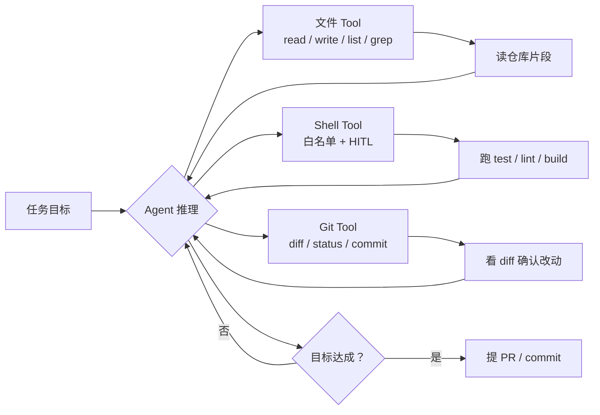

# **产品形态**：文件 Tool + Shell + Git（+ 测试）组成编码循环

> 对应模块：[模块 16 · Coding Agent ⭐⭐⭐⭐⭐](./README.md) · 小节进度第 1 条
> 这一小节由 Coach 按 2026-10-10 本对话 `coach start` 详解首次写入。贯穿场景是 Coding Agent 在仓库里读代码、改代码、跑命令、提提交。学习者只减不加。进度表这一行还没打钩。下一节是精确编辑，本文件只把它当作核心抓手来对照，不把它当新课写完。

- **来源**：本对话 `coach start` 详解。
- **状态**：已沉淀
- **Demo**：无。这一段只检查笔记，不检查代码。从模块 14 起本仓库不再新写模拟演示，见学习总览。

> 各节写什么、达标要求：见仓库根 [AGENTS.md §7.2](../../../AGENTS.md#72-写入小节文档--小节进度对齐)。

## 是什么

**Coding Agent** 是一种让大语言模型（LLM）在仓库（或者沙箱）里**读代码、改代码、跑命令、提提交**的 Agent 形态。Cursor / Claude Code / Codex / Aider / Continue.dev / Tabnine Agentic 都是这一类。它们都共享同一组核心能力块（Capability Block）：

- **文件 Tool**：read / write / list / search（grep）。
- **Shell Tool**：能跑命令——但**有白名单（allow-list，允许的命令列表）或人工确认**。
- **Git Tool**：diff / status / commit，让 Agent 看到自己改了什么，准备提交。
- **测试运行**：Agent 自己跑测试、看是否通过。
- **反馈循环（Feedback Loop）**：上面这一圈要在多轮里自纠——不是「生成 → 提一次交」就完，而是「生成 → 跑测试 → 看错 → 改 → 再跑」。

这五件工具不是缺一不可，但**至少要有前三件**（File + Shell + Git）才算 Coding Agent。少了 Shell，Agent 改完没法验；少了 Git，Agent 改完没法承诺可逆；少了 File，Agent 没办法动手。

后端给的产物不是一段话，**是这一圈工具配合 Agent 推理跑下来的实际改动**。对话上下文（Context Window）里重要的是「Agent 看到什么 + Agent 做了什么」——和模块 15 那一节把「看得到 + 操作」当成一个共同主线是一致的：能看（文件 Tool）、能改（write + patch）、能验（test）、能追（git diff）。



生活里，这是「给一个新人同事开仓库权限」。新人能看到代码、能改、能跑测试、能 commit，但**不能 rm -rf、不能 force push、不能改全局配置**。Coding Agent 是同一个意思：把仓库权限交给模型，模型按规则 + 工具走完一整套读改验提。

## 为什么（Agent 开发要懂）

**Coding Agent 是相对容易「看起来跑通了、其实没跑通」的形态**。模型在对话里说「我已经改完啦」并不等于仓库里真的改完；「我加了测试」不等于测试能跑；「我修复了 issue」不等于 issue 关得上。Agent 开发要懂的恰恰是怎么把这些「不等于」变成「等于」——也就是把反馈循环做扎实。

**编码任务对上下文窗口不友好**。一个几百行的文件对模型来说就是几千个词元（Token）一次性压进去，模型看完后再去改。模型自己重新生成整个文件常常会丢无关代码 / 改坏格式 / 引入新 bug。**精准定位（局部读）+ 精确编辑（patch）** 比「整文件重写」稳。

**Shell Tool 是把双刃剑**：Agent 跑 `rm -rf`、`git push --force`、`apt remove`、改全局配置、下载并执行远程脚本——这些命令对仓库和宿主机都能造成不可恢复的破坏。生产 Coding Agent 不是「把 shell 给模型让它随便跑」，是「给模型一个受白名单限制的、能看见退出码（exit code）和错误流（stderr）的、关键动作要人在环路（Human-in-the-Loop，HITL）的 shell」。

**规则文件 ≠ MCP**。规则文件（AGENTS.md / SKILL.md / .cursorrules）是用**文档约束**告诉 Agent 该怎么干、能干什么、不能干什么。MCP 是给模型**新的工具能力**——把外部服务暴露成可调用的工具。两者一个是「写给模型读的规则」、一个是「写给模型用的工具协议」，分工清楚。混淆就会出现「我写了一份规则文件想给 Agent 加一个新能力」——加错地方。

## 易混点

| 你以为是一回事的两个版本 | 它们实际差在哪 | 用错时会发生什么 |
| --- | --- | --- |
| Coding Agent vs 一般 Chat + 终端助手 | 后者是你手动跑命令，Agent 是模型**自己**决定跑哪些命令；Agent 的跑是有反馈循环的 | 把 Coding Agent 退化成「聊天问、你手动跑」= 退化成传统开发 |
| Coding Agent vs 机器人流程自动化（Robotic Process Automation，RPA）/ 流水线 | 后者是脚本按步骤硬编码；Agent 是每一步由模型决定 | 步骤稳定 → RPA 更便宜；步骤变化 / 要读懂代码 → Coding Agent |
| Cursor vs Claude Code vs Codex vs Aider | IDE 内嵌 vs 终端 vs SaaS 自助 vs 终端伴侣；各家在工具能力 / 上下文注入 / 模型选择上不同 | 把别人家的「推荐做法」搬到另一家架构里工作不灵 |
| 文件 Tool 全读 vs 精准读 | 全读是一次把整个文件塞给模型；精准读是 grep / 行号 / 范围读 | 大文件整段塞 → 上下文窗口爆 + 模型仍然找不到关键片段 |
| 整文件重写 vs patch / unified diff（统一格式的修改片段） | 整文件重写是「再生成一遍」；patch 是「只换需要的那几行」 | 整文件重写 → 无关代码丢失 / 注释变 / 格式变；patch → 改动易 review |
| Shell Tool 裸跑 vs 白名单 + HITL | 前者等于把 root 给模型；后者限定能跑什么 + 关键动作拦下 | 裸跑 → `rm -rf` / force push / 改全局配置一发不可收 |
| 规则文件 vs MCP（Model Context Protocol，模型上下文协议） | 规则文件是「文档约束 Agent 的行为」；MCP 是「给 Agent 接上新工具能力」 | 想加新能力写到 AGENTS.md 里，毫无作用；想禁止某种写到 MCP 里，也加不上 |
| Git Tool 自动提交 vs 自动提 PR（Pull Request，合并请求） | 前者直接落到本地分支；后者还要走 review | 自动提交能用，但要能回滚；自动 PR 要加 CI（持续集成） + review gate（合并前必须有人审核的门槛） |

**短/小巧本身不保证够用**。Coding Agent 单独加了 read 工具但没加 grep，找一个函数定义要反复 open 大文件——慢、贵、上下文窗口爆。

## 例子

### 调试一个老仓库

第一次拿到一个陌生 monorepo（大型单一仓库），几十个目录，几百个文件。Agent 不能盲目 open 全部。

- **读**：grep Tool 按名字找到出现点。
- **改**：定位要改的几行 → patch 那几行，不重写整文件。
- **验**：跑 `pnpm test` 看是否过；失败 → 看 stderr 重写 patch。

这一圈就是反馈循环：grep → read 局部 → patch → test → 看错。

### 加单测

让 Agent 给一个函数加单测。流程：

1. read + grep：找到函数定义和已有的测试文件。
2. write：加 test case（不是整文件重写，是 patch 那一段）。
3. Shell Tool 跑 `vitest run path/to/test.ts`。
4. 退出码（exit code） ≠ 0 或 stderr 报错 → 改 test / 改 source。
5. 全部过 → git diff 看自己改了什么 → commit。

### 修复安全漏洞

依赖升级后，告警（Alert）来了。Agent 不是盲目 `npm install`，而是要：

- grep Tool 找出来哪些文件 import 了有漏洞的版本；
- read 找到所有出现点；
- 替换到新版本或换库；
- 跑 build + test；
- 看 git diff，确认改动范围合理；
- commit + 提 PR（不直接 push）。

### 跨多文件重构

把一个函数从「工具方法」挪到「业务模块」：

- grep 找所有 importer；
- 多文件 patch；
- 每改一处跑一次 build / test，看下游是否还能 import；
- 都过 → 一次性 commit 把改动聚合；
- 提 PR 走 review。

## 需求清单

下面每条都用 Coding Agent 在仓库里的真实场景验收。验收是讲得清。真要做出来，做在单独的真实项目里。本仓库这一节不写模拟页。

1. **业务场景**：第一次拿到一个陌生 monorepo，有几十个目录和几百个文件。**目标**：不盲目 open 整个仓库，找出能改的范围。**涉及**：文件 Tool 的 list / search（grep）。**验收**：Agent 通过 grep 命中目标，而不是用 read 把每个文件都读一遍。

2. **业务场景**：让 Agent 改一个函数（不是整文件重写）。**目标**：精确改一处，不带无关改动。**涉及**：read + 精确 patch / 字符串替换。**验收**：git diff 看到的目标行被改，其余代码不动。

3. **业务场景**：让 Agent 跑测试看是否通过。**目标**：让 Agent 自治验证改动。**涉及**：Shell Tool + 测试运行 + 退出码（exit code）+ stderr（标准错误流）捕获。**验收**：跑测试命令收到非零退出码 = 失败并改；不能自己看着「应该没问题」就提交。

4. **业务场景**：让 Agent 完成一个跨多文件的改动（比如重构 + 单测）。**目标**：能跨文件协调。**涉及**：Git diff / status 看总改动。**验收**：commit 包含预期文件，无遗漏也无意外大块改动。

5. **业务场景**：避免 Agent 干危险命令（`rm -rf` / `git push --force` / 改全局配置）。**目标**：拦下来。**涉及**：Shell 白名单 + HITL。**验收**：危险命令被拦下，需要真人按确认键。

6. **业务场景**：用规则文档约束 Agent 行为（工作目录、禁止事项、怎么改文件）。**目标**：避免把规则写到 MCP 里——规则不在工具层而在文档层。**涉及**：AGENTS.md / SKILL.md / .cursorrules。**验收**：AGENTS.md 写明的禁区 Agent 不进入；规则文件不是新工具能力，不能替代 MCP。

7. **业务场景**：工作区隔离。**目标**：Agent 不能碰工作目录之外的文件。**涉及**：工作目录限制 / 沙箱 / 容器。**验收**：Agent 试图 read / write 仓库外路径被拒。

8. **业务场景**：危险动作（删除、force push、改全局配置、提 PR）需要人在环路。**目标**：真人能在动作前按下确认键。**涉及**：HITL。**验收**：每个危险动作前 Agent 暂停、请求确认；不按就不动。

9. **业务场景**：改动前可回滚。**目标**：改坏能撤。**涉及**：备份或 Git 保护。**验收**：可以回到改之前的状态。

10. **业务场景**：准确对标 Cursor / Claude Code / Codex / Aider 等成熟产品的能力块。**目标**：讲得清各家的核心组合与差异。**涉及**：把外部成熟产品当对照表。**验收**：能说出每家在 IDE / 终端 / 模型 / 工具能力上的关键差异。

## 这几种情况都要分开讲

| 情况 | 数据怎么走 | 需求 |
| --- | --- | --- |
| 产品形态（IDE 内嵌 / 终端 CLI / SaaS 自助 / IDE 伴侣） | 工作流嵌入位置 | 需求 10 |
| 上下文注入（单文件 / 多文件 / 整仓） | 模型能看什么 | 需求 1 |
| 修改方式（整文件重写 / 字符串替换 / unified diff） | 改动稳度 | 需求 2 |
| 反馈循环（一次性 / 评估-改-再评估） | 自纠频率 | 需求 3 |
| Shell 隔离（白名单 / HITL / 容器） | 风险面 | 需求 5、8 |
| Git 整合（commit / patch / 自动 PR） | 提交流程深度 | 需求 4 |
| 规则文件 vs MCP | 约束 vs 工具 | 需求 6 |
| 工作区机制 / 沙箱 | 文件可触范围 | 需求 7 |
| 可回滚 / 备份 | 改坏的兜底 | 需求 9 |
| HITL 拦危险动作 | 人在环路 | 需求 8 |

## 取舍

| 你在意的事 | 更合适的做法 |
| --- | --- |
| 任务只发生在 chat 里、Agent 不直接动代码 | 不需要 Coding Agent；用一般 Chat + 手工执行 |
| 任务在 IDE 里 | 选 IDE 内嵌 / 伴侣型（Cursor / Continue.dev / Copilot 伴侣） |
| 任务在终端 / Linux 远程 / 运维 | 选终端 CLI（Claude Code / Codex / Aider） |
| 改动只动一行 / 局部 | 用 patch / 字符串替换 / unified diff，不重写整文件 |
| 改动跨多文件 / 重构 | 配合 grep + 多次精准 patch + 频繁跑 test |
| 模型上下文容易爆 | 大文件精准 grep + 范围 read；不整段塞 |
| Shell 是必要的 | 用白名单 + HITL + 容器；不要把 root shell 给模型 |
| 需要 review | Agent 只产出 patch / PR，不直接 push |
| 需要规则约束 | 用 AGENTS.md / SKILL.md，**不要**用规则当工具 |
| 需要新能力 | 接 MCP（暴露新工具），不要写到 AGENTS.md 里 |
| 团队多人共用 | 把 AGENTS.md / 规则文件写进仓库，跟代码一起走 Git |

## 踩坑

- **让 Agent 整文件重写**。无关代码丢失、注释变、格式变，review 阶段看出一大堆奇怪 diff。
- **把裸 Shell 给 Agent**。`rm -rf`、force push、改全局配置一发不可收。
- **没有白名单，没有 HITL**。Agent 跑任何命令都过，等于不设防。
- **把规则写到 MCP 里**（或者反过来）。规则和工具是分工——前者约束行为，后者加新能力。
- **Agent 直接 push 到主分支**。没有 review gate，bad commit 立刻上 main。
- **上下文窗口一次塞整个仓库**。大仓库 = 上下文窗口爆 + 模型看不到重点。
- **反馈循环跑一次就提交**。没跑测试 / 没看 stderr / 没比对 diff，等于「我以为改对了」。
- **不写 AGENTS.md**。规则散在对话里、散在 PR 描述里，Agent 每次新开会话都要重新对齐。
- **沙箱 / 工作区机制松**。Agent 误碰仓库外的文件（`/etc`、用户目录、其他项目）一发不可收。
- **危险命令没确认**（删除、force push、改配置）。HITL 是默认，没有例外。
- **改动前没有可回滚方式**。改坏撤不回来。

## 过关自检

对照「本条要能讲清」= **能对标 Cursor / Claude Code / Codex（以及 Aider）的能力块**：

- 能说出 Coding Agent 的核心能力块：文件 Tool（read / write / list / search）+ 受限 Shell + Git + 测试 + 反馈循环。
- 能说出 Shell Tool 的底线是白名单或 HITL，不把 root 给模型。
- 能说出反馈循环的关键：跑测试看退出码、看 stderr、不一次性提交。
- 能说出精准编辑（patch / 字符串替换 / diff）为何优于整文件重写（无关代码 / 注释 / 格式）。
- 能说出 AGENTS.md / 规则文件 ≠ MCP：前者约束行为，后者加新工具能力。
- 能说出 IDE / 终端 / SaaS / 伴侣这几类产品形态在选型上的差异。
- 能说出工作区隔离 + 可回滚 + HITL 这三件防御性的必备项。
- 能对标 Cursor / Claude Code / Codex / Aider 在 IDE / 终端 / 模型 / 工具上的关键差异。

## 还没搞懂的

- 各家 Coding Agent 在「上下文注入」上的具体策略细节（哪些文件默认注入、哪些按需读）。
- Shell Tool 的白名单粒度：哪些命令全允许、哪些命令要参数检查（如 `rm` 看目标是否在白名单目录）。
- 反馈循环的多轮评估怎么定义「多轮多少次上限」——以及超时策略。
- 自动 PR + CI 这层在各家里的集成程度差异。
- AGENTS.md / SKILL.md / .cursorrules 在不同产品里具体支持的优先级。

## 我追问过的

本对话没有知识追问。不编造。

## 契约记录

- 本轮「coach start 直接沉淀文档」是命令触发 + 写入动作，不是认知追问；不进「我追问过的」。
- 上一模块（模块 15 Browser / Computer Agent）三节均已 ✅；01 的 `coach complete` 仍没正式跑过打钩前检查 1 + 2（学习者上一轮自己改的），是否补跑由学习者决定。
- 进度表 16-01 这一行仍是 ⬜。
- 本仓库模块 14 之后这一节不写 `## Demo 子节进度` 块，也不要求 `apps/` 有新代码；可运行演示做在学习者单独的真实项目里。
- 这一轮实际打开过的外部 URL：没有。`## 还没搞懂的` 列的几项（上下文注入策略、白名单粒度、PR + CI 集成度、各家对规则文件优先级）源自对照表，没有逐行打开公开文档。

## Demo 判断

```text
Demo 判断
- 小节：产品形态：文件 Tool + Shell + Git（+ 测试）组成编码循环
- 结论：无
- 理由：这一段只检查笔记，不检查代码。从模块 14 起，可运行的代码放在学习者单独的真实项目里，见学习总览。本条要能讲清的是 Coding Agent 的核心能力块 + 风险点 + Cursor / Claude Code / Codex / Aider 的对标能力，而不是某一段代码。
- 你学完要：笔记写在这一份小节文档里。不新建 apps/ 文件夹。
```
