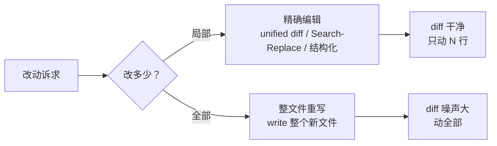

# **精确编辑 vs 整文件重写**：为什么生产里要用 patch / diff

> 对应模块：[模块 16 · Coding Agent ⭐⭐⭐⭐⭐](./README.md) · 小节进度第 2 条
> 这一小节由 Coach 按 2026-10-10 本对话 `coach start` 详解首次写入。贯穿场景是 Coding Agent 在仓库里改文件：精确编辑 vs 整文件重写在生产里的取舍。学习者只减不加。进度表这一行还没打钩。上一节（产品形态）已经沉淀，本节是上一节的「改文件粒度」专门展开。

- **来源**：本对话 `coach start` 详解。
- **状态**：已沉淀
- **Demo**：无。这一段只检查笔记，不检查代码。从模块 14 起本仓库不再新写模拟演示，见学习总览。

> 各节写什么、达标要求：见仓库根 [AGENTS.md §7.2](../../../AGENTS.md#72-写入小节文档--小节进度对齐)。

## 是什么

**精确编辑**是一种粒度到「指定位置 + 改成什么」的工具：Agent 给的是改动本身（哪几行改什么），不是整份新文件。最常见的三种形式：

- **unified diff（统一格式的修改片段）**：带 anchor（锚点）的修改建议，能直接 `git apply`。
- **Search-Replace（在文本中精确匹配并替换）**：一段旧文本配一段新文本，工具按字面匹配。
- **结构化操作（symbol rename / IDE-style）**：按符号 / 类型 / 范围改，例如 TypeScript 的 `Rename Symbol`。

**整文件重写**是另一种粒度：Agent 给的是「整个文件的新内容」，工具用新内容替换旧文件。

关键差别：**精确编辑改 N 行只动 N 行周边；整文件重写改 N 行动全部**。同一段逻辑用前者会得到一个干净的 diff（修改片段），用后者常常会丢无关代码、改注释、换排版、换命名风格——很多地方跟要改的事毫无关系。



生活里，这是「改一份合同」。精确编辑 = 改那一处条款，附件不动、目录不动、落款不动；整文件重写 = 整份合同重新打印一份，目录页码落款全变了。生产 Coding Agent 的稳态是前者。

## 为什么（Agent 开发要懂）

**整文件重写最大的代价不是「错」，是「噪声」**。一个 200 行的文件改 1 行，整文件重写后模型大概率把同样的逻辑换一个略有差别的写法写出来，diff 里就变成 200 行全是改动。要在 review 里区分「真正的改动」和「顺手重排了」，很贵。

**整文件重写的成本和改动量不成正比**。改 1 行逻辑 + 把整文件重写，等于把 200 行重新生成一遍，词元（Token）消耗是 patch 的几十倍。

**上下文窗口的影响**。整文件重写之前，Agent 一般要先 read 整个文件 → 改动 → write 整个文件。两步都对上下文窗口不友好：大文件 read 一次塞几百到几千词元；write 再把整个文件回灌一次。Patch / Search-Replace 只灌「需要改的那段上下文 + 改后」，开销小一个数量级。

**review 的可读性**。一个 patch 长 6 行，reviewer 一眼能看出改了什么；一个整文件重写长 200 行，reviewer 必须先对比旧版才能挑出真实改动。在合并请求（PR）上，**精确 diff 让 review / 回滚 / 冲突解决都更容易**。

**模型自己「重新生成整个文件」常常会顺手换风格**。你命名用 `getUser`，模型重写完可能变成 `fetchUserById`；你用 `try { ... } catch {}`，模型可能改成隐式错误处理；你写 `const`，模型可能变 `let`。这些不是错，但每一条都让 diff 噪声变大、出处难追。

**整文件重写不是不能用**。新建文件、整个格式化推倒、文件 < 100 行、大段重写、用 patch 复杂到不值得写——这些是合法场景。后面「取舍」里讲。

## 易混点

| 你以为是一回事的两个版本 | 它们实际差在哪 | 用错时会发生什么 |
| --- | --- | --- |
| 精确编辑 ≠ 简单字符串 find-and-replace | 简单字符串替换没有结构 anchor（锚点，定位位置的特征文本），前后空白 / 引号风格变一下就匹配不上 | 一个空格变 tab 就替换失败；多个相似行全被改 |
| Search-Replace ≠ unified diff | 前者按字面匹配改；后者带上下文（前后行）做 anchor，可以唯一锚定 | Search-Replace 改重载后的同名方法可能误伤别处 |
| 整文件重写 ≠ 一定错 | 新建文件 / 大段重写 / 文件 < 100 行 时合法 | 一概拒绝整文件重写 = 把模型逼到笨地方 |
| 文件类型对修法选择有影响 | JSON / YAML 缩进敏感；Markdown 列表有序无序；TS 类型不能丢；SQL 关键词大小写 | 不分类型一律 patch，JSON 里少个空格语法报错 |
| 小模型 vs 大模型的整文件重写能力 | 小模型倾向于「重写就行，差不多得了」；大模型相对稳 | 选错模型 + 整文件重写 = 整篇都换风格 |
| patch 对 Git 工作流 | unified diff 能直接 `git apply`，能精准回滚，冲突解决看上下文 | 用整文件重写无法做「精准 revert 这一处」 |
| 精确编辑 ≠ IDE 结构感知 | IDE 的 rename symbol 是按抽象语法树（AST）重命名；Agent 的 patch 多半按字符串 | 重名时同名变量一起被改（IDE 想要这样）；patch 按字面只能改字面那段 |
| 工具支持的边界 | 有的模型只支持整文件 write，不支持 patch | 期待出 patch 但模型只能 write——只能外层包一层做差分处理 |

## 例子

### 改一个函数签名

把 `function getUser(id: string): User` 改成 `function getUser(id: string, opts: GetOpts = {}): User`。

- **整文件重写**：重写整个文件 ≈ 200 行 diff 噪声。
- **精确编辑（Search-Replace / patch）**：改两行，diff 干净。

### 缩进 / 换行

Agent 改了一个函数，本意改两行，但模型重写整文件时换了缩进风格（4 空格 → 2 空格），diff 里看上去几十行变化。

- **整文件重写**：diff 全是空格。
- **精确编辑**：改动小，diff 干净。

### 跨段 patch

Agent 要把一段 import 顺序从「字母序」改成「分组序」。可能涉及 30 行；如果用 Search-Replace，整段替换；如果用 patch，整段重新对齐 + 后面的引用不变。前者稍微多动，后者更细。

### 整文件重写合法场景

`vite.config.ts` 全是配置文件，本来就没几行，整个换掉比 patch 几行还快。这就是整文件重写的合法场景。

### 大段重写

把旧 API 调用改新 API 调用，跨度大、半文件都要改。Patch 这种规模不再「精确」——成本太高。这种情况**整段改或者重写一段，然后跑 build + test 看下游**是合法的；不要硬把大改动拆成几十个小 patch。

### symbol rename vs 字符串替换

把 `getUser` 改成 `fetchUser`。符号重命名按抽象语法树（AST）做，知道所有出现点不会改到字符串字面里、注释里。字符串替换按字面，注释和测试名里的 `getUser` 也会被换，常常换坏。

## 需求清单

下面每条都用 Coding Agent 在仓库里改文件的真实场景验收。验收是讲得清。真要做出来，做在单独的真实项目里。本仓库这一节不写模拟页。

1. **业务场景**：把 `function getUser(id: string): User` 加一个默认参数 `opts: GetOpts = {}`。**目标**：只改那两行，不动别的。**涉及**：Search-Replace / patch + 看 git diff。**验收**：diff 里改动的 ≤ 4 行；其他文件、注释、命名风格不动。

2. **业务场景**：Agent 改一处加新 case，但模型整文件重写时把 4 空格缩进换成 2 空格。**目标**：diff 干净，缩进风格不被换。**涉及**：精确编辑 + lint 工具。**验收**：跑 lint / formatter 不报错；diff 里无关行 unchanged。

3. **业务场景**：YAML 配置改一个 list 顺序。**目标**：缩进保留；list 顺序对。**涉及**：Search-Replace + 跑 YAML parser 验证。**验收**：YAML 解析过、list 顺序如预期、diff 干净。

4. **业务场景**：跨多文件改 API——把旧方法名 `getUser` 在源代码里替换为 `fetchUser`。**目标**：按 AST 重命名，不动字符串字面量 / 测试描述。**涉及**：symbol rename / 结构化操作；review 看 git diff。**验收**：字符串里、注释里、测试名里的 getUser 不变；只有真正调用点变。

5. **业务场景**：改一大段 API 调用（10+ 处出现），从旧 call 改新 call。**目标**：能稳定完成复杂改。**涉及**：判断改动量——是否要拆 patch，是否整段重写。**验收**：build / test 过得去；review 接受。

6. **业务场景**：新建一个 `vite.config.ts`，整段从 0 写。**目标**：整文件 write 是合法选择。**涉及**：判断场景——新建 vs 改动。**验收**：整段创建符合预期；不需要考虑 noise。

7. **业务场景**：验证改动。**目标**：让 review / CI 接受。**涉及**：git diff 限制改动范围 + 跑测试。**验收**：diff 行数 / 范围符合预期；test pass。

8. **业务场景**：按行 revert。**目标**：改坏能精准撤回。**涉及**：unified diff + git 操作。**验收**：revert 这一处只回滚这一改，不动其它。

## 这几种情况都要分开讲

| 情况 | 数据怎么走 | 需求 |
| --- | --- | --- |
| 修法选择（整文件 write / Search-Replace / unified diff / 结构化） | 改动粒度从粗到细 | 需求 1、6 |
| 文件类型（代码 / JSON / YAML / Markdown / SQL） | 缩进 / 引号 / token 边界敏感 | 需求 3 |
| 改动量（单行 / 小段 / 大段 / 全文件） | 决定要不要 patch | 需求 5 |
| 验证方式（语法 / 测试 / diff） | 精确 diff 让验证简单 | 需求 7 |
| 回滚能力（按 diff / 按文件） | 越细越能精准回滚 | 需求 8 |
| 模型能力（小模型 / 大模型 / 长上下文） | 决定能稳定处理哪种粒度 | 需求 2 |
| 符号重命名 vs 字符串替换 | 结构感知 vs 字面替换 | 需求 4 |

## 取舍

| 你在意的事 | 更合适的做法 |
| --- | --- |
| 改动是 1~5 行 | 用 Search-Replace / patch；不要整文件重写 |
| 改动是几十行 / 半文件 | 看：是 patch 改还是写新段。两者都行；完成后跑 build + test |
| 改动是新建文件 / 整段新内容 | 整文件 write 是合法选择 |
| 文件 < 100 行 + 改动过半 | 整文件重写常常更省 token，因为 patch 的开销跟文件大小不成比例 |
| 文件敏感缩进 / 引号（YAML、JSON、SQL） | 优先 Search-Replace 而不是 patch；或先 lint 一次 |
| 改 API 名 / 类型名 / 变量名 | 优先 symbol rename / 结构化操作，不用字符串替换 |
| 模型上下文窗口小 | 优先 patch / Search-Replace，避免整文件 read + write 双向 |
| review 严格 / 改动要易审查 | 改完 `git diff --stat` 看相对大小 + 必要时只贴 diff |
| 仓库用统一 lint / formatter | 让 lint / formatter 跑一遍再提交，避免无关 diff |
| 改坏担心回滚 | 优先 patch，能逐段回滚 |
| 模型只能 write 不能 patch | 在外层自己改文件——用 Search-Replace / 临时工具生成，再交给 write 工具 |

## 踩坑

- **一律整文件重写**。所有改动看上去都像整篇改动。
- **一律用 Search-Replace 改相似多处**。同名函数 / 变量被全部替换。
- **改一处但模型把整篇缩进换了**。Review 看不出哪行真的改了。
- **diff 巨大时被强推 review**。Reviewer 忍了 → 后患无穷。
- **改完没跑过 test / lint**。即使 patch 对了，可能漏改别处。
- **符号重命名当字符串替换用**。字符串里 + 注释里 + 测试名里全被换。
- **JSON / YAML 文件用 patch 改缩进**。编辑器存一次缩进变 tab → patch anchor 错位。
- **大段重写硬拆成几十 patch**。Patch 文档看不出意图，review 难。
- **改了 doc / 注释当「真的改了」**。Markdown / 注释改了也进 diff，要诚实评估。
- **改完没说 git diff**。Reviewer 看不到意图。

## 过关自检

对照「本条要能讲清」= **能说出整文件重写会踩什么坑**：

- 能说出整文件重写的代价与改动量不成正比；噪声远大于真正改动。
- 能说出整文件重写对上下文窗口的双向压力（read + write 双向塞满）。
- 能说出精确编辑的几种形式（unified diff / Search-Replace / 结构化）的各自适用场景。
- 能说出整文件重写合法场景（新建文件 / 文件极小 / 大段重写 / 配置类文件）。
- 能区分 Search-Replace 与 unified diff 在 anchor 上的差别。
- 能说出文件类型对修法选择的影响（YAML / JSON / Markdown / SQL 各有敏感点）。
- 能说出符号重命名（symbol rename）vs 字符串替换在 `getUser → fetchUser` 之类改动上的差别。
- 能说出 review / 回滚 / 冲突解决为什么都偏向精确 diff。

## 还没搞懂的

- 哪些 Coding Agent 模型层具体支持 patch / Search-Replace，哪些只支持整文件 write。
- unified diff 在跨大段改动时的 anchor 稳定性（如何处理嵌套 patch）。
- 整文件重写 + lint / formatter 自动跑一遍后的实际 diff reduction 比例。
- Patch 在跨多文件 + 跨大量改动下的工具支持。
- 一些 IDE 的结构化操作（如 TypeScript 的 Rename Symbol）有没有真的接入到主流 Coding Agent 的工具层。

## 我追问过的

本对话没有知识追问。不编造。

## 契约记录

- 本轮「2」是对上一轮选项 2 的回应（继续按直接沉淀文档推 16-02），不是认知追问，不进「我追问过的」。
- 16-01 已沉淀；15-01 的 `coach complete` 在本会话内（2026-10-10）已由学习者补跑过打钩前检查 1（用词）+ 2（§7.2 知识覆盖）。
- 进度表 16-02 这一行仍是 ⬜。
- 本仓库模块 14 之后这一节不写 `## Demo 子节进度` 块，也不要求 `apps/` 有新代码；可运行演示做在学习者单独的真实项目里。
- 这一轮实际打开过的外部 URL：没有。

## Demo 判断

```text
Demo 判断
- 小节：精确编辑 vs 整文件重写：为什么生产里要用 patch / diff
- 结论：无
- 理由：这一段只检查笔记，不检查代码。从模块 14 起，可运行的代码放在学习者单独的真实项目里，见学习总览。本条要能讲清的是「为什么生产 Coding Agent 偏好精确编辑而不是整文件重写」+ 「不同修法的取舍」，不是某一段代码。
- 你学完要：笔记写在这一份小节文档里。不新建 apps/ 文件夹。
```
