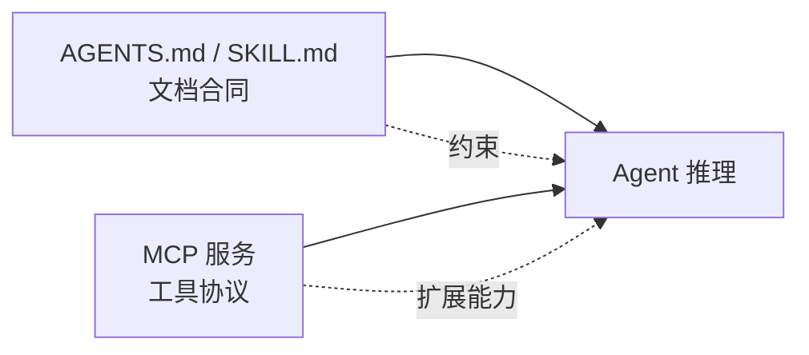

# **AGENTS.md / Skills**：用文档约束 Agent 行为，不是再写一套 MCP

> 对应模块：[模块 16 · Coding Agent ⭐⭐⭐⭐⭐](./README.md) · 小节进度第 3 条
> 这一小节由 Coach 按 2026-10-10 本对话 `coach start` 详解首次写入。贯穿场景是 Coding Agent 在仓库里：规则文件约束行为；MCP 协议提供工具能力。学习者只减不加。进度表这一行还没打钩。上一节（精确编辑）已经沉淀；本节是上一节的「何时用规则 vs 何时用 MCP」专门展开。

- **来源**：本对话 `coach start` 详解。
- **状态**：已沉淀
- **Demo**：无。这一段只检查笔记，不检查代码。从模块 14 起本仓库不再新写模拟演示，见学习总览。

> 各节写什么、达标要求：见仓库根 [AGENTS.md §7.2](../../../AGENTS.md#72-写入小节文档--小节进度对齐)。

## 是什么

**规则文件**（AGENTS.md / SKILL.md / .cursorrules / CONVENTIONS.md）是用**文档**告诉大语言模型（LLM）该怎么干、能干什么、不能干什么。它和模型共享的是同一份对话上下文（Context Window），Agent 启动时按规则被加载进上下文。

**MCP（Model Context Protocol，模型上下文协议）**是一种工具协议：把外部服务暴露成可调用的**工具**（Tool）。模型不是「被告知怎么干」，是「真的多了一件工具可以用」。

**规则文件和 MCP 是分工**：前者写给模型读的规则，后者写给模型用的工具协议。规则文件**不**给 Agent 加新能力；MCP **不**告诉 Agent 该怎么做。前者约束行为；后者扩展能力。



生活里，这是「合同 + 工具柜」的关系。仓库根放合同（AGENTS.md）：里面写禁区、写工作流、写 commit 规范、写文件改法。工具柜放真正的工具：DB 查询 MCP、Jira MCP、内部 API MCP。模型接合同，知道该怎么做；接工具，能做到。

## 为什么（Agent 开发要懂）

**这两个东西常被搞混**。「我需要让 Agent 能做 X，我在 AGENTS.md 里写一段吧。」——加错地方，AGENTS.md 是文档不是工具，模型读完后能做 X 没取决于规则写了没，而取决于有没有 Tool 能调。规则只让模型「知道这么做」，不提供执行。

**反向也错**。「我需要禁止 Agent 做 X，去 MCP 里禁吧。」——也加错地方。MCP 是工具协议，不是规则引擎。禁止某件事不去 MCP 里配，应该写在 AGENTS.md 里**通过对话约束**，或通过 Shell 白名单 + HITL（人在环路，Human-in-the-Loop）做工程隔离。

**两者一起决定 Coding Agent 的「能做 + 不许做」全集**。把 AGENTS.md 想成一份**合同**：里面写明「不许 force push」（禁区）、「commit 信息要 imperative 句」（格式）、「改文件用 patch」（方法）。MCP 想成是**工具柜**：里面只放工具，不放合同条款。

**规则文件 vs 单次 prompt**：prompt（提示词）是会话级、单次开场；规则文件是仓库级、永久跟着代码走。前者换会话就没了；后者在所有同事的所有 Coding Agent 会话里都生效。仓库里放了规则文件，等于把团队对 Agent 的期望**写进 Git**。

**没有规则文件 = 每次开会都要重新对齐**。每次新开会话、每个新人 onboarding 一个 Coding Agent，都要重复说一遍「我们怎么改文件、怎么提 commit、不能 force push」。规则文件把这些变成可读的、可版本控制的内容。

## 易混点

| 你以为是一回事的两个版本 | 它们实际差在哪 | 用错时会发生什么 |
| --- | --- | --- |
| AGENTS.md vs SKILL.md | AGENTS.md 是仓库级 / 全局规则；SKILL.md 是某个具体任务 / 工具的说明书 | 把所有规则都堆 AGENTS.md → 越来越长、读不进去；用 SKILL.md 当全局 → 漏规则 |
| AGENTS.md vs MCP | AGENTS.md 是文档（约束行为）；MCP 是工具协议（扩展能力） | 想加新能力写到 AGENTS.md → 没作用；想禁止做到 MCP → 加不上 |
| AGENTS.md vs prompt | AGENTS.md 是仓库永久规则；prompt 是单次会话开场 | 规则写到 prompt 里 → 换会话就丢；规则写到 AGENTS.md 里 → 跟着仓库走 |
| 规则文件能做的事 vs 不能做的事 | 能禁、能规范格式、给工作目录、给文件改法、给 commit 规范；不能接工具、加新能力 | 想用 AGENTS.md 给 Agent 加 DB 查询能力 → 没用；DB 查询要走 MCP |
| 规则文件加载时机 | 启动时一次加载进上下文 / 触发式（按需读） | 规则全压进上下文 → 上下文窗口爆；按需读 → 每次又得多一步 read |
| 优先级层级 | 系统提示（system prompt，最高） > AGENTS.md（仓库规则） > 用户消息（最低的临时指示） | 不分层的规则 = 用户一句「这次别管 AGENTS.md」直接覆盖禁区 |
| 文件名差异 | AGENTS.md / SKILL.md / .cursorrules / CONVENTIONS.md | 工具不认文件名 = 规则没生效 |
| 规则文件 vs 系统提示 | 系统提示是产品给的（产品名 / 工具说明）；AGENTS.md 是用户加的 | 关键约束进系统提示 = 改不动；要可定制 = 走 AGENTS.md |
| 规则文件 vs 工具描述（Tool Description） | Tool Description 是给模型「这个工具怎么用」的说明书；AGENTS.md 是「这份合同怎么签」 | 把「不许 force push」写到 Tool Description 里 = 模型以为那是工具本身的能力说明 |
| 规则文件里能写 Bash 命令示例 vs 真去跑 | 规则文件是文档；真要白名单要在 shell wrapper / 工具层实现 | 在 AGENTS.md 写「禁止 rm -rf」 = 模型自律；用 shell wrapper 拦截 = 工程级禁止 |

## 例子

### 一份典型的 AGENTS.md

```
# AGENTS.md

## 工作目录
- 工作目录限制：只能触碰本仓库内的文件；不要碰 /etc /usr / 用户主目录。
- 不要修改与本任务无关的目录。

## 修改文件
- 改文件用 patch（unified diff）/ Search-Replace；不要整文件重写。
- 改完跑 `git diff --stat`，确认改动范围符合预期。

## Shell
- 不要 `rm -rf`。
- 不要 `git push --force`。
- 不要 `apt remove` / 改全局配置。
- Shell 命令前先看白名单；不在白名单里要等 HITL 确认。

## Git
- commit 信息用 imperative 句：「Add foo」而不是「Added foo」。
- 提交前必须过 CI / 跑 `pnpm test`。
- 不要 force push 到 main；推 PR 走 review。

## 禁区
- 不要改 .env / 不要读 secret 文件 / 不要写 token 到日志。
```

这一份读起来是「合同」，不是「工具柜」。

### 一份典型的 SKILL.md

```
# SKILL.md · add-unit-test

任务：给一个函数加单元测试。

步骤：
1. grep 找到函数定义。
2. 读现有测试文件，找到同模块的测试文件风格。
3. patch 加 test case（不要整文件重写测试文件）。
4. 跑 `pnpm vitest run path/to/test.ts` 看通过。
5. 失败 → 看 stderr 重写；过 → git diff 看改动范围合理。
6. commit：信息含「Add unit test for X」。
```

这一份是「任务说明书」，告诉 Agent 这件事**应该这么做**。它不是工具、不能用 `add_unit_test` 这种名字调用，它只是文档。

### 跨文件规则

仓库根放 AGENTS.md（全局规则）；模块下放 CONVENTIONS.md（这一模块的约定，如 `tests/` 目录的写法）；某个工具下放 SKILL.md（特定任务）。三层叠加：

```
仓库根
├── AGENTS.md             ← 工作目录、禁区、git、shell 白名单
├── modules/
│   ├── api/
│   │   └── CONVENTIONS.md  ← 这一模块怎么命名路由、怎么写错误处理
│   └── web/
│       └── CONVENTIONS.md  ← 这一模块怎么组织 components / hooks
└── skills/
    └── add-unit-test/
        └── SKILL.md        ← 加单测的工作流
```

Agent 启动时按从远到近 / 从上到下读，按优先级合并。

### AGENTS.md ≠ MCP 的对照

| 你想做 | 走 AGENTS.md | 走 MCP |
| --- | --- | --- |
| 禁止 force push | ✅ 写在禁区里 | ❌ MCP 不管这个 |
| 加新的「查 DB」能力 | ❌ AGENTS.md 不能给工具 | ✅ 接 DB MCP |
| 强制 commit 信息格式 | ✅ 写在约定里 | ❌ MCP 不管 |
| 把内部 API 暴露给 Agent | ❌ AGENTS.md 不能加 HTTP tool | ✅ 写 MCP 服务 |
| 让 Agent 跑单测前先看 CI 状态 | ✅ 写在流程里 | ❌ |
| 让 Agent 调新的 Jira 接口 | ❌ | ✅ 写 Jira MCP |

混淆 = 想加 DB 查询写到 AGENTS.md、想禁 force push 写到 MCP。两件错位的事。

## 需求清单

下面每条都用 Coding Agent 在仓库里的真实场景验收。验收是讲得清。真要做出来，做在单独的真实项目里。本仓库这一节不写模拟页。

1. **业务场景**：仓库要禁止 Agent 跑 `rm -rf` / `git push --force` / 改全局配置。**目标**：拦下来。**涉及**：AGENTS.md 写禁区 + Shell wrapper 工程级拦截。**验收**：危险命令 100% 被拦；AGENTS.md 是文档防线，wrapper 是工程防线，两层都要有。

2. **业务场景**：要求 Agent 改文件用 patch，不要整文件重写。**目标**：diff 干净。**涉及**：AGENTS.md 写「怎么改文件」+ 看 git diff 验证。**验收**：Agent 改完跑 `git diff --stat`，改动范围符合预期。

3. **业务场景**：commit 信息规范。**目标**：commit history 干净。**涉及**：AGENTS.md 写 commit 规范 + Git hook 校验。**验收**：commit message 用 imperative 句；不合格被 hook 拦下。

4. **业务场景**：Shell 命令白名单。**目标**：白名单外命令不能跑。**涉及**：AGENTS.md 写白名单 + Shell wrapper 强制执行 + HITL。**验收**：白名单内过；白名单外拦下；危险命令走 HITL。

5. **业务场景**：工作目录限制。**目标**：Agent 不能碰工作目录之外的文件。**涉及**：AGENTS.md 写明 + shell wrapper 沙箱。**验收**：`read` / `write` 仓库外路径 = 拒。

6. **业务场景**：模块级约定。**目标**：每个模块有自己的写法约定。**涉及**：仓库根 AGENTS.md + 子目录 CONVENTIONS.md。**验收**：在模块内写代码时，CONVENTIONS.md 规则生效；同一规则跨模块不冲突。

7. **业务场景**：加单测的标准工作流。**目标**：每个加单测任务按同一步骤走。**涉及**：SKILL.md 写流程。**验收**：Agent 加单测时按 SKILL.md 六步走，结果稳定。

8. **业务场景**：加新工具能力（数据库（DB）查询、内部应用程序编程接口（API））。**目标**：给 Agent 接上新工具。**涉及**：MCP 协议，不是 AGENTS.md。**验收**：Agent 通过 MCP 调 DB / API，AGENTS.md 只描述用、不实现。

9. **业务场景**：多层规则叠加生效。**目标**：仓库级 + 子目录级 + 任务级 三层都生效。**涉及**：AGENTS.md + CONVENTIONS.md + SKILL.md。**验收**：在仓库任何子目录读起，都能读到正确的规则叠加。

10. **业务场景**：用户的临时指示不能覆盖禁区。**目标**：用户说「这次别管 AGENTS.md」不生效。**涉及**：明确优先级：system > 仓库 > 用户。**验收**：用户消息想覆盖禁区时被系统挡住。

## 这几种情况都要分开讲

| 情况 | 数据怎么走 | 需求 |
| --- | --- | --- |
| 文件名差异（AGENTS.md / SKILL.md / .cursorrules） | 各家产品支持 | 全部 |
| 范围（仓库级 / 子目录 / 任务级） | 三层叠加 | 需求 6、9 |
| 加载时机 | 启动 vs 触发 | 全部 |
| 优先级（system > 仓库 > 用户） | 哪条胜出 | 需求 10 |
| 内容形态（禁区 / 工作流 / 改法 / commit） | 写进 AGENTS.md 的不同内容 | 需求 1、2、3、7 |
| AGENTS.md vs MCP | 文档 vs 工具 | 需求 8 |
| 工程级 vs 自律级 | 文字约束 vs 强制 | 需求 1、4、5 |

## 取舍

| 你在意的事 | 更合适的做法 |
| --- | --- |
| 任务只发生在 chat 里、Agent 不直接动代码 | 不需要规则文件；用 prompt 即可 |
| 团队多人共用 Coding Agent | 把 AGENTS.md 写进仓库，跟代码走 Git |
| 单个新人快速 onboarding | 用 AGENTS.md 写「不要做的事」清单 + 「先做的事」流程 |
| 任务多 + 每个有专属工作流 | 给每个任务写一份 SKILL.md |
| 模块之间风格差异大 | 子目录 CONVENTIONS.md + 仓库根 AGENTS.md |
| 风险动作需要二次确认 | AGENTS.md 写禁区 + Shell wrapper 工程拦截 + HITL 三层 |
| 想给 Agent 加新能力 | 接 MCP，不写到 AGENTS.md |
| 想禁止 Agent 做某事 | 写到 AGENTS.md（文档）+ wrapper（工程）+ 关键动作 HITL |
| 规则越来越长 | 分层：AGENTS.md 总体 + 模块 CONVENTIONS.md + 任务 SKILL.md |
| 上下文窗口紧 | 关键规则进 AGENTS.md（启动加载）；长篇文档按需触发 |
| 与 prompt 容易混淆 | 把「仓库永久约定」放 AGENTS.md；「这次具体要做的事」放 prompt |

## 踩坑

- **把规则当工具用**。要加新数据库查询写在 AGENTS.md 里，毫无作用；数据库查询要走 MCP。
- **把工具当规则用**。禁止 force push 写到 MCP 里，加不上；走 AGENTS.md + Shell wrapper。
- **规则写到 prompt 里**。每次新开会话规则就丢。
- **规则文件没进仓库**。改了规则不上 Git = 同事的 Agent 看不见。
- **规则全堆 AGENTS.md**。越来越长，模型读不完；用 CONVENTIONS.md / SKILL.md 分层。
- **规则没工程级兜底**。只靠模型自律；关键一定要 Shell wrapper / 沙箱。
- **文件名写错**。工具不认 = 规则没生效。
- **不分优先级**。用户一句「这次别管 AGENTS.md」就覆盖禁区。
- **把 Skill 当 MCP 用**。Skill 是文档；MCP 是工具协议。
- **禁区写在工具描述（Tool Description）里**。模型以为那是工具的能力说明，不是规则。
- **规则改了没改 shell wrapper**。AGENTS.md 改了，但 wrapper 还是老配置，规则与执行脱节。
- **工具名 / 文件名风格不统一**。各产品用不同文件名（AGENTS.md / SKILL.md / .cursorrules / CONVENTIONS.md），写错等于没写。

## 过关自检

对照「本条要能讲清」= **知道「规则文件」和「工具协议」的分工**：

- 能说出 AGENTS.md / SKILL.md / .cursorrules 这一类**规则文件**是用文档约束行为。
- 能说出 MCP 是**工具协议**，给 Agent 接上新工具能力。
- 能说出规则文件**不能**给 Agent 加新能力——加新能力要走 MCP。
- 能说出 MCP **不能**禁止 Agent 行为——禁止要走 AGENTS.md + 工程级 wrapper。
- 能说出 AGENTS.md（仓库永久）+ SKILL.md（任务说明）+ CONVENTIONS.md（子模块）三层叠加的分工。
- 能说出规则文件与 prompt 的差别：前者跟着仓库走，后者跟着会话走。
- 能说出规则 ≠ prompt ≠ MCP：三种"约束 Agent 的工具"各管一层。
- 能说出工程级兜底（Shell wrapper / 沙箱）必要——文字约束模型偶尔违反，工程拦截不可越界。

## 还没搞懂的

- 不同 Coding Agent（Cursor / Claude Code / Codex / Aider）对规则文件的支持细节（文件名 / 加载时机 / 优先级处理）。
- AGENTS.md / SKILL.md 的当前流行的标准（是否某一方在主导事实标准）。
- 多层规则（仓库级 + 子目录级 + 任务级）的合并策略——各家长得不一样。
- MCP 与规则文件交叉时的「禁止 + 加能力」组合边界（白名单 + 沙箱 vs 新工具）。
- 规则文件对大型 monorepo 的拆法（每个子模块一份 vs 总仓库一份）。

## 我追问过的

本对话没有知识追问。不编造。

## 契约记录

- 本轮「2」是对上一轮选项 2 的回应（继续按直接沉淀文档推 16-03），不是认知追问，不进「我追问过的」。
- 16-01、16-02 已沉淀；15-01 的 `coach complete` 在本会话内（2026-10-10）已由学习者补跑过打钩前检查 1（用词）+ 2（§7.2 知识覆盖）。
- 进度表 16-03 这一行仍是 ⬜。
- 本仓库模块 14 之后这一节不写 `## Demo 子节进度` 块，也不要求 `apps/` 有新代码；可运行演示做在学习者单独的真实项目里。
- 这一轮实际打开过的外部 URL：没有。

## Demo 判断

```text
Demo 判断
- 小节：AGENTS.md / Skills：用文档约束 Agent 行为，不是再写一套 MCP
- 结论：无
- 理由：这一段只检查笔记，不检查代码。从模块 14 起，可运行的代码放在学习者单独的真实项目里，见学习总览。本条要能讲清的是「规则文件 vs MCP 的分工 + 三层叠加（AGENTS.md / SKILL.md / CONVENTIONS.md）」，不是某一段代码。
- 你学完要：笔记写在这一份小节文档里。不新建 apps/ 文件夹。
```
