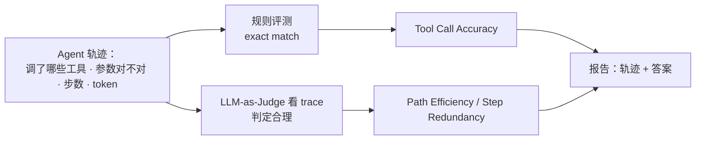

# **轨迹评测**：工具调对了没有、步骤是否跑偏，不只看最终答案

> 对应模块：[模块 17 · Agent Evaluation ⭐⭐⭐⭐⭐](./README.md) · 小节进度第 2 条
> 这一小节由 Coach 按 2026-10-10 本对话 `coach start` 详解首次写入。贯穿场景是 Agent 评测——除了 17-01 的答案评测外，还要看执行路径。**上一节（17-01 LLM-as-Judge）已沉淀，本节是其「看过程」的延伸**。学习者只减不加。进度表这一行还没打钩。

- **来源**：本对话 `coach start` 详解。
- **状态**：已沉淀
- **Demo**：无。这一段只检查笔记，不检查代码。从模块 14 起本仓库不再新写模拟演示，见学习总览。

> 各节写什么、达标要求：见仓库根 [AGENTS.md §7.2](../../../AGENTS.md#72-写入小节文档--小节进度对齐)。

## 是什么

**轨迹评测（Trajectory Evaluation）** = 对 Agent 的整个执行路径做评测，不只是最终答案。

一条轨迹包含：

- Agent 决定调哪些**工具**（Tool Choice）。
- 调工具时填的**参数**（Tool Argument）。
- 调完之后**观察**返回、决定下一步、再调下一次工具。
- 一条对话里**走了多少步**（Step Count）。
- **重复 / 死循环检测**——同一调用循环重复出现。
- 每一步的 token 消耗 / 时延。

评测轨迹就是把这些维度转成数字：tool call accuracy、step count 分布、loop 检测命中、参数准确率、token 总成本。**和 17-01 的答案评测互补**——一个看「对没对」，一个看「怎么对的」。



生活里，这是「看交警的执法记录仪」。只看结果（开了多少罚单），看的是「效率」；看过程（怎么开的罚单、有没有误判、有没有多绕路），才能看到「执法质量」。Agent 的轨迹评测是同样的逻辑——最终答案 = 结果，trace（执行轨迹）= 过程。

## 为什么（Agent 开发要懂）

**同样的最终答案，可以走完全不同的路径**。一条直：用户问 → 查工具 → 得出答案。一次调对，3 步结束。另一条绕：用户问 → 猜一个工具 → 错了 → 再换 → 又错 → 猜出对的。10 步才到答案，而且路径里有冗余、可能产生副作用。**只看答案正确率 = 错失「执行质量问题」**。

**改 prompt 让答案对了，trajectory 可能变差**。改完答案对了 100%，但调了 5 次无关工具（`search_news` 调了 4 次都没命中）。**答案对了、过程变贵**——这是答案评测看不到的。

**轨迹评测是 LLM-as-Judge 的补充**。LLM-as-Judge 看答案（17-01），轨迹评测看过程。两者一起跑：答案对、过程顺 = 真好；答案对、过程绕 = 路径有问题；答案错、过程绕 = 双差。

**对生产 Agent 来说，过程问题常常比答案问题更严重**。一条绕路的 Agent 多花 token、多花时间、可能调了不该调的副作用工具（搜索、写邮件）。**评测 Agent 不能只看对没对，要看怎么对的**。

## 易混点

| 你以为是一回事的两个版本 | 它们实际差在哪 | 用错时会发生什么 |
| --- | --- | --- |
| 轨迹评测 ≠ 答案评测 | 前者看过程，后者看结果 | 只评答案 = 错失执行质量问题 |
| 轨迹评测 ≠ LLM-as-Judge | 前者看 trace 整体；后者通常评最终输出 | LLM-as-Judge 适合评答案；轨迹评测需要 trace 工具 |
| Tool call accuracy ≠ 答案准确率 | 前者看工具是否被该调；后者看最终输出对不对 | 答案对但工具调错 = 看似好的轨迹 |
| Step count 越少 ≠ 越好 | 简单任务步数少是好事；复杂任务步数少可能跳过关键验证 | 用 step count 一刀切 = 鼓励跳步 |
| 不同任务「该调的工具」不同 | 客服任务需要查订单 + 写回复；改 bug 任务需要 grep + patch | 模板化的 tool 列表 = 不通 |
| 离线轨迹评测 vs 在线 trace 采样 | 前者跑历史数据集；后者上线后采样真实流量 | 只跑离线 = 不反映真实用户行为 |
| Tool Argument 准确性 vs Tool Choice 准确性 | 前者看参数填对没有；后者看调没调 | 调对了工具但参数填错 = 半对 |
| 重复 / 循环 vs 多步 | 同样调 N 次工具，重复 = bug；多步 = 设计 | 不检循环 = 漏掉死循环 |
| 轨迹评测的金标准（Gold Trajectory） | 标准做法是先有人标一份 gold trajectory | 没 gold = 只能用 LLM-as-Judge 看 trace |
| Path Efficiency vs 答案正确 | 路径直 ≠ 答案对 | 一味追路径直 → 答案错 |
| Token 总成本 vs 单步 token | 看总成本才能判断 Agent 是不是「绕」 | 看单步 = 看不到累计 |

## 例子

### Tool Call Accuracy：调对了没有

跑数据集，每条看 Agent 是否调了该调的工具。客服任务里，用户问订单状态 → Agent 应该调 `get_order`；如果 Agent 调 `search` 而不是 `get_order`，tool call accuracy 扣分。**参数也对才 pass**——`get_order(order_id=user_input)` 才对，`get_order(order_id=raw_user_text_garbage)` 是错的。

### Step Count 分布

跑 100 条客服数据，画 step count 分布。50% 在 3 步内，30% 在 5~8 步，20% 超过 10 步。**那 20% 是要看的**——多调了什么？是用户问题复杂（合理），还是 Agent 绕路了（不合理）？

### Path Efficiency：直接 vs 绕

Agent 想回答问题 A。直接路径：调 `get_order` → 拿到 → 答复。绕路：调 `search("订单")` → 没用 → 调 `list_orders` → 再调 `get_order` → 拿到 → 答复。绕路多花 2 次工具调用、多花 token。

### 重复 / 死循环

Agent 决定查天气，调 `get_weather`，返回错误，再调一次 `get_weather`，又错，再调……轨迹里同一调用重复 ≥3 次 = 死循环。**轨迹评测要检测这个**——少做这一步，Agent 跑 5 分钟后才被发现死循环。

### Tool Selection 是否合理

任务只需要查订单状态，但 Agent 调了 `search` + `summarize` + `translate`。**工具过度选择**。每多调一次就多一次延迟和 token。轨迹评测能把这种问题量化。

### Token 总成本

跑 50 条数据，看每条 token 总成本。某次升级 prompt 让 accuracy 涨 2%，但 token 平均涨 30%——升级不划算。**总成本指标**告诉你这件事。

## 需求清单

下面每条都用评测流水线在仓库里的真实场景验收。验收是讲得清。真要做出来，做在单独的真实项目里。本仓库这一节不写模拟页。

1. **业务场景**：客服任务里用户问订单状态，Agent 是否调对了 `get_order`。**目标**：tool choice 准确。**涉及**：tool name exact match。**验收**：调对该调的工具比例 ≥ 95%。

2. **业务场景**：Agent 调对了工具，但参数填错。**目标**：tool argument 准确。**涉及**：参数解析 + 与输入比。**验收**：参数正确率 ≥ 95%。

3. **业务场景**：Step count 太多。**目标**：step efficiency 高。**涉及**：步数分布检测。**验收**：简单任务 ≤5 步；复杂任务 ≤10 步。

4. **业务场景**：死循环。**目标**：检测重复调用。**涉及**：loop detection，同一调用重复 ≥3 次记分。**验收**：跑 100 条数据无 loop。

5. **业务场景**：Tool 过度选择。**目标**：不该调的没调。**涉及**：与 gold trajectory 对比。**验收**：多工具调用 < 10% 的简单任务。

6. **业务场景**：Token 总成本。**目标**：防止「升级 prompt → token 飞涨」。**涉及**：token 总成本 + 平均。**验收**：token 平均涨幅 < 10% / accuracy 涨幅；超阈报警。

7. **业务场景**：gold trajectory 比对。**目标**：有 ground truth 时直接规则比。**涉及**：模板匹配 + 差异列表。**验收**：trace 和 gold trajectory 的工具序列相似度有报告。

8. **业务场景**：trace 缺失 / 无法评测。**目标**：知道什么时候评测没意义。**涉及**：trace capture 自查。**验收**：跑数据集前 trace 已采集；缺失报警。

## 这几种情况都要分开讲

| 情况 | 数据怎么走 | 需求 |
| --- | --- | --- |
| 评估对象维度（tool choice / argument / step count / loop / token） | 不同维度互补 | 需求 1-4 |
| 评估方式（exact match / 模板 / Judge） | 任务复杂度决定选哪个 | 需求 1、2、7 |
| 轨迹来源（runtime / Langfuse / LangSmith） | 看你有没有可观测工具 | 需求 8 |
| Ground truth（模板 / 静态 / 无 gold） | 有 gold 时规则最稳；没 gold 时只能用 Judge | 需求 7 |
| 离线 vs 在线（历史数据集 / 上线后采样） | 离线稳定；在线接近真实 | 需求 1-7 |
| 轨迹类型（单轮 / 多轮 / 单 Agent / 多 Agent） | 评测难度不同 | 需求 3 |

## 取舍

| 你在意的事 | 更合适的做法 |
| --- | --- |
| 任务固定（客服 / FAQ） | 模板 gold trajectory + 规则匹配 |
| 任务灵活（开放问答） | LLM-as-Judge 看 trace + rubric |
| 工具类型多 | 多维度 tool accuracy（每个工具一档） |
| 时间预算紧 | step count + token 总成本双指标 |
| 调试路径偏差 | 看单条 trace 的可视化（Langfuse / LangSmith） |
| 上线后稳定性 | 在线 trace 采样 + 实时 dashboard（可视化仪表板） |
| Agent 改了 prompt | 同数据集 before / after 对照 trajectory 差异 |
| 多 Agent 协作 | 每 Agent 各自 trace + 全局 trace |
| Loop / 死循环 | 专项检测（不能漏） |
| Token 预算紧 | token 总成本 + 平均 / 中位数 + 95 分位 |
| 需要知道「为何变差」 | 看 trace diff 而不只是分数 |

## 踩坑

- **只看答案正确率**。执行质量问题被掩盖。
- **轨迹没 gold = 用 Judge 评分**。Judge 看 trace 也是有偏差的。
- **Step count 越少越好**。复杂任务跳步反而错。
- **token 总成本不报**。升级 prompt 让 token 涨 5 倍没人发现。
- **loop 检测没做**。死循环跑 5 分钟才发现。
- **trace 采集不完整**。某次工具调用没采到 → 评测漏。
- **参数准确率和工具选择准确率压一起报**。看不到具体哪种错。
- **gold trajectory 写得太死**。模型不能有任何偏差。
- **trace viewer 没接到 CI（持续集成，Continuous Integration）**。本地能看，CI 跑没人看。
- **多 Agent trace 混一起看**。分不清哪个 Agent 出错。
- **judge 评 trace 与 judge 评答案用同一份 rubric（评分标准文档）**。任务不同，rubric 也不同。
- **用同一份 Judge 评自己家族 Agent**。self-preference。

## 过关自检

对照「本条要能讲清」= **能说出至少 2 个过程指标**：

- 能说出轨迹评测看的是执行路径（tool choice / tool argument / step count / loop / token），不只是答案。
- 能区分轨迹评测 vs 答案评测（17-01）。
- 能说至少有 2 个过程指标：tool call accuracy、step count、loop detection、参数准确率、token 总成本——选两个能讲清怎么算。
- 能区分轨迹评测与 LLM-as-Judge——Judge 通常评答案；轨迹评测需要 trace 工具。
- 能说出「同答案不同路径」的危害：答案对、过程绕 → token 涨 / 多副作用。
- 能说出 loop / 死循环是专项检测（不能漏）。
- 能说出多 Agent / 单 Agent 在 trace 上的差异。
- 能说出 judge 看 trace 时同样要校对（与 17-01 同偏差）。

## 还没搞懂的

- 各家 trace viewer（Langfuse / LangSmith / OpenLLMetry / Helicone）的具体能力对比。
- Path alignment（轨迹对齐）算法：怎么定量比较两条轨迹的相似度。
- 长链轨迹（10+ 步）评测的稳定性。
- 多 Agent 协作 trace 的分段评测协议。
- Online / shadow eval（影子模式评测，把新版本和线上版本并行跑但不影响真实流量）的具体接入路径。

## 我追问过的

本对话没有知识追问。不编造。

## 契约记录

- 本轮「1」是对上一轮选项 1 的回应（继续推 17-02），不是认知追问，不进「我追问过的」。
- 17-01 / 17-02 已沉淀；15-01 的 coach complete 已补跑过（这一会话内）。
- 进度表 17-02 这一行仍是 ⬜。
- 本仓库模块 14 之后这一节不写 `## Demo 子节进度` 块，也不要求 `apps/` 有新代码；可运行演示做在学习者单独的真实项目里。
- 这一轮实际打开过的外部 URL：没有。

## Demo 判断

```text
Demo 判断
- 小节：轨迹评测：工具调对了没有、步骤是否跑偏，不只看最终答案
- 结论：无
- 理由：这一段只检查笔记，不检查代码。从模块 14 起，可运行的代码放在学习者单独的真实项目里，见学习总览。本条要能讲清的是「Agent 看过程不只看结果 + 多个过程指标 + 怎么算」，而不是某一段代码。
- 你学完要：笔记写在这一份小节文档里。不新建 apps/ 文件夹。
```
