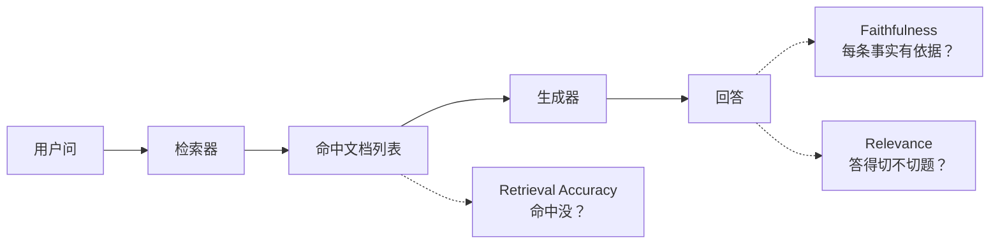

# **Faithfulness / Relevance / Retrieval Accuracy**：检索对了吗、回答是否只基于检索材料、答是否切题

> 对应模块：[模块 17 · Agent Evaluation ⭐⭐⭐⭐⭐](./README.md) · 小节进度第 3 条
> 这一小节由 Coach 按 2026-10-10 本对话 `coach start` 详解首次写入。贯穿场景是 RAG / 检索增强流水线的三段评测——17-01（答案评测）+ 17-02（轨迹评测）+ 17-03（三段评测）一起把「好不好」拆开看。**前两节（17-01、17-02）已沉淀，本节是其「检索 + 答案阶段评测」的延伸**。学习者只减不加。进度表这一行还没打钩。

- **来源**：本对话 `coach start` 详解。
- **状态**：已沉淀
- **Demo**：无。这一段只检查笔记，不检查代码。从模块 14 起本仓库不再新写模拟演示，见学习总览。

> 各节写什么、达标要求：见仓库根 [AGENTS.md §7.2](../../../AGENTS.md#72-写入小节文档--小节进度对齐)。

## 是什么

检索增强生成（RAG / Retrieval-Augmented Generation）流水线有三个关键阶段，每段都有对应的评测指标。这一节把三件分开讲清楚：

| 指标 | 它评什么 | 评哪一段 |
| --- | --- | --- |
| **Retrieval Accuracy** | 检索阶段——检索命中的文档里有没有 gold 文档 | 检索器 |
| **Faithfulness** | 生成阶段——回答里的事实是不是只来自检索材料 | 生成器 |
| **Relevance** | 答案阶段——回答有没有切题（解决用户的问题） | 生成器 + 整体 |

三项一起看才看清整条 pipeline。**只报单一指标 = 看不清到底哪里坏**。

### 各项定义

- **Retrieval Accuracy** = 检索结果里有没有**命中** gold 文档。常用 hit-rate / recall@k / MRR（Mean Reciprocal Rank，平均倒数排名）/ NDCG（Normalized Discounted Cumulative Gain，归一化折损累积增益）。
- **Faithfulness（忠实度 / 抗幻觉）** = 回答里出现的每一条事实，**能不能在检索材料里找到**。找不到就是模型「编造」——把外部信息塞进答案。
- **Relevance（相关性 / 切题度）** = 回答有没有解决用户问的问题。即使检索里命中、回答里没编造，回答也可能答非所问（用词不对、对的问题不对）。



生活里，这是「做菜 + 摆盘 + 上桌」。Retrieval Accuracy = 食材有没有买对（生抽买成了老抽？）。Faithfulness = 菜里每样食材是不是真出现（有「盐味」但没放盐 = 偷工）。Relevance = 端上桌的菜是不是用户点的那道（点了红烧肉，端上糖醋里脊）。

## 为什么（Agent 开发要懂）

**RAG / Agent 用检索的常见三类问题正好对应这三项**：

- 检索召回差 → 用户问 A，搜出来全是 B、C → Relevance 经常也差
- 回答编造 → 模型基于检索材料 + 「我不知道」的常识瞎说 → Faithfulness 低
- 答非所问 → 检索对了、没编造，但生成器用错材料 → Relevance 差

**不区分这三项，就分不清到底哪里坏**。如果你只看「回答正确率」一个分数，可能：

- 检索召回差，导致回答错（**你以为是生成问题，其实是检索问题**）。
- 编造度高，导致回答错（**你以为是检索问题，其实是生成问题**）。
- 答非所问，导致扣分（**你以为是答得不对，其实是切题度问题**）。

**RAGAS（Retrieval-Augmented Generation Assessment）和大多数评测博客默认三件套就是这三项**。三项跑出来才看到完整画面。

## 易混点

| 你以为是一回事的两个版本 | 它们实际差在哪 | 用错时会发生什么 |
| --- | --- | --- |
| Faithfulness ≠ Hallucination（幻觉） | 前者衡量「答的事实有没有依据」（正面）；后者是「编造」 | 用 Faithfulness 高分假设 = 仍可能有幻觉 |
| Relevance ≠ Answer Correctness | 前者问「答得切题吗」；后者问「答案字面对不对」 | 字面对但答偏 = correctness 高 / relevance 低 |
| Retrieval Accuracy ≠ Retrieval Recall | Accuracy 看「对了的占总数比」；Recall 看「gold 占检索数比」 | 分类场景里 Accuracy 看起来高但 Recall 漏召 |
| Retrieval hit-rate ≠ top-k recall | hit-rate = 「top-1 命中就行」；recall@k = 「前 k 个里命中」 | 任务需 top-5 时用 hit-rate 评 = 偏松 |
| Faithfulness 不是「事实对不对」 | 它是「是否**基于检索**」，不一定对 | gold 检索材料本身就错 → Faithfulness 高但答案错 |
| Relevance 不是「字数」 | 长答 ≠ 切题 | judge 用长度偏好评切题 → 偏 noise |
| Retrieval Accuracy vs Ranking Quality | 前者看有没有；后者看排得对不对 | 用 hit-rate 评排序 = 看不到排序差 |
| 三项指标 ≠ 一项综合分 | 各评不同阶段 | 算一个总分 = 看不见哪一段差 |
| Faithfulness vs Context Precision | 前者看「用了检索材料吗」；后者看「用得准不准」 | 上下文都给，但只用一半 = Faithfulness 高但 Context Precision 低 |
| RAG 召回 vs Embedding 质量 | 前者是评测；后者是检索器组件 | 把 embedding 单独评测当 RAG 评测 = 漏掉端到端效果 |

## 例子

### Retrieval Accuracy

跑 50 条客服 query，gold 文档是「订单中心faq-v2.pdf」。检索 top-5 命中 gold 的条数 / 总条数 = retrieval accuracy。命中率 0.78 = 11 条检索没召回。**不召回的 11 条靠生成器补不出来**。

### Faithfulness 检测编造

问：「订单 12345 什么时候发的？」检索材料：订单已发货 2026-10-08。回答：「订单 12345 在 2026-10-08 由顺丰发出，已到达上海中转站」。

Faithfulness 检测：「由顺丰发出」「到达上海中转站」这两件事**检索材料没有**，模型编造了。**Faithfulness 低**——但答案里「事实 2026-10-08 发货」是对的。

### Relevance 检测切题

问：「我能不能取消这笔订单？」检索材料：取消订单条件（30 天内，未发货）。回答：「订单已发货，发货时间为……」。

答案「事实对」——确实已发货。但用户问的是「能不能取消」，回答**没答这个问题**。Relevance 低——字面对但答偏。

### 三项一起跑的报告

| 数据集 | Retrieval Accuracy | Faithfulness | Relevance |
| --- | --- | --- | --- |
| 客服 FAQ | 0.92 | 0.85 | 0.79 |
| 内部文档 | 0.78 | 0.91 | 0.83 |

**两种诊断方向**：

- 客服 FAQ 看 Relevance 最低——问题可能在生成（生成没切题）。
- 内部文档看 Retrieval Accuracy 最低——问题在检索（召回不够）。

**对策不一样**：客服 FAQ 改生成 prompt；内部文档改检索器 / 加数据。

### Faithfulness 检测中的边界

检索材料写「订单由顺丰寄出」，回答写「由顺丰寄出」。Faithfulness 高。**但**回答还补了一句「预计今天到」，检索材料没写 → 扣分。

### 多跳检索

问：「工程师 A 负责的项目用了哪些数据库？」需要 2~3 跳检索：先找 A 的项目，再查项目文档里的数据库。**单一 top-1 召回不够**，要 top-5 / top-10 才能凑齐。Retrieval Recall@k、Faithfulness、Relevance 三项都受影响。

## 需求清单

下面每条都用检索流水线在仓库里的真实场景验收。验收是讲得清。真要做出来，做在单独的真实项目里。本仓库这一节不写模拟页。

1. **业务场景**：客服 FAQ 检索阶段。**目标**：retrieval accuracy。**涉及**：hit-rate / recall@k。**验收**：跑 50 条 query，命中率 / 召回率 ≥ 0.85。

2. **业务场景**：检索召回好，但回答里有「编造」。**目标**：faithfulness 检测。**涉及**：RAGAS Faithfulness / LLM-as-Judge 评每条事实依据。**验收**：Faithfulness ≥ 0.90；偏差项有具体标注。

3. **业务场景**：检索好、不编造，但答非所问。**目标**：relevance 检测。**涉及**：LLM-as-Judge 评切题 + rubric。**验收**：Relevance ≥ 0.85；与人工 100 条抽检一致。

4. **业务场景**：诊断「到底哪一段坏了」。**目标**：三项一起跑。**涉及**：流水线集成。**验收**：报告里有 retrieval / faithfulness / relevance 三段独立数。

5. **业务场景**：gold set 太小。**目标**：用程序 / LLM 扩 gold。**涉及**：同义复述 + 多 gold 命中。**验收**：每条至少 1 个 gold 文档；N ≥ 50。

6. **业务场景**：升级检索器前要看 Faithfulness 有没有变化。**目标**：before / after 对比。**涉及**：同数据集回归。**验收**：report 里有 delta。

7. **业务场景**：多跳问题。**目标**：评估多跳检索。**涉及**：recall@k 取较大 k。**验收**：multi-hop 子集 ≥ 100 条，独立跑出三项。

8. **业务场景**：跨语种。**目标**：跨语种 Faithfulness。**涉及**：多语种 gold + multilingual judge。**验收**：每语种三项独立报告。

## 这几种情况都要分开讲

| 情况 | 数据怎么走 | 需求 |
| --- | --- | --- |
| 检索阶段（hit-rate / Recall@k / MRR / NDCG） | 召回 vs 排序 | 需求 1 |
| 生成 Faithfulness 算法（RAGAS / Anchored / TruLens） | 不同算法 | 需求 2 |
| 答案 Relevance 算法（RAGAS Answer Relevance / Judge） | 不同 judge | 需求 3 |
| 多跳 / 多模态 | top-k + 多 gold | 需求 7、8 |
| 三项一起 | 流水线独立报告 | 需求 4 |
| Gold set 太小 | 程序扩 / LLM 扩 | 需求 5 |
| before / after | 同数据集回归 | 需求 6 |

## 取舍

| 你在意的事 | 更合适的做法 |
| --- | --- |
| 看到底哪段坏 | 三项独立报告，不要综合 |
| 检索召回是不是差 | 看 retrieval accuracy + recall@k |
| 模型是不是在编造 | 看 faithfulness |
| 模型是不是答非所问 | 看 relevance |
| 升级检索器 | 重点看 retrieval accuracy + 答案阶段是否变差 |
| 升级生成器 | 重点看 faithfulness / relevance |
| 多跳问题 | top-k 取大 + 多 gold |
| 跨语种 | multilingual judge + 每语种独立报告 |
| 在线稳定性 | 加 online 采样 + dashboard（可视化仪表板） |
| 没 gold set | 先扩 gold，比评测先 |
| 编造严重 | Faithfulness 加更严 rubric |
| 答偏严重 | Relevance judge 加 rubric |

## 踩坑

- **只报单一指标**。看不见哪一段差。
- **gold set 太小**。Faithfulness 与 relevance 都被噪声盖住。
- **judge 评 faithfulness vs judge 评 relevance 用同一套**。两件事不同。
- **judge 与 gold 不对齐**。用 Judge 前先校对。
- **不区分检索 / 生成阶段**。升级生成 prompt 实际有用没用？看 retrieval 不变 + faithfulness 变才看准。
- **retrieval 召回高就以为好**。要追问生成阶段有没有正确用。
- **faithfulness 高就以为好**。检索材料本身错的 = 答案仍错。
- **relevance 高就以为好**。要追问答案是否在材料里有依据（faithfulness）。
- **多跳问题用单一 hit-rate**。top-1 不够。
- **不保留 baseline**。改了 retrieval 没法对比前后。
- **RAGAS 直接当真理**。RAGAS 是工具，要校对它的 faithfulness 算法配你场景。
- **跨语种用单语种 judge**。Judge 也要 multilingual。

## 过关自检

对照「本条要能讲清」= **能区分这三项；评测报告里至少能量其中一项**：

- 能区分 Retrieval Accuracy（检索阶段）/ Faithfulness（生成是否编造）/ Relevance（答案是否切题）。
- 能说出三者各评哪一段：Retrieval Accuracy 评检索器，Faithfulness + Relevance 评生成器。
- 能说出 Faithfulness 不是「事实对不对」，是「事实是否**基于检索**」。
- 能说出 Relevance ≠ Answer Correctness：Relevance 问「答得切题吗」，Correctness 问「字面对」。
- 能说出三项独立报告不合成综合分：综合分会掩盖分段问题。
- 能说出至少 1 个能算的指标（hit-rate / RAGAS Faithfulness / RAGAS Answer Relevance）并会用。
- 能说出多跳检索对指标 k 的影响。
- 能说出 gold set 太小带来的噪声。

## 还没搞懂的

- RAGAS / TruLens / Anchored / LM Unit Test 的 Faithfulness 算法在跨场景的具体精度。
- 多跳检索评测的真实适用（top-k 选几、如何做 multi-hop gold）。
- 跨语种 Faithfulness 的 multilingual judge 选型。
- Faithfulness 边界（半真半假 / 隐含事实怎么处理）。
- 三项指标在大规模（10K+）运行时的成本与抽样策略。

## 我追问过的

本对话没有知识追问。不编造。

## 契约记录

- 本轮「1」是对上一轮选项 1 的回应（继续推 17-03），不是认知追问，不进「我追问过的」。
- 17-01 / 17-02 / 17-03 已沉淀；15-01 的 coach complete 已补跑过。
- 进度表 17-03 这一行仍是 ⬜。
- 本仓库模块 14 之后这一节不写 `## Demo 子节进度` 块，也不要求 `apps/` 有新代码；可运行演示做在学习者单独的真实项目里。
- 这一轮实际打开过的外部 URL：没有。

## Demo 判断

```text
Demo 判断
- 小节：Faithfulness / Relevance / Retrieval Accuracy：检索对了吗、回答是否只基于检索材料、答是否切题
- 结论：无
- 理由：这一段只检查笔记，不检查代码。从模块 14 起，可运行的代码放在学习者单独的真实项目里，见学习总览。本条要能讲清的是「RAG 三段评测指标的区分 + 各自怎么算 + 用 gold 校对」，而不是某一段代码。
- 你学完要：笔记写在这一份小节文档里。不新建 apps/ 文件夹。
```
