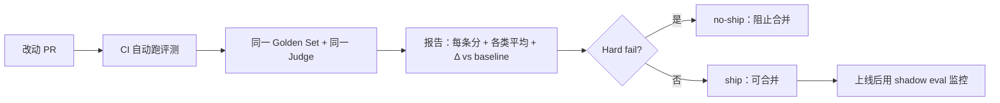

# **CI / ship-no-ship**：改动前后用同一 Golden Set 出数字，再决定能不能上

> 对应模块：[模块 17 · Agent Evaluation ⭐⭐⭐⭐⭐](./README.md) · 小节进度第 4 条
> 这一小节由 Coach 按 2026-10-10 本对话 `coach start` 详解首次写入。贯穿场景是把评测变成改动门禁——前 3 节（17-01 / 17-02 / 17-03）讲评测本身，本节讲评测的落地动作。**前 3 节已沉淀；本节是其「评测 → 发布」的衔接**。学习者只减不加。进度表这一行还没打钩。

- **来源**：本对话 `coach start` 详解。
- **状态**：已沉淀
- **Demo**：无。这一段只检查笔记，不检查代码。从模块 14 起本仓库不再新写模拟演示，见学习总览。

> 各节写什么、达标要求：见仓库根 [AGENTS.md §7.2](../../../AGENTS.md#72-写入小节文档--小节进度对齐)。

## 是什么

**CI（Continuous Integration，持续集成）/ ship-no-ship（决定上不上线）** 是把评测变成改动门禁的两件配套动作。

**CI** 在每次代码改动（PR / merge）后**自动跑评测流水线**——同一份数据集、同一个 Judge、同一个脚本——出一份报告。**ship-no-ship** 拿这份报告的数字决定能不能合 / 上线。

这套流程的关键件：

- **Golden Set** = 标好答案的固定数据集，每改一次跑同一次。
- **Baseline** = 上一次合 / 上线的指标数字，存在仓库里。
- **CI 门禁** = 自动跑评测，对比 baseline，超阈就 fail。
- **报告** = 每次跑出的指标 + 与 baseline 的 Δ。
- **ship / no-ship 决议** = 看指标与 baseline 决定合 / 不合 / 合但需注意。



生活里，这是「工厂出厂检测」。每一批货都过同一台检测仪，看数字有没有退步。Golden Set 是检测仪，Baseline 是上次合格的数字。**没有这台检测仪 = 「出厂」靠人眼。**

## 为什么（Agent 开发要懂）

**没有数字门禁，Agent 改动就是凭感觉**。你调了 prompt、换了检索器、升了模型版本，没人能答「是变好了还是变坏了」。17-01 / 17-02 / 17-03 教的是评测本身；**CI / ship-no-ship 是评测的落地动作**——把数字接进 PR / merge / 发布。

**自动化 CI 跑 = 防止「忘了跑评测」**。手动跑永远会忘。CI 跑一次，看一次，红就拦。

**Ship-no-ship 是评测与发布的接口**。评测给数字，ship / no-ship 决定能不能发。**没有 ship-no-ship = 评测发了数字没用上**。

**Golden Set 必须存在**——它是「今天的改动是不是变好」的对照。同样的数据集、同样的 Judge、同样的脚本——这些变一项就失真。

**Baseline 漂移**也很关键——baseline 必须随每次合 / 上线更新，否则 CI 跟当前生产脱节。

## 易混点

| 你以为是一回事的两个版本 | 它们实际差在哪 | 用错时会发生什么 |
| --- | --- | --- |
| CI ≠ ship-no-ship | CI 是自动跑测试；ship-no-ship 是决议 | CI 跑了但没决议 = 数字没用 |
| 评测 vs 门禁 | 评测是出数字；门禁是用数字拦 PR | 只有门禁没评测 = 没数字 |
| 离线 vs 在线（shadow） | 离线跑数据集；在线观察真实流量 | 只看离线 = 不反映真实用户 |
| Golden set vs test set | Golden 标好答案；test 不一定有 | test 跑评测 = 看不到检索 Faithfulness |
| 回归 vs 新能力验证 | 回归检测「退步没」；新能力验证看「提升没」 | 只看回归 = 看不清新增 |
| 单一指标 vs 综合 | 单一指标快；综合反映整体 | 综合掩盖单项问题（Faithfulness 单独看） |
| 评测漂移 vs 模型漂移 | 前者是 Judge / 数据集变了；后者是模型变了 | 不区分 = 升模型以为是改 prompt 改好的 |
| Hard fail vs soft warn | Hard 拦合并；warn 只提示 | Hard fail 用错 = 不重要的指标也挡 |
| Baseline 漂移 vs Ground truth 漂移 | Baseline 一段时间更新；gold 不变 | gold 漂移 = 评测基准失真 |
| Shadow eval vs 灰度发布 | Shadow 并行但不引流量；灰度引部分流量 | 一律灰度 = 风险高 |
| CI 跑时间 vs 评测时间 | CI 加超时；评测可能要 30 分钟 | CI 慢 = 等不及 |

## 例子

### 一次典型 CI 流程

工程师改 prompt 推 PR → GitHub Actions 起评测 → 跑 500 条 Golden → Judge 评分 → 出 JSON 报告 → 与 baseline 比较 → Faithfulness -3% → Hard fail → PR 拦下不准合并。

### Golden Set 设计

50~500 条标好答案的固定数据集。新版本上线前跑同一条数据集，看数字有没有变。**关键是「固定」**——数据集改了评测基准就漂了。

### Ship / No-ship 决议

- Faithfulness -1%、Accuracy +0.5%、Token +20%——**no-ship**：编造轻微退步、token 涨太多，整体不划算。
- Faithfulness 不变、Accuracy +2%、Token +5%——**ship**：小进步，token 微涨，可接受。
- Faithfulness -5%、Accuracy +10%——**人工 review**：可能加大了检索召回导致编造上升，需要看细节。

### Shadow Eval 接入

新版本上线时，不直接替换旧版本。**两份并行跑**：旧版本给真实用户，新版本跑同一份输入，结果不引流量。**shadow 的好处**：新版本上线前一天就能看到真实效果；坏处：跑两份 = 贵。

### 回归报警

baseline = 「上周发布的指标」。CI 跑后某项指标变差 > 2% → Hard fail。变差 ≤ 2% → Soft warn（提示但不拦）。**告警阈值要随场景调**，严了拦太多，宽了看不出退步。

### Judge 模型漂移

评测跑久了 Judge 模型换版（gpt-4o → gpt-4.1）→ 同一份数据集分数全变了 5%。**这就要重新校准 baseline**。不重对齐 = 旧 baseline 跟新 Judge 对不上，假警报 / 假绿灯。

## 需求清单

下面每条都用评测门禁在仓库里的真实场景验收。验收是讲得清。真要做出来，做在单独的真实项目里。本仓库这一节不写模拟页。

1. **业务场景**：每次 PR 改完要自动跑评测。**目标**：CI 自动跑评测。**涉及**：GitHub Actions / GitLab CI（持续集成服务）。**验收**：每条 PR 自动起评测流水线；超阈 fail 合并。

2. **业务场景**：Golden set 太小的告警。**目标**：稳定可比的 baseline。**涉及**：数据集设计与固定。**验收**：数据集 ≥ 50 条固定不变；diff 出更新审计。

3. **业务场景**：ship / no-ship 决议自动化。**目标**：门禁客观。**涉及**：阈值 + 报警。**验收**：Faithfulness -2% → Hard fail；其他变化有 warn。

4. **业务场景**：升级前要看新版本真实效果。**目标**：shadow eval。**涉及**：并行跑两份版本。**验收**：shadow 报告独立；上线前能看。

5. **业务场景**：Judge 模型升级。**目标**：知道 Judge 什么时候漂了。**涉及**：定期对齐 + baseline 重对齐。**验收**：升 Judge 后人工标 100 条对齐；相关性足够高。

6. **业务场景**：报告输出。**目标**：报告能看 + 能报警。**涉及**：HTML / JSON / Slack webhook。**验收**：CI 跑完有报告链接；阈值 fail 有 Slack 通知。

7. **业务场景**：多评测集。**目标**：不同场景分开测。**涉及**：golden / regression / smoke 三档。**验收**：每档独立报告；smoke 跑得快（5 分钟内）；regression 慢但全。

8. **业务场景**：评测时间长 CI 等不及。**目标**：CI 跑得快且准。**涉及**：分层跑 + 抽样。**验收**：PR 阶段跑 smoke；merge 后跑 regression；上线前跑 full。

## 这几种情况都要分开讲

| 情况 | 数据怎么走 | 需求 |
| --- | --- | --- |
| CI 形态（GitHub Actions / GitLab CI / 自建） | 不同 CI 系统的语法 | 需求 1 |
| 门禁种类（hard fail / soft warn / 仅报告） | 升级 vs 拦下 | 需求 3 |
| Golden set 设计（N 大小 / 领域 / 更新频率） | 数据集形态 | 需求 2 |
| 报告输出（HTML / JSON / Slack / Markdown） | 报告可读 | 需求 6 |
| 离线 vs shadow（传统 vs 并行引流量） | 不同接入 | 需求 4 |
| 多评测集（golden / regression / smoke） | 多档 | 需求 7 |
| Baseline 更新（每次合 vs 每周固定时间） | 节奏 | 需求 5 |
| Judge 漂移检测（定期对齐） | 防 Judge 换版 | 需求 5 |

## 取舍

| 你在意的事 | 更合适的做法 |
| --- | --- |
| 看到底能不能上线 | CI + Golden + Baseline + ship 决议 |
| 改代码前看新版本真实效果 | Shadow eval 并行 |
| 改动小、快、要常跑 | smoke 数据集小 + 跑得快 |
| 改动大、上线前跑 | regression 完整集 |
| Judge 模型换版 | 先人工对齐 + 重新 baseline |
| 评测漂移 | 加监控：每跑 N 次抽 N 条对齐 |
| 离线 vs 在线 | 离线 = CI 门禁；在线 = shadow + 真流量 |
| 报告给 PM 看 | HTML dashboard |
| 报告给数据团队看 | JSON + 可机读 |
| 报告给上下游协作团队看 | Slack webhook + Markdown |
| 阈值设计 | Hard fail 用于硬伤（Faithfulness 大量退步）；warn 用于软指标 |

## 踩坑

- **没 CI 自动跑 = 评测放着不用**。手动跑永远忘。
- **没用 Golden set = baseline 漂移**。不固定 = 没对照。
- **改了 baseline 但不通知**。合一段后忘了更新。
- **Judge 漂移时没人知道**。Judge 升级看似有新分数其实不是新分数。
- **改了 prompt 不重对齐 baseline**。改了 prompt 跟之前版本对不上。
- **Hard fail 用错** = 不重要指标挡合 = 失去门禁意义。
- **shadow eval 没接真实流量** = 永远测不准真实场景。
- **报告没人看** = 数字出了决策没做。
- **多评测集不互相同步** = 各档 baseline 不同步。
- **回归 vs 新能力混跑** = 看不清是退步还是新增。
- **CI 超时没设计** = 大数据集跑不完，仓促 merge。
- **CI 不接 PR 评论** = 报告打不开 = 没人看。

## 过关自检

对照「本条要能讲清」= **能描述一条「命令出报告」的门禁**：

- 能描述一条 CI 门禁的命令：`yarn eval` 或 `.github/workflows/eval.yml` 起评测流水线。
- 能说出 ship / no-ship 决议需要 baseline + 阈值 + 自动拦 + 自动 warn。
- 能说出回归检测 = 「用同一份数据集、同一个 Judge、同一个脚本对比」。
- 能说出 CI 自动跑 vs 手动跑的差别：手动跑永远会忘。
- 能说出 Golden Set 必须固定——改了数据集 baseline 漂。
- 能说出 Baseline 必须随合 / 上线更新——不更新 baseline 漂。
- 能说出 Judge 漂移检测—— Judge 升级看似新分数实际不是。
- 能说出 shadow eval 的接入位置和成本。

## 还没搞懂的

- Shadow eval 接入细节（一份输入两份输出对照）。
- Judge 漂移检测的具体协议（怎么定期对齐、对齐多少条）。
- 多评测集的统一管理（baseline 同步、报告合并）。
- CI 评测结果与 PR 评论的接入（GitHub PR check / GitLab MR 等）。
- Baseline 漂移与生产反馈对齐（用户真实数据 vs Golden）。

## 我追问过的

本对话没有知识追问。不编造。

## 契约记录

- 本轮「1」是对上一轮选项 1 的回应（继续推 17-04），不是认知追问，不进「我追问过的」。
- 17-01 / 17-02 / 17-03 / 17-04 已沉淀；15-01 的 coach complete 已补跑过。
- 进度表 17-04 这一行仍是 ⬜。
- 本仓库模块 14 之后这一节不写 `## Demo 子节进度` 块，也不要求 `apps/` 有新代码；可运行演示做在学习者单独的真实项目里。
- 这一轮实际打开过的外部 URL：没有。

## Demo 判断

```text
Demo 判断
- 小节：CI / ship-no-ship：改动前后用同一 Golden Set 出数字，再决定能不能上
- 结论：无
- 理由：这一段只检查笔记，不检查代码。从模块 14 起，可运行的代码放在学习者单独的真实项目里，见学习总览。本条要能讲清的是「CI 自动跑 + Golden Set + Baseline + 门禁阈值 + 报告 + ship / no-ship」一条流程，而不是某一段代码。
- 你学完要：笔记写在这一份小节文档里。不新建 apps/ 文件夹。
```
