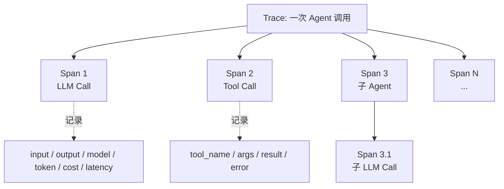

# **Trace / Span**：一次 Agent 执行 = 1 条 Trace，每步 LLM/Tool = Span

> 对应模块：[模块 18 · Observability ⭐⭐⭐⭐⭐](./README.md) · 小节进度第 1 条
> 这一小节由 Coach 按 2026-10-10 本对话 `coach start` 详解首次写入。贯穿场景是给 Agent 加上结构化执行轨迹——评测（模块 17）是离线数字门禁，可观测（模块 18）是在线信号，能定位事故。**上一模块（17 Agent Evaluation）全部 5 节已 ✅；本节是其「上线后看什么」的延伸**。学习者只减不加。进度表这一行还没打钩。

- **来源**：本对话 `coach start` 详解。
- **状态**：已沉淀
- **Demo**：无。这一段只检查笔记，不检查代码。从模块 14 起本仓库不再新写模拟演示，见学习总览。

> 各节写什么、达标要求：见仓库根 [AGENTS.md §7.2](../../../AGENTS.md#72-写入小节文档--小节进度对齐)。

## 是什么

**Trace** = 一次 Agent 执行的完整轨迹。**Span** = Trace 里的一个独立事件（一次 LLM Call / 一次 Tool Call / 一次子 Agent 调用）。

关系：**一次 Agent 调用 = 1 条 Trace；Trace 内有 N 个 Span**。Span 之间有父子关系——root span 是整次 Agent 调用；中间层是子 Agent / Chain；叶子是 LLM Call / Tool Call。

```text
Trace (root: Agent.run)
├── Span: think-1 (LLM Call)                ← input / output / token / cost
│   └── Span: tool-call-1 (Search)           ← input args / output payload
├── Span: think-2 (LLM Call)
└── Span: response-1 (Tool Call)
```

**OpenTelemetry（OTel）**是行业标准的 trace / span 协议——定义什么叫 span、怎么传递、什么 metadata。Langfuse / LangSmith / Phoenix / Helicone / Ariza Phoenix 等各家工具都是 OTel 兼容或自家协议，但**接 trace / span 的语义是一致**的。



生活里，这是「一次手术的病历」。手术 = 1 次 Trace，每一步（开皮 / 切 / 缝 / 收尾）= 1 个 Span。病历上每一步都有时间、谁做的、用了什么、结果怎样。**病历断了 = 手术没事，找不出哪里出错了**。

## 为什么（Agent 开发要懂）

**没有 trace，调试就是黑盒**。「Agent 答错了」「查询失败了」「用户看不到订单」——你不知道中间哪一步出问题。**没有 trace 时只能靠「我看着输出猜」**，这跟评测之前的「凭感觉调」一个意思。

**评测是离线数字，可观测是在线信号**。17 模块给了评测：跑数据集、出报告、决定 ship / no-ship。**18 模块给可观测**：上线后出问题时能实时定位到具体 span。

**生产 Agent 的 fail mode 都在中间某一步**：

- LLM 调用格式错（schema violation）→ 看 LLM span 的 input/output
- Tool 参数填错 → 看 Tool span 的 args
- 子 Agent 跑得慢 → 看 Chain 的 latency
- Token 飞涨 → 看每个 LLM span 的 token count
- 用户抱怨「我刚才那个问题没答对」→ 用 trace id 找回那条 Trace 看完整路径

**没有 trace = 没有事故调查能力**。一场生产事故，你只能看最终输出 + 一片空白。

**敏感信息必须脱敏**。Trace 把每一步都记录下来——**用户的密码 / 信用卡 / 隐私 / token 全部暴露在 trace 里 = 数据泄露事故**。所有个人可识别信息（PII，Personally Identifiable Information）字段在写 trace 前脱敏。

## 易混点

| 你以为是一回事的两个版本 | 它们实际差在哪 | 用错时会发生什么 |
| --- | --- | --- |
| Trace ≠ Log（日志） | Trace 是结构化的执行轨迹，按 span 组织；Log 是单条消息 | 用 log 做「trace」 = 无法还原路径 |
| Span ≠ Log Line | Span 是一段有时间区间的操作 + 输入输出；Log line 是一时刻一句话 | 用 log 当 span = 没时间区间 |
| Trace ID vs Span ID | Trace ID 一条 trace 共享；Span ID 每个 span 唯一 | 不区分 = 跨 span 串不起来 |
| LLM Call Span vs Tool Call Span vs 子 Agent Span | 不同 span 类型，输入输出字段不同 | 一律一种 = 字段错位 |
| OTel / OTLP vs 私有协议 | OTel 是标准；Langfuse / LangSmith 等各家可有私有 | 混用 = 不通 |
| Trace ID 串起来 ≠ 时间戳对齐 | trace_id 才是串；时间戳近似对 = 误判 | 用时间戳对齐 = 漂移 |
| Token 记在 metadata 还是输出文本 | token 是 metadata；输出文本是模型输出 | 漏记 token = 算不出成本 |
| 报错 / 异常 vs Trace 失败 | 一个 span 出错不等于整 trace 错（agent 可自纠）；整 trace 错也不一定在某 span 抛错 | 把异常当 trace 失败处理 = 错失 |
| PII 脱敏 vs 完整记录 | Trace 该记录什么字段；哪些要 mask | 不脱敏 = PII 泄露 |
| Production trace vs Staging trace | Production 要采样；Staging 可全量 | 一律全量 = production 成本爆 |
| Trace 持久化 vs Trace 实时流 | 持久化 = 写库供查询；实时流 = 触发报警 | 不持久化 = 报警但查不到 |
| Metric（指标）from Trace vs from Metric Source | trace 里 metric 是 span 内计算；metric source 是独立采集 | 跨来源拼指标 = 对不上时间 |

## 例子

### 一次客服 Trace 切分

用户问「订单 12345 什么时候发的？」

```text
Trace id: abc123 (env=prod, user_id=u_42, session=s_99)
├── Span 1: think-1 (LLM Call)
│   model=claude-sonnet-4.5, input_tokens=120, output_tokens=80, cost=$0.0015, latency=850ms
├── Span 2: get_order (Tool Call)
│   tool_name=get_order, args={order_id:"12345"}, result={status:"shipped", date:"2026-10-08"}
├── Span 3: think-2 (LLM Call)
│   model=claude-sonnet-4.5, input_tokens=350, output_tokens=120, cost=$0.0042, latency=1100ms
└── Span 4: response (final output)
```

每一段都有 input / output / metadata。出问题时直接定位到某一 span。

### 出错定位

用户报「客服说我订单状态错了」。先用 trace_id（user_id + session + 时间）找回那条 Trace。逐步看 span：

- Span 1: LLM 决策 = 想调 get_order ✓
- Span 2: get_order 调用，参数正确，返回订单数据 ✓
- Span 3: LLM 二次生成，看到订单状态「已发货」✓
- Span 4: 输出说「订单已发货，发货时间 2026-10-08」✓ — **没有错误**

发现用户记错了。再核对。

### 性能 / 成本分析

某次升级 agent 后用户报「变慢了」。跑 100 条 trace，平均：

- root span 总耗时 2.3s（升级前 1.8s）
- LLM span 平均 1.8s（升级前 1.0s）
- Tool span 平均 250ms（升级前 200ms）
- Token 总成本从 $0.005 / query 涨到 $0.012

定位：LLM span 变慢 + token 涨。原因：prompt 升级后变长 + 加了 thinking。

### 敏感数据脱敏

Tool `get_order(order_id="12345")` 调用 —— Args 直接记到 trace 里会暴露用户订单号。

**mask 策略**：

- 哈希：存 `order_id_sha256 = "a1b2c3..."`
- 截断：存 `order_id = "1234..."`
- 不记敏感字段：完全不记

按数据类型选。重要：**不要把 GDPR / 隐私 / 凭证类字段明文落 trace**。

### 子 Agent 嵌套

多 Agent 协作：root agent → 子 agent A / B

```text
Trace (root)
├── Span: think-1 (LLM)
├── Span: agent-A (sub-agent)
│   ├── Span: think-1.A (LLM)
│   └── Span: tool-1.A (Tool Call)
├── Span: agent-B (sub-agent)
│   ├── Span: think-1.B (LLM)
│   ├── Span: think-2.B (LLM)
│   └── Span: tool-1.B (Tool Call)
└── Span: response (final)
```

子 Agent 是一个 span，但 span 内部有自己的 LLM / Tool 调用。**整体 Token / cost = 整条 Trace 之和**。

### 跨服务串联

Agent 跑在服务 A，给服务 B 发 HTTP / MCP 调用。需要 trace 跨服务传递：

- 服务 A 写 trace_id 到 outbound headers
- 服务 B 读到 trace_id，作为自己的 root span
- OpenTelemetry 有 W3C Trace Context 标准做这件事

不传 trace_id = 服务 B 的 trace 跟 A 串不起来，跨服务问题定位不可能。

## 需求清单

下面每条都用可观测在仓库里的真实场景验收。验收是讲得清。真要做出来，做在单独的真实项目里。本仓库这一节不写模拟页。

1. **业务场景**：每次 Agent 执行有一条 trace。**目标**：唯一 trace_id 串起。**涉及**：OTel SDK / Langfuse。**验收**：每条 agent 调用有 trace_id；跨 span 关联。

2. **业务场景**：每步 LLM / Tool 是 span。**目标**：span 类型标准化。**涉及**：span type llm / tool / agent / chain。**验收**：所有 LLM Call 和 Tool Call 都是 span，metadata 完整（input / output / model / token / cost）。

3. **业务场景**：算钱。**目标**：记录 cost 字段。**涉及**：cost 算 metadata。**验收**：每条 trace 有总 cost；与计费对得上。

4. **业务场景**：溯源。**目标**：trace_id 关联 user / session / env。**涉及**：trace-level metadata。**验收**：能从 user_id + time 找回那条 trace。

5. **业务场景**：敏感信息。**目标**：脱敏。**涉及**：mask 工具。**验收**：trace 里没有明文密码 / 身份证 / 卡号 / token；review 通过。

6. **业务场景**：跨服务。**目标**：trace_id 传递。**涉及**：W3C Trace Context headers。**验收**：A 服务出 trace，B 服务能接上。

7. **业务场景**：出错定位。**目标**：报错时直接定位。**涉及**：error span with stack。**验收**：每条出错 trace 有 error span + 错误类型。

8. **业务场景**：成本控制。**目标**：按 ratio 采样。**涉及**：tail-based / head-based sampling（采样策略，决定哪些 trace 被记录）。**验收**：production 采样 ≤10%；错误 trace 100% 保留。

## 这几种情况都要分开讲

| 情况 | 数据怎么走 | 需求 |
| --- | --- | --- |
| Trace 协议（OTel / Langfuse / LangSmith / Phoenix） | 不同协议 / 库 | 需求 1 |
| Span 层级（root / parent / child） | 树结构 | 需求 1 |
| Span type（llm / tool / chain / retriever / agent） | 不同字段 | 需求 2 |
| Trace 关联（user / session / env / feature_flag） | metadata | 需求 4、5 |
| Token / cost 记录 | metadata | 需求 3 |
| PII 脱敏 | mask / hash / omit | 需求 5 |
| Production 采样 | ratio / tail-based | 需求 8 |
| 跨服务 | W3C Trace Context | 需求 6 |
| 出错定位 | error span | 需求 7 |

## 取舍

| 你在意的事 | 更合适的做法 |
| --- | --- |
| 调试 Agent 出错 | 完整 trace + 错误 span + 出错信息 |
| 算成本 | 每条 trace 总 cost + 每 span 成本 |
| 跨服务排查 | W3C Trace Context 传递 trace_id |
| 太多 trace 撑爆存储 | tail-based / head-based 采样 |
| 敏感信息保护 | 全字段脱敏 + 定期 audit |
| 上下游分析 | trace_id 同时落 log |
| 实时报警 | 流式 trace 触发 metric → alertmanager |
| 多 Agent 协作 | 嵌套 span + 整条 trace 关联 |
| 调试 prompt 改了好不好 | 同数据集 before/after trace 对照 |
| OpenTelemetry 标准 → 自家 backend | 用 OTel SDK，后端可换 |

## 踩坑

- **不用 trace，只用 log**。出错时找不到中间步骤。
- **trace 落敏感信息**。泄露即事故。
- **trace_id 不传到下游服务**。跨服务看不到。
- **Span type 不分**。LLM 当 Tool 看 = 字段错位。
- **不在 LLM span 记 token / cost**。算不出钱。
- **Production 全量**。存储费用崩。
- **失败 trace 不保采**。保采失败 = 看不到事故现场。
- **Trace 没有 user / session 关联**。找不到用户的具体 trace。
- **Trace 与 log 不同步**。一套 trace_id log 是另一套。
- **采样策略不写文档**。后来人不懂为什么 90% trace 都丢了。
- **不接持久化**。trace 实时不被存储。
- **每 span 全量输入输出**。token 大 / 慢 / 隐私风险。

## 过关自检

对照「本条要能讲清」= **能画这层关系**：

- 能画出「一次 Agent 调用 = 1 Trace，trace 内 N 个 Span，LLM/Tool 是叶子」树状关系。
- 能区分 Trace ID vs Span ID vs parent/child 关系。
- 能列出 Span 类型：LLM / Tool / Agent / Chain / Retriever 各类及其关键字段。
- 能区分 Trace（结构化轨迹）vs Log（单条消息）。
- 能说出 W3C Trace Context 在跨服务串联时怎么传 trace_id。
- 能说出 PII 脱敏的位置（输入前 + 字段级 hash / mask）。
- 能说出 token / cost 记在哪个 span、哪个字段。
- 能说出 production 采样策略：ratio / 错误保采。

## 还没搞懂的

- 各家 LLM observability 工具的协议差异（Langfuse / LangSmith / Phoenix / Helicone / OpenLLMetry）—— 自己查。
- Tail-based sampling 的具体实现 —— 自己查 OTel 文档。
- 跨服务 W3C Trace Context 在 HTTP / MCP 不同协议下的传递细节 —— 自己查。
- 子 Agent trace 自动嵌套的支持 —— 自己查各家 SDK。
- Trace + Log + Metric 三件怎么统一关联（observability 三件套） —— 自己查。

## 我追问过的

本对话没有知识追问。不编造。

## 契约记录

- 本轮「1」是对上一轮选项 1 的回应（跨到模块 18 并按直接沉淀文档推 18-01），不是认知追问，不进「我追问过的」。
- 17-01 / 17-02 / 17-03 / 17-04 / 17-05 已 ✅。15-01 coach complete 已补跑过，15 / 16 / 17 文档契约记录已刷新。
- 进度表 18-01 这一行仍是 ⬜。
- 本仓库模块 14 之后这一节不写 `## Demo 子节进度` 块，也不要求 `apps/` 有新代码；可运行演示做在学习者单独的真实项目里。
- 这一轮实际打开过的外部 URL：没有。

## Demo 判断

```text
Demo 判断
- 小节：Trace / Span：一次 Agent 执行 = 1 条 Trace，每步 LLM/Tool = Span
- 结论：无
- 理由：这一段只检查笔记，不检查代码。从模块 14 起，可运行的代码放在学习者单独的真实项目里，见学习总览。本条要能讲清的是「Trace / Span 关系 + span type + 跨服务 + PII 脱敏 + 采样」一套，不是某一段代码。
- 你学完要：笔记写在这一份小节文档里。不新建 apps/ 文件夹。
```
