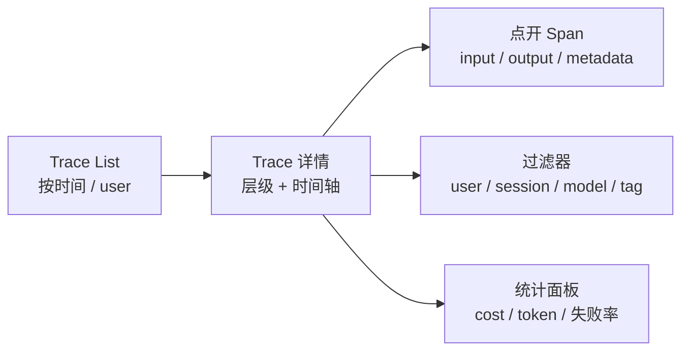

# **轨迹可视化**：在 Langfuse / LangSmith 里点到失败的那一步

> 对应模块：[模块 18 · Observability ⭐⭐⭐⭐⭐](./README.md) · 小节进度第 2 条
> 这一小节由 Coach 按 2026-10-10 本对话 `coach start` 详解首次写入。贯穿场景是把 trace 渲染成可点的 UI——评测（模块 17）是离线门禁，可观测（模块 18）是在线信号，UI 是其中「找具体一条 trace」的关键件。**18-01（Trace / Span）已沉淀；本节是其「用 UI 看」的延伸**。学习者只减不加。进度表这一行还没打钩。

- **来源**：本对话 `coach start` 详解。
- **状态**：已沉淀
- **Demo**：无。这一段只检查笔记，不检查代码。从模块 14 起本仓库不再新写模拟演示，见学习总览。

> 各节写什么、达标要求：见仓库根 [AGENTS.md §7.2](../../../AGENTS.md#72-写入小节文档--小节进度对齐)。

## 是什么

**轨迹可视化** = 把 trace / span 渲染成 UI 视图，让人能**点开看**每一段的输入输出，而不是扫一行行 log。

主流工具：

- **Langfuse**（开源为主）— LLM 可观测平台，主打 trace + cost + 用户评分。
- **LangSmith**（LangChain 商业）— LangChain 生态首选，UI / 调试 / 数据集联动紧密。
- **Phoenix**（Ariza 开源）— OpenTelemetry 原生，trace 调试 + 数据集评测。
- **Helicone**（云）— 偏 cost / log 视角，OpenAI-compatible 代理。
- **OpenLLMetry**（OTel SDK 扩展）— 标准 OTel + LLM 字段补全。

关键件（无论哪家都有）：

- **层级视图**：把 trace 的 span 父子关系画成树 / 时间轴。
- **详情面板**：点开一个 span 看 input / output / metadata / latency / token / cost。
- **过滤搜索**：按 user / session / env / model / tag / time range 过滤。
- **统计面板**：聚合一段时间的 cost / token / 失败率 / tool 命中率。



生活里，这是「医院的电子病历系统」。每条 trace = 一份病历；UI 上点开能看每一段的检查报告、用药、医生、时间。**没有电子病历 = 只能看手写纸面 = 找不到中间环节**。

## 为什么（Agent 开发要懂）

**出问题时定位最快**。用户报「我刚才那个回复错了」——你 trace_id 一查，UI 上点开，直接看到第 3 步 LLM 生成时输入被截断。**用 log 一行行扫 + 想时间对应 = 难度 9；用 UI 点开 = 难度 1**。

**不只是 console.log**。`console.log` 在生产端把日志冲掉 = 找不回。UI 持久化 trace + 全文搜索 = 任何时候都能找回。

**跨 session / user 关联**。同一用户多次跑 Agent / 多个 Agent 合作 / 团队多人共用——这些跨维度的事 log 很难做，UI 上是「过滤」+「分组」的事。

**团队协作**。PM 看 cost 报表、工程师看失败 trace、客户支持看单个用户的具体 trace——**同一份 trace 不同角色看不同视图**。log 做不到。

**评测数据集联动**（LangSmith / Langfuse 都有）—— trace 上标记 bad / good → 自动进 dataset → 跑评测（17 模块）。**评测与可观测不是两套系统，是一套**。

## 易混点

| 你以为是一回事的两个版本 | 它们实际差在哪 | 用错时会发生什么 |
| --- | --- | --- |
| console.log vs Trace UI | 前者一次性 stdout；后者持久化 + 可视化 | 生产 log 冲掉 = 找不回 |
| 自建日志查看器 vs 现成 UI | 前者自己写；后者用 Langfuse 等 | 自建没 token / cost 自动算 |
| Langfuse vs LangSmith vs Phoenix | 生态 / 开源 / 协议不同 | 选错 = 跟 stack 不通 |
| 实时 trace vs 历史 trace | 实时指上线中；历史指过去一段时间 | 不持久化 = 实时可用，历史丢 |
| 树视图 vs 时间轴视图 | 树表达父子；时间轴表达并发 / 顺序 | 一律树视图 = 看不清并发 |
| Session / User 维度 | Session 是单次会话；User 是真实用户 | 不区分 = 报告粒度不对 |
| Token / Cost 报表 vs 实时计算 | 报表是聚合；实时是单条 | 漏 token 字段 = 报表不准 |
| UI 与 OTel SDK 解耦 | UI 看的是 Span；后端可能不同 | 协议绑死 = 换 UI 难 |
| Trace 报警 vs UI 通知 | Trace 流触发 metric 报警；UI 通知是 web 通知 | 漏报警 = 事故没人发现 |
| Dataset 联动 vs 评测 | Trace 标 dataset → 评测用 | 不联动 = 评测与线上脱节 |

## 例子

### Langfuse UI 上点 trace 看 span

用户在生产跑 Agent → Langfuse 后端收到 trace → UI trace 列表按时间排序 → 点开某条 → 看到树：root agent span + 3 个 LLM span + 2 个 Tool span → 点开 span 3（LLM）→ input prompt + output 全显式 → 一眼看 prompt 跑偏了。

### LangSmith UI 看层级 + token / cost

工程师在 LangSmith dashboard 看 cost 曲线：今天 cost 涨 30%。点击某 trace 看 cost 分布：发现某 LLM span token count 是平时 3 倍。点开 span 看 prompt = token 数从 1500 涨到 4500。回到 dataset 看新加的 few-shot 例没剪。

### Phoenix（OTel 原生）

标准 OTel SDK 收集的 trace 直接进 Phoenix（开源 / 自部署）。Trace 列表 + 层级 + 时间轴。**特点**：和 OTel 协议 1:1，不绑任何 LLM 提供方。

### 出错定位工作流

1. 用户报错 → 客户支持拿到 user_id + time
2. 在 Langfuse 按 user_id 过滤，找到那条 trace
3. 点开看层级：root → think-1 → tool-1 → 报错
4. 点开 tool-1 span：args = 「查询订单 12345」，result = error: 「not found」
5. 判断：订单号是用户填错 / 接口正常
6. 标记 user feedback = bad → 自动进 dataset
7. （17 模块）跑评测确认其他用户没撞这个错

### 跨 trace 搜索

「昨天 14:00 到 15:00 之间，凡是用了 gpt-4o 模型的，且失败的所有 trace」。在 UI 上勾：time range = yesterday 14-15 / model = gpt-4o / status = error → 列表剩 12 条 → 逐个点开看 → 找到根因。

### Session / User 维度

单个用户多 session：把 user_id 当主键，过滤一条 user 看所有 session。Session 维度：每条 user_id + session 串起完整对话。**前者看「这个用户的所有经历」，后者看「这次对话做了什么」**。

## 需求清单

下面每条都用可观测在仓库里的真实场景验收。验收是讲得清。真要做出来，做在单独的真实项目里。本仓库这一节不写模拟页。

1. **业务场景**：出问题时查具体 trace。**目标**：UI 过滤 + 点开。**涉及**：trace_id / user_id / 时间。**验收**：从报障到定位 ≤ 5 分钟。

2. **业务场景**：cost 飞涨。**目标**：cost 报表定位某 trace。**涉及**：cost 聚合 + drill-down（逐层下钻，从汇总数据点开看明细）。**验收**：能定位到具体 trace + 具体 span。

3. **业务场景**：客户支持回话。**目标**：support 用 UI 查用户。**涉及**：权限分级 + user filter。**验收**：support 只能看自己用户；不能看 token / 系统元数据。

4. **业务场景**：评测数据集联动。**目标**：trace 标记 → 自动进 dataset。**涉及**：UI 评分按钮 + dataset 同步。**验收**：标 bad 的 trace 进 dataset；评测用这 dataset 跑。

5. **业务场景**：实时报警。**目标**：trace 流触发 alert。**涉及**：metric threshold + Slack webhook。**验收**：失败率 > 阈值报警。

6. **业务场景**：跨服务串联。**目标**：trace_id 跨服务。**涉及**：W3C Trace Context。**验收**：服务 A 出 trace，B 服务能接上（在 UI 里看到完整路径）。

7. **业务场景**：UI 也要脱敏。**目标**：trace 不在 UI 露 PII（个人可识别信息）。**涉及**：UI 字段 mask。**验收**：UI 上看不到明文密码 / 卡号。

8. **业务场景**：自建 vs 商用。**目标**：选工具。**涉及**：Langfuse vs LangSmith vs Phoenix。**验收**：选 SaaS / 开源软件（OSS）后能跑；预算与需求匹配。

## 这几种情况都要分开讲

| 情况 | 数据怎么走 | 需求 |
| --- | --- | --- |
| 视图（树 / 时间轴 / 表格） | 不同看法 | 需求 1、2 |
| 过滤（user / session / env / model / tag / error） | 找具体 trace | 需求 1 |
| 聚合（cost / token / latency p95 / 失败率） | 趋势报告 | 需求 2 |
| 实时 vs 历史 | 实时流 vs 持久化 | 需求 1、5 |
| Dataset 联动 | trace → bad/good → dataset | 需求 4 |
| 团队权限 | read / write / admin | 需求 3 |
| 报警 | metric 触发 / Slack | 需求 5 |
| PII 在 UI | UI 也是 trace 入口 | 需求 7 |
| 自建 vs 商用 | Langfuse / LangSmith / Phoenix | 需求 8 |

## 取舍

| 你在意的事 | 更合适的做法 |
| --- | --- |
| 调试 Agent 出错 | UI 过滤 + 点开 span |
| 算成本 | UI 报表 + drill-down |
| 跨服务排查 | UI 看完整 trace 树（跨服务） |
| 太多 trace 撑爆 UI | 后端采样 + UI 搜索 |
| 敏感信息保护 | UI 字段 mask（与后端脱敏一致） |
| 团队协作 | 权限分级 + role-based |
| 实时报警 | trace 流 → metric → alertmanager（告警管理器） |
| 评测数据集联动 | UI 评分 + dataset sync |
| 自部署 vs SaaS | Langfuse OSS / Phoenix 自部署 / LangSmith + Langfuse SaaS |
| 跨工具切换 | 用 OTel 标准 SDK + 切后端 |
| 客户支持场景 | UI 看用户 + 报告评分回写 |

## 踩坑

- **不接 UI 直接 log**。要找 trace 时 log 早冲掉了。
- **过滤器不全**。找不到具体那条 trace。
- **Cost 统计不准**（漏记 LLM cost / 多算）。
- **找不到具体那条**（trace_id 没串起）。
- **团队权限没分级**（PM 看技术细节 / support 看不到自己客户）。
- **Dataset 联动断**（评测与线上脱节）。
- **UI 也漏 PII 脱敏**（trace 后端脱敏了，UI 仍显示明文 = UI 端再来一次）。
- **报警只靠 UI 通知**（生产环境需要不依赖 UI 也能触发）。
- **没持久化只实时**（事故后想复盘，没数据）。
- **采样丢了失败 trace**（事故现场恰好被采样掉 = 看不出问题）。

## 过关自检

对照「本条要能讲清」= **会用 UI 定位，不只会打 console.log**：

- 能说出 UI 关键件：层级视图 + 详情面板 + 过滤搜索 + 统计面板。
- 能说出与 console.log 的差别：UI 持久化 + 跨维度搜索 + 团队协作。
- 能说出 Langfuse / LangSmith / Phoenix 三家定位：开源 vs 商业 / OTel 兼容性 / LangChain 生态紧密度。
- 能描述一次「用户报错的定位工作流」：从 user_id + time，到 filter，到点开 trace，到点开 span，到标 bad。
- 能说出 dataset 联动与 17 模块评测的关系：trace 标 bad → 自动进 dataset → 跑评测。
- 能说出 cost 报表 + drill-down 找具体 span 的工作流。
- 能说出 UI 也要 PII 脱敏（不只是后端）。
- 能说出团队权限分级：不同角色看不同视图。

## 还没搞懂的

- 各家 UI 在「跨服务 trace」的可视化对比：Langfuse 跨服务视图 vs Phoenix vs LangSmith。
- Dataset 联动：标 bad 触发评测的协议细节。
- Cost 计算各家算法差异：input / output token 之外，caching、batch、cached read、prompt caching 是否计入。
- 团队权限模板：role-based / ACL（访问控制列表）/ row-level 各家支持度。
- UI 字段 mask 与后端脱敏的一致性协议。

## 我追问过的

本对话没有知识追问。不编造。

## 契约记录

- 本轮「1」是对上一轮选项 1 的回应（继续推 18-02），不是认知追问，不进「我追问过的」。
- 18-01 已沉淀；15-01 coach complete 已补跑过；模块 15-17 全部 已收口。
- 进度表 18-02 这一行仍是 ⬜。
- 本仓库模块 14 之后这一节不写 `## Demo 子节进度` 块，也不要求 `apps/` 有新代码；可运行演示做在学习者单独的真实项目里。
- 这一轮实际打开过的外部 URL：没有。

## Demo 判断

```text
Demo 判断
- 小节：轨迹可视化：在 Langfuse / LangSmith 里点到失败的那一步
- 结论：无
- 理由：这一段只检查笔记，不检查代码。从模块 14 起，可运行的代码放在学习者单独的真实项目里，见学习总览。本条要能讲清的是「UI 关键件 + 工作流 + dataset 联动 + PII 在 UI」一套，不是某一段代码。
- 你学完要：笔记写在这一份小节文档里。不新建 apps/ 文件夹。
```
