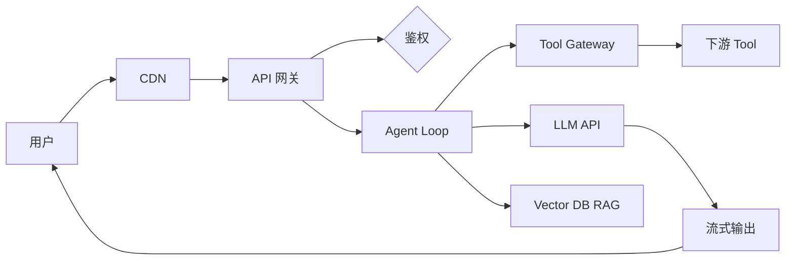

# **独立系统设计**：给定约束能画出架构，并标出评测 / 观测 / 安全 / 成本

> 对应模块：[模块 23 · Production Agent Architecture ⭐⭐⭐⭐⭐](./README.md) · 小节进度第 6 条
> 本条笔记已写入小节文档（`coach start` 详解后由 Coach 写入）。

- **来源**：`coach start`（本对话详解，2026-10-11）
- **状态**：已沉淀

> 各节写什么、怎么判断归哪一节、达标要求：见仓库根 [AGENTS.md §7.2](../../../AGENTS.md#72-沉淀--小节进度对齐)。

### 是什么

**独立系统设计**是**给定约束**（业务 / 用户量 / 预算 / 时间），**从 0 产出完整架构 + 风险标注 + 成本估算 + 可观测 + 评测**——不是只能复述自己写过的代码。

#### 约束四要素

| 要素 | 问什么 | 例子 |
|------|--------|------|
| **业务目标** | 这个系统做什么 | 「Agent 帮用户查订单」 |
| **用户量级** | 多少用户 / DAU | 1000 DAU / 10000 DAU |
| **预算上限** | 月成本多少 | 月成本 ≤ ¥5 万 |
| **上线时间** | 多久上线 | 3 个月 MVP |

#### 设计流程

```
约束四要素
 ↓ 选型
关键决策（流式 / 队列 / 网关 / 观测 / 评测 / 安全 / 成本）
  ↓ 组件
架构图（mermaid / ASCII）
  ↓ 风险
风险标注（每组件的可靠性 / 安全 / 性能 / 成本）
  ↓ 落地
设计文档 + 上线计划
```

一句话：**独立系统设计 = 「给定约束 → 架构图 + 风险 + 成本 + 观测 + 评测」——能设计，不是只能复述**。

### 为什么（Agent 开发要懂）

具体后果（举四个最常见的）：

1. **面试压顶**：面试官问「设计一个支持 10000 DAU 的 Agent 系统」→ 答不出 → 挂。
2. **创业失败**：拿到一笔钱 → 不知道架构怎么搭 → **边搭边改** → 6 个月还没上线。
3. **团队协作**：同事要你设计新项目 → 你只懂「自己写过的那块」→ **讲不清整体**。
4. **技术债**：一开始就埋坑 → 上线后改架构 → **成本 10x**。

独立系统设计能力 = **能扛事的标志**。

### 易混点

独立系统设计常被和它的「邻居概念」混淆。**判错任何一个会让设计失准**——必须分清。

#### 独立设计 vs 跟着做

| | 独立设计 | 跟着做 |
|---|---|---|
| **输入** | 约束（业务 / 量 / 预算 / 时间） | 既有架构 |
| **产出** | 从 0 出架构 | 按既有抄 |
| **价值** | **判断能力** | 实施能力 |

**判错会怎样**：只会跟着做 → 离开既有项目就懵。

#### 架构设计 vs 详细设计

| | 架构设计 | 详细设计 |
|---|---|---|
| **粒度** | **模块关系**（哪个服务调哪个） | **函数实现**（函数怎么写） |
| **图** | mermaid / 方块图 | 流程图 / 时序图 |
| **适合** | 评审 / 立项 | 实施 |

**判错会怎样**：把详细设计当架构 → 评审看不出「整体」。

#### 风险标注 vs 测试用例

| | 风险标注 | 测试用例 |
|---|---|---|
| **问什么** | **哪里会出问题** | 验证什么逻辑 |
| **粒度** | 组件 / 边界 | 函数 / 场景 |

**判错会怎样**：用测试用例覆盖风险 → 漏了「不确定」的边界。

#### 方案对比 vs 选 A 不选 B

| | 方案对比 | 选 A 不选 B |
|---|---|---|
| **输出** | **列两个方案 + 取舍** | 直接选 |
| **价值** | 评审能追问 = 选对了 |评审 = 选错了 |

**判错会怎样**：直接选 → 评审质疑 → 答不出 → 项目卡住。

#### 生产级 vs Demo 级

| | 生产级 | Demo 级 |
|---|---|---|
| **要什么** | **安全 / 观测 / 评测 / 成本** | 能跑 |
| **门槛** | 高（要 5 大件套） | 低（1 个 Demo） |

**判错会怎样**：把 Demo 当生产 → 上线就崩。

### 核心概念（变体 / 分支全扫）

独立系统设计有 10 个变体。

#### 1. 约束四要素

**问 4 个问题**：

```
1. 这个系统做什么？ （业务目标）
2. 多少用户 / DAU？ （用户量级）
3. 月成本 ≤ 多少？ （预算）
4. 多久上线？ （时间）
```

**没有这 4 个 = 没开始设计**。

**需求 1（约束四要素）**：定一个 Agent 项目；写 4 个问题的回答。

#### 2. 约束 → 选型 → 架构 流程

**5 步流程**：

```
1. 业务 → 核心能力（如：流式输出 + Tool 调用 + RAG 检索）
2. 量级 → 容量（如：10000 DAU × 10 次 = 100000 次/日 = 1.2 QPS 平均）
3. 预算 → 成本（如：LLM ¥3万 + 服务器 ¥1万 + 观测 ¥0.5万 = ¥4.5万）
4. 时间 → 关键路径（如：3 个月 MVP + 2 个月观测 + 1 个月优化）
5. 约束 → 选型 → 架构
```

**例子**：建筑师盖楼 = 给需求 → 出图纸 → 标注风险 → 标成本 → 报价。

**需求 2（约束 → 架构）**：用 5 步流程推导一个 Agent 项目架构。

#### 3. 关键决策点

**7 大决策**（每次设计都要回答）：

| 决策 | 选什么 |
|------|--------|
| **同步 vs 异步** | 短任务同步 SSE；长任务队列 |
| **单模型 vs 多模型** | 单模型省钱；多模型灵活 |
| **单租户 vs 多租户** | 单租户简单；多租户 RBAC |
| **直连 Tool vs Tool Gateway** | 直连简单；Gateway 安全 |
| **无 RAG vs 有 RAG** | 无 RAG 简单；有 RAG 答得准 |
| **无 MCP vs 有 MCP** | 无 MCP 简单；有 MCP 复用 |
| **自建 vs SaaS** | 自建灵活；SaaS 快 |

**需求 3（关键决策点）**：为 Agent 项目答 7 大决策；每个 1 句话取舍。

#### 4. 架构图模板

**mermaid 模板**（用户最常用）：



**每节点标**：技术选型 + 容量 + 风险。

**需求 4（架构图）**：用 mermaid 画完整架构；每节点标选型 + 容量。

#### 5. 风险标注

**每个组件标 4 类风险**：

| 风险 | 问什么 |
|------|--------|
| **可靠性** | 挂了怎么办？ |
| **安全** | 谁越权？ |
| **性能** | 慢在哪？ |
| **成本** | 烧在哪？ |

**例子**：API 网关 = 可靠性（限流）/ 安全（鉴权）/ 性能（响应延迟）/ 成本（流量费）。

**需求 5（风险标注）**：每个组件标 4 类风险。

#### 6. 成本估算

**用模块 02 公式**：

```
月成本 = 单次任务 × 每日调用 × DAU × 30
```

**输出**：LLM / 服务器 / 存储 + 观测 三大块占比。

**需求 6（成本估算）**：输出月成本表；3 大块占比。

#### 7. 可观测设计

**埋点位置**：

```
1. API 网关：请求量 / 失败率 / 延迟 P99
2. Agent Loop：每步 LLM / Tool 调用 + Token + 成本
3. Tool Gateway：身份校验 + 限流 + 审计
4. LLM API：调用次数 + 延迟 + 成本
5. 异步队列：队列长度 + Worker 状态
6. 数据库：连接池 + 慢查询
7. 观测层：所有埋点汇总到 Langfuse / Datadog
```

**需求 7（可观测设计）**：7 个埋点位置；每位置标指标。

#### 8. 评测设计

**门禁**：

```
1. Golden Set（≥30 条）
2. LLM-as-Judge（评分）
3. Trajectory Evaluation（轨迹）
4. Faithfulness（RAG 时）
5. CI 拦截（不达标拒绝合并）
```

**需求 8（评测设计）**：5 类评测 + CI 门禁。

#### 9. 方案对比

**至少 2 套备选**：

| 方案 | 优势 | 劣势 |
|------|------|------|
| **方案 A**（如：单租户 + 自建） | 简单 / 灵活 | 运维成本高 |
| **方案 B**（如：多租户 + SaaS） | 快上线 | 灵活性低 / 数据主权 |

**取舍**：根据约束（预算 / 时间 / 用户量）选。

**需求 9（方案对比）**：2 套备选 + 取舍。

#### 10. 完整设计文档模板

**标准结构**：

```markdown
# {项目名} 设计文档

## 1. 约束
（业务 / 量 / 预算 / 时间）

## 2. 架构
（mermaid 图 + 文字）

## 3. 关键决策
（7 大决策）

## 4. 风险标注
（每个组件 4 类风险）

## 5. 成本估算
（月成本表）

## 6. 可观测设计
（埋点 + 指标）

## 7. 评测设计
（Golden Set + CI）

## 8. 方案对比
（2 套备选）

## 9. 上线计划
（3 个月 MVP → 2 个月观测 → 1 个月优化）

## 10. 风险预案
（关键风险 + 兜底方案）
```

**需求 10（完整设计文档）**：写 10 节设计文档；每节填实。

### 例子

#### 建筑师盖楼 vs 独立系统设计

建筑师盖楼 = 给需求 → 出图纸 → 标注风险 → 标成本 → 报价。

对应：**独立系统设计 = 建筑师为项目设计**。

#### 医生诊断 vs 独立系统设计

医生诊断 = 看症状 → 出治疗方案 → 标注风险 → 标费用。

对应：**独立系统设计 = 医生诊断系统**。

#### 旅行规划 vs 独立系统设计

旅行规划 = 给时间 / 预算 / 偏好 → 出路线 → 标注风险 → 标花费。

对应：**独立系统设计 = 旅行规划**。

#### 7 大决策

同步 vs 异步 / 单 vs 多模型 / 单 vs 多租户 / 直连 vs Gateway / 无 vs 有 RAG / 无 vs 有 MCP / 自建 vs SaaS。

对应：**7 个必答决策**。

#### mermaid 架构图

用户 → CDN → API 网关 → 鉴权 → Agent Loop → Tool Gateway → 下游 Tool → 流式输出。

对应：**标准 Agent 架构图**。

#### 风险标注

API 网关 = 可靠性（限流）/ 安全（鉴权）/ 性能（延迟）/ 成本（流量费）。

对应：**每个组件 4 类风险**。

### 需求清单

> **模块 14 及之后**：下面的演示要求**写进学习者单独的真实项目**，不写进本仓库 `apps/`。`coach complete` 在进度表打钩时只对笔记里的变体覆盖逐条过，不对 `apps/` 跑 §5.4。

| # | 需求 | 场景 | 目标 | 涉及变体 | 验收标准 |
|---|------|------|------|----------|----------|
| 1 | **约束四要素** | Agent 项目 | 答 4 个问题 | 变体 1 约束 | 4 问题齐全 |
| 2 | **约束 → 架构** | 5 步流程推导 | 出架构 | 变体 2 流程 | 5 步可走 |
| 3 | **关键决策点** | 7 大决策 | 每个 1 句话 | 变体 3 决策 | 7 决策全答 |
| 4 | **架构图** | mermaid | 完整 + 选型 + 容量 | 变体 4 架构图 | mermaid 完整 |
| 5 | **风险标注** | 每组件 4 类 | 完整 | 变体 5 风险 | 4 类齐 |
| 6 | **成本估算** | 月成本表 | 3 大块 | 变体 6 成本 | 3 块齐 |
| 7 | **可观测设计** | 7 个埋点 | 每点指标 | 变体 7 观测 | 7 点齐 |
| 8 | **评测设计** | 5 类评测 + CI | 门禁 | 变体 8 评测 | 5 类齐 |
| 9 | **方案对比** | 2 套备选 + 取舍 | 决策有依据 | 变体 9 对比 | 2 套齐 |
| 10 | **完整设计文档** | 10 节设计文档 | 每节填实 | 变体 10 文档 | 10 节齐 |

### 我追问过的

本对话学习者本轮未提出知识类追问（仅下了 `coach start` / `把笔记写进小节文档` 两条命令）。无内容可沉。

### 过关自检

- **能设计，不是只能复述自己写过的代码**：见「是什么 · 约束四要素」（4 要素表）+「是什么 · 设计流程」（流程图）+「核心概念 2」（约束 → 选型 → 架构 流程）+ 例子建筑师。
- **并标出评测 / 观测 / 安全 / 成本**：见「核心概念 5」（风险标注 4 类）+「核心概念 6」（成本估算）+「核心概念 7」（可观测 7 点埋点）+「核心概念 8」（评测设计 5 类）。
- 能说**Agent 开发为什么要懂**：见「为什么」（4 个后果：面试 / 创业 / 团队 / 技术债）。
- 能区分**独立设计 vs 跟着做 / 架构 vs 详细 / 风险 vs 测试 / 方案对比 vs 选 A / 生产 vs Demo**：见「易混点」五组对比。
- 能说出独立系统设计的 **10 个变体**：见「核心概念 1~10」。
- 能写出**每条业务需求覆盖哪个变体**：见「需求清单」第 1~10 行。

### Demo

Demo：无。模块 14 及之后这一段只检查笔记，不检查代码。需求清单的演示做在学习者单独的真实项目里，不写进本仓库 `apps/`。